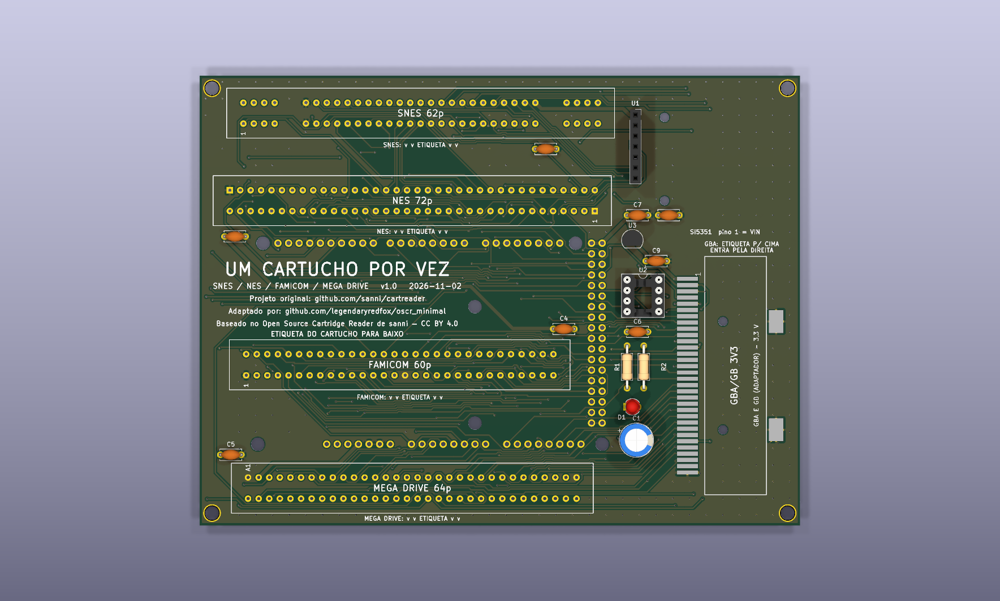

# 16_and_8_bits — placa de 5 slots



**README por versão** (renders de cima e de baixo, peças, diferenças): [v1.0](hardware-v1.0/README.md), [v1.1](hardware/README.md).

**Slots:** SNES (62p), NES (72p), Famicom (60p), Mega Drive (64p) e GBA (32p, SMD, 3,3 V). Um cartucho por vez.

**Estado:** DRC 0 erros e 4 avisos justificados, netlist confere com `docs/pinmap.md`, gerbers v1.0 em `fab/`. Nada encomendado nem montado.

| Pasta | Conteúdo |
|---|---|
| `hardware/` | `dumper.kicad_pro/_sch/_pcb` (KiCad 10) |
| `fab/` | `gerbers/`, `bom.csv`, `dumper-v1.0-jlcpcb.zip`, `dumper-v1.1-jlcpcb.zip` |
| `docs/` | `pinmap.md` (fonte da verdade), `bom.md`, `montagem.md` |

Verificação (da raiz do repositório):

```
python3 tools/check_netlist.py --board 16_and_8_bits
kicad-cli sch erc boards/16_and_8_bits/hardware/dumper.kicad_sch
kicad-cli pcb drc boards/16_and_8_bits/hardware/dumper.kicad_pcb
```

**Peças opcionais:** o que se perde ao retirar cada componente, e que jogos são afetados, está em [`docs/componentes-opcionais.md`](docs/componentes-opcionais.md).

## Bloco de troca de cartucho (v1.1, D126)

Circuito e motivo: `docs/referencia/bloco-troca.md` (na raiz do repositório). Peças novas desta placa:

| Ref. | Valor | Função |
|---|---|---|
| Q1 | IRF9540N (P-MOSFET, TO-220) | chave de alta do 5V dos slots (`+5V_CART`); comando no D19 (nível baixo liga) |
| R3 | 100 kΩ | gate do Q1 ao 5V (desligado com o Mega em reset) |
| R4 | 100 Ω | D19 ao gate do Q1 |
| R5, D2 | 1 kΩ, LED verde 3 mm | `+5V_CART` presente |
| Q2, R6 e R7 | 2N7000 (TO-92), 330 Ω (o R7 descarrega o 3,3 V) | descarga do rail quando o Q1 abre |
| Q3, R8, R9, R10, D3 | 2N7000, 100 kΩ, 1 kΩ, 1 kΩ, LED amarelo 3 mm | sensor do rail: D3 aceso = seguro trocar; R10 leva o nó ao D53 |

Os pinos de 5V dos slots e dos circuitos que a placa tiver (Si5351, PIC, pull-up, entrada do regulador de 3,3 V) e os capacitores deles ficam em `+5V_CART`. O Q1 (TO-220) fica em pé na placa, sem dissipador (a corrente do cartucho é baixa).

## Versões: com e sem o desligamento por software (D128)

O desligamento do 5V dos slots por software (bloco de troca de cartucho, D126) é uma versão **separada**; a placa existe também sem ele.

| Versão | Bloco de troca (Q1, Q2, Q3, LEDs, D19 e D53) | Projeto KiCad | Fábrica | Renders (cima e baixo) |
|---|---|---|---|---|
| v1.0 | **não** (5V direto nos slots) | `hardware-v1.0/` | `fab/gerbers-v1.0/`, `fab/dumper-v1.0-jlcpcb.zip`, `fab/bom-v1.0.csv` | `renders/16_and_8_bits-v1.0-cima.png`, `renders/16_and_8_bits-v1.0-baixo.png` |
| v1.1 | sim | `hardware/` | `fab/gerbers/`, `fab/dumper-v1.1-jlcpcb.zip`, `fab/bom.csv` | `renders/16_and_8_bits-v1.1-cima.png`, `renders/16_and_8_bits-v1.1-baixo.png` (`render.png` = v1.1, de cima) |

A v1.0 é o projeto de antes do D126, restaurado do histórico do git; os gerbers dela foram regerados da pasta `hardware-v1.0/`. Verificação: `python3 tools/check_netlist.py --board 16_and_8_bits --sem-troca boards/16_and_8_bits/hardware-v1.0/dumper.kicad_sch` (v1.0) e `python3 tools/check_netlist.py --board 16_and_8_bits` (v1.1). Para refazer os gerbers da v1.0: `HWDIR=hardware-v1.0 GDIR=gerbers-v1.0 tools/export_fab.sh 16_and_8_bits v1.0`. Nenhuma das duas foi encomendada, montada nem testada com cartucho.

