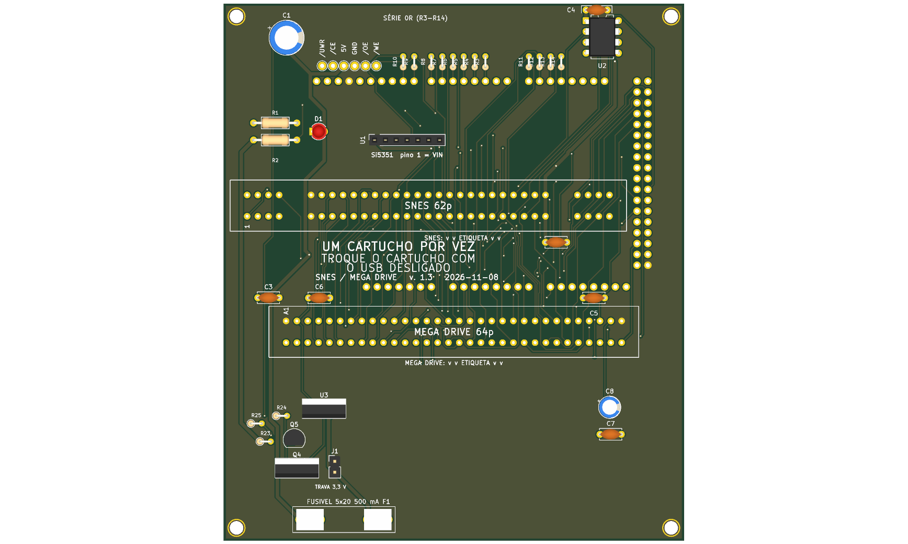

# 16_bits — SNES e Mega Drive



**README por versão** (renders de cima e de baixo, peças, diferenças): [v1.0](hardware-v1.0/README.md), [v1.2](hardware-v1.2/README.md), [v1.3](hardware-v1.3/README.md).

Versão mínima da placa de 5 slots (`../16_and_8_bits/`): só os slots **SNES** (62p, 2,5 mm) e **Mega Drive** (64p, 2,54 mm). Shield para Arduino Mega 2560 R3, 100% THT, só USB, **5 V** em tudo (sem regulador de 3,3 V). Um cartucho por vez.

**Estado:** DRC 0 erros e 0 ligações abertas (só 5 avisos de biblioteca; os 3 `starved_thermal` foram resolvidos na revisão de 2026-11-06, D97), netlist confere com `docs/pinmap.md`, gerbers das três versões em `fab/` (v1.0, v1.2 sem a chave de 5V e sem reset, v1.3 com o bloco de troca). A v1.0 em `fab/dumper-v1.0-jlcpcb.zip` é a antiga `rev2` (D97, D110); a v1.0 original, com trilhas de alimentação em 0,3 mm, foi encomendada pelo usuário em 2026-11-06 (informado no chat) e seus gerbers saíram do repositório. Nenhuma versão foi montada nem testada com cartucho.

> **D130 (2026-11-08):** a v1.2 saiu sem os 12 TVS (D3 a D14); a v1.3 os mantém (DNP).

## Versões (D128, 2026-11-07)

Pedido do usuário: o botão de reset sai de todas as versões; a **v1.2 não tem** o circuito de desligar o 5V dos slots pelo Arduino; a **v1.3** tem o bloco de troca de cartucho. Cada pasta de versão (`hardware-v1.0/` etc.) tem os PNGs do render 3D (cima e baixo) e o `README.md` da versão.

| Versão | Projeto | Bloco de troca (Q1, Q2, Q3, LEDs, D19, D53) | Botão de reset | PNGs |
|---|---|---|---|---|
| v1.0 | `hardware-v1.0/` | não | não | `hardware-v1.0/render-cima.png`, `hardware-v1.0/render-baixo.png` |
| v1.2 | `hardware-v1.2/` | **não** | **não** | `hardware-v1.2/render-cima.png`, `hardware-v1.2/render-baixo.png` |
| v1.3 | `hardware-v1.3/` | sim | **não** | `hardware-v1.3/render-cima.png`, `hardware-v1.3/render-baixo.png` (`render.png`) |

Detalhes, o que saiu e o que entrou: [`docs/versoes.md`](docs/versoes.md). O RP2040 continua fora (só depois de validado). **As seções "v. 1.2 final" e "Revisão" abaixo são o histórico de 2026-11-04 a 06; onde falam de chave de 5V, Q1, SW1 ou reset, valem só para a v1.3 (chave) ou para nenhuma versão (reset).**

## v. 1.2 final: proteção, chave de 5V, reset e furos do Mega (2026-11-06, D108)

O usuário levou para a v. 1.2 tudo o que estava planejado para a v. 1.3, **menos o RP2040** (esse fica sozinho na v. 1.3, se der certo). Resistores série e TVS (DNP) nas 12 linhas de controle, pull-up de `/VRES` (DNP), botão de reset, chave de 5V dos slots comandada pelo D19, três furos M3 alinhados com o Mega. A placa foi roteada de novo. Detalhes, lista de peças e testes de bancada: `docs/v12-final.md`. **Nada foi montado nem medido.**

## Revisão final v. 1.2 (2026-11-06, D107)

Estudo final em `docs/estudo-final-v1.2.md`. Aplicado: **C4 junto do PIC** (de 21,7 mm para 2,5 mm do VDD, e 3,6 mm do GND; duas vias no lugar do pad antigo), **aviso do USB no silk** ("NÃO COLOQUE NEM RETIRE O CARTUCHO COM USB LIGADO"), data do silk 2026-11-06 e rótulos C5, C6 e U2 visíveis. DRC 0 erros e 0 ligações abertas, netlist confere. Projeto fechado; o que sobra vai para a v. 1.3.

## Revisão v. 1.2 (2026-11-04)

Além do silk `v. 1.2`: `/CART` (B32 do slot Mega Drive) ligado ao D50 do Mega para detectar cartucho; capacitores extras C5 (junto ao A31) e C6 (junto ao A2); seis pontos de teste (`/UWR`, `/CE`, `5V`, `GND`, `/OE`, `/WE`) numa fileira acima do cabeçalho do Mega. Ficaram de fora, por falta de espaço sem refazer o roteamento: resistores série e TVS nas linhas do cartucho. Detalhe: `docs/planos/melhorias-megadrive-hardware.md` e `docs/decisoes.md` D87. O firmware ainda **não lê** `/CART`.

## Diferenças em relação à `16_and_8_bits`

| Item | 16_and_8_bits | 16_bits |
|---|---|---|
| Slots | SNES, NES, Famicom, Mega Drive, GBA | SNES, Mega Drive |
| Regulador 3,3 V (U3, C7, C8, C9) | sim | não |
| Capacitores de 100 nF | C2 a C6, C9 | C2 (SNES), C3 (Mega Drive), C4 (PIC), C5 e C6 (extras do slot Mega Drive, v. 1.2) |
| Placa | 144 × 108 mm | 108 × 86 mm |
| Furos | 4 M3 de canto, 6 do Mega, 2 M2 do Si5351 | 4 M3 de canto + 3 alinhados com o Mega (v. 1.2 final) |
| Si5351 | header vertical, módulo ao lado | header horizontal, módulo sobre ele, sem furos |

Pinagem idêntica à da `16_and_8_bits` (e ao OSCR HW5): `docs/pinmap.md` é um recorte do dela.

**Mecânica:** os pinos macho longos mantêm o encaixe; os 4 furos de canto servem para espaçadores M3 e pés de borracha, e na v. 1.2 final três furos (MH5 a MH7) alinham com furos do Mega para prender o shield com espaçadores M3.

| Pasta | Conteúdo |
|---|---|
| `hardware-v1.3/` | `dumper.kicad_pro/_sch/_pcb` (KiCad 10): a **v1.3** (v1.2 sem Q1 e reset, mais o bloco de troca de cartucho, D128); pasta de trabalho |
| `hardware-v1.2/` | **a v. 1.2 congelada**, desde 2026-11-07 **sem** SW1, Q1, R16 a R18 e D2 (D128); esquemático, PCB e `.kicad_pro` iguais aos de `fab/dumper-v1.2-jlcpcb.zip` (DRC 0 erros e 0 ligações abertas, ERC 0, `check_netlist --sem-troca` OK). Usa `../../_lib/` (inclui o símbolo `Q_PMOS_GDS`). Para refazer os gerbers dela: `HWDIR=hardware-v1.2 GDIR=gerbers-v1.2 tools/export_fab.sh 16_bits v1.2` |
| `hardware-v1.0/` | a v1.0 (commit `7c38c77`) com as correções de alimentação e de térmico (D97); gerbers em `fab/dumper-v1.0-jlcpcb.zip` |
| `fab/` | `PEDIDO.md` (como pedir na JLCPCB), `gerbers-v1.3/` (da pasta de trabalho `hardware-v1.3/`, v1.3), `dumper-v1.3-jlcpcb.zip`, `gerbers-v1.2/` (da `hardware-v1.2/`, congelada, como a `gerbers-v1.0/` da v1.0), `bom-v1.3.csv` (v1.3), `bom-v1.2.csv`, `dumper-v1.2-jlcpcb.zip` |
| `docs/` | `pinmap.md`, `bom.md`, `montagem.md` |

Verificação (da raiz do repositório):

```
python3 tools/check_netlist.py --board 16_bits
kicad-cli sch erc boards/16_bits/hardware-v1.3/dumper.kicad_sch
kicad-cli pcb drc boards/16_bits/hardware-v1.3/dumper.kicad_pcb
tools/export_fab.sh 16_bits v1.2
```

**Peças opcionais:** o que se perde ao retirar cada componente, e que jogos são afetados, está em [`docs/componentes-opcionais.md`](docs/componentes-opcionais.md).
