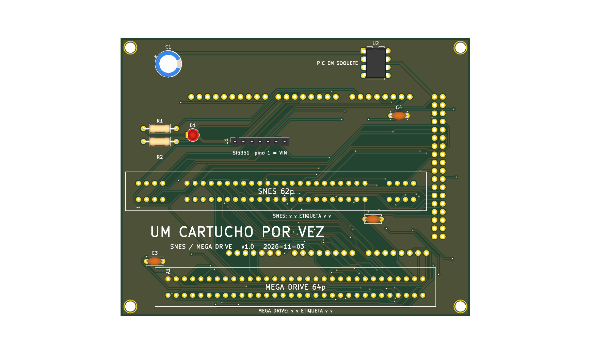
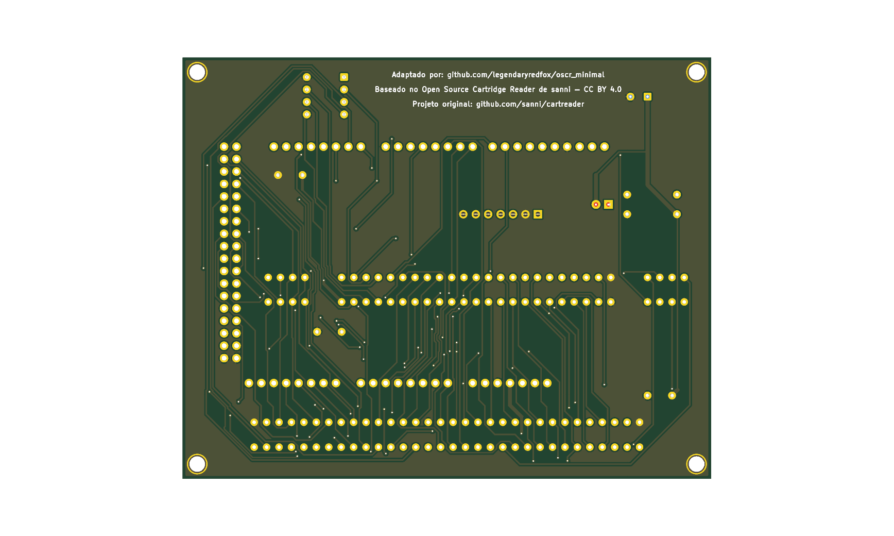

# 16_bits v1.0





Versão **v1.0** da placa [`16_bits`](../README.md): shield 100% THT para Arduino Mega 2560 R3, só USB. Versão anterior, mantida ao lado da mais nova.

| | |
|---|---|
| Slots | SNES (62p) e Mega Drive (64p), 5 V |
| Circuitos | Si5351 em header fêmea e PIC12F629 (CIC do SNES) em soquete. Sem botão de reset em nenhuma versão (D128). |
| Tamanho | 108,1 × 86,1 mm |
| Projeto KiCad | [`hardware-v1.0/`](.) (`dumper.kicad_pro`, `.kicad_sch`, `.kicad_pcb`) |
| Fábrica (JLCPCB) | `../fab/gerbers-v1.0/`, `../fab/dumper-v1.0-jlcpcb.zip` |
| Renders | `render-cima.png`, `render-baixo.png` |
| Estado | Nada montado nem testado com cartucho; revisar o layout no KiCad antes de encomendar |

## Troca de cartucho

O 5V dos slots vai direto do Mega e **não é cortado por software** (o desligamento por software foi retirado, D139). Para trocar o cartucho, **desligue a placa tirando o cabo USB** do Mega; nunca com a USB ligada.

## Particularidades desta versão

Antiga `rev2` (D97): alimentação em 0,8 mm, sem resistores série nem TVS nas linhas de controle, sem `/CART` no D50, sem C5, C6 e pontos de teste, sem furos M3 do Mega. A v1.0 original (trilhas de 0,3 mm) foi encomendada pelo usuário em 2026-11-06 e seus gerbers saíram do repositório (D110).

## Lista de peças

| Referências | Valor | Footprint | Qtd |
|---|---|---|---|
| A1 | Mega2560_R3_Shield | `dumper:Mega2560_R3_Shield` | 1 |
| C1 | 470u/16V | `Capacitor_THT:CP_Radial_D8.0mm_P3.50mm` | 1 |
| C2,C3,C4 | 100n | `Capacitor_THT:C_Disc_D5.0mm_W2.5mm_P5.00mm` | 3 |
| D1 | LED 3mm | `LED_THT:LED_D3.0mm` | 1 |
| FLG1,FLG2 | PWR_FLAG | `` | 2 |
| MD1 | MD_Slot | `dumper:MD_Slot` | 1 |
| R1 | 220R | `Resistor_THT:R_Axial_DIN0207_L6.3mm_D2.5mm_P10.16mm_Horizontal` | 1 |
| R2 | 1k | `Resistor_THT:R_Axial_DIN0207_L6.3mm_D2.5mm_P10.16mm_Horizontal` | 1 |
| SNES1 | SNES_Slot | `dumper:SNES_Slot` | 1 |
| U1 | Si5351_Module | `Connector_PinSocket_2.54mm:PinSocket_1x07_P2.54mm_Vertical` | 1 |
| U2 | PIC12F629 (em soquete; snescic-lock-resync) | `Package_DIP:DIP-8_W7.62mm` | 1 |

Gerada do esquemático desta versão (`kicad-cli sch export bom`). Peças marcadas DNP ou opcionais: `docs/componentes-opcionais.md` da placa.

## Verificação e fábrica (da raiz do repositório)

```
kicad-cli sch erc boards/16_bits/hardware-v1.0/dumper.kicad_sch
kicad-cli pcb drc boards/16_bits/hardware-v1.0/dumper.kicad_pcb
tools/export_fab.sh 16_bits v1.0
tools/render_board.sh 16_bits v1.0 v1.2 v1.3
```

`tools/check_netlist.py` não se aplica à v1.0 da `16_bits`: o `pinmap.md` atual inclui C5, C6, D3 a D14 e TP2, que esta versão não tem.

Mais: [README da placa](../README.md), [`docs/`](../docs/). Comparação entre as versões: [`docs/versoes.md`](../docs/versoes.md).
