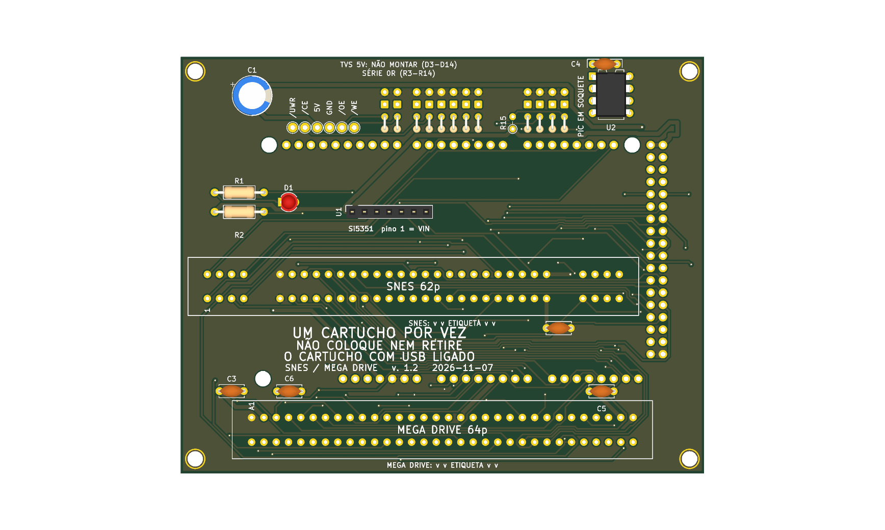
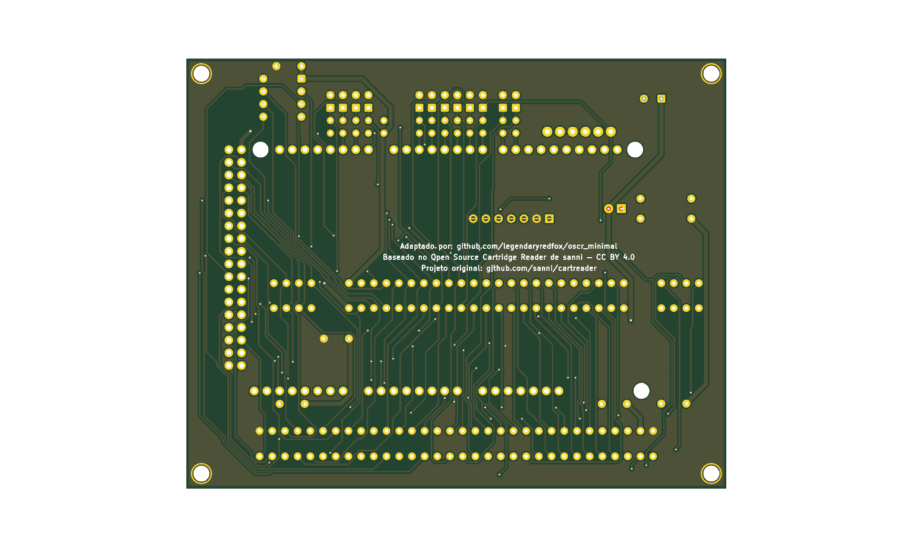

# 16_bits v1.2





Versão **v1.2** da placa [`16_bits`](../README.md): shield 100% THT para Arduino Mega 2560 R3, só USB. Versão congelada, mantida ao lado da mais nova.

| | |
|---|---|
| Slots | SNES (62p) e Mega Drive (64p), 5 V |
| Circuitos | Si5351 em header fêmea e PIC12F629 (CIC do SNES) em soquete. Sem botão de reset em nenhuma versão (D128). |
| Tamanho | 108,1 × 86,1 mm |
| Desligar o 5V por software | **não** |
| Projeto KiCad | [`hardware-v1.2/`](.) (`dumper.kicad_pro`, `.kicad_sch`, `.kicad_pcb`) |
| Fábrica (JLCPCB) | `../fab/gerbers-v1.2/`, `../fab/dumper-v1.2-jlcpcb.zip` |
| Renders | `../renders/16_bits-v1.2-cima.png`, `../renders/16_bits-v1.2-baixo.png` |
| Estado | Nada montado nem testado com cartucho; revisar o layout no KiCad antes de encomendar |

## Troca de cartucho

**Sem desligamento por software.** O 5V vai direto do Mega aos slots. Para trocar o cartucho, **desligue a placa tirando o cabo USB** do Mega; nunca com a USB ligada.

## Particularidades desta versão

Resistores série (0 Ω) e TVS (DNP) nas 12 linhas de controle, pull-up de `/VRES` (DNP), `/CART` no D50, C5, C6, pontos de teste e três furos M3 alinhados com o Mega. Sem a chave de 5V (Q1) e sem o botão de reset (D128); D19 e RST ficam sem ligação.

## O que muda em relação à v1.0

| Peça | Referências | Antes | Agora |
|---|---|---|---|
| TVS ou zener 5V (DNP) | D3,D4,D5,D6,D7,D8,D9,D10,D11,D12,D13,D14 | 0 | 12 |
| 0R | R3,R4,R5,R6,R7,R8,R9,R10,R11,R12,R13,R14 | 0 | 12 |
| 10k (DNP) | R15 | 0 | 1 |
| 100n | C2,C3,C4,C5,C6 | 3 | 5 |

## Lista de peças

| Referências | Valor | Footprint | Qtd |
|---|---|---|---|
| A1 | Mega2560_R3_Shield | `dumper:Mega2560_R3_Shield` | 1 |
| C1 | 470u/16V | `Capacitor_THT:CP_Radial_D8.0mm_P3.50mm` | 1 |
| C2,C3,C4,C5,C6 | 100n | `Capacitor_THT:C_Disc_D5.0mm_W2.5mm_P5.00mm` | 5 |
| D1 | LED 3mm | `LED_THT:LED_D3.0mm` | 1 |
| D3,D4,D5,D6,D7,D8,D9,D10,D11,D12,D13,D14 | TVS ou zener 5V (DNP) | `Diode_THT:D_DO-35_SOD27_P2.54mm_Vertical_CathodeUp` | 12 |
| FLG1,FLG2 | PWR_FLAG | `` | 2 |
| MD1 | MD_Slot | `dumper:MD_Slot` | 1 |
| R1 | 220R | `Resistor_THT:R_Axial_DIN0207_L6.3mm_D2.5mm_P10.16mm_Horizontal` | 1 |
| R2 | 1k | `Resistor_THT:R_Axial_DIN0207_L6.3mm_D2.5mm_P10.16mm_Horizontal` | 1 |
| R3,R4,R5,R6,R7,R8,R9,R10,R11,R12,R13,R14 | 0R | `Resistor_THT:R_Axial_DIN0204_L3.6mm_D1.6mm_P2.54mm_Vertical` | 12 |
| R15 | 10k (DNP) | `Resistor_THT:R_Axial_DIN0204_L3.6mm_D1.6mm_P2.54mm_Vertical` | 1 |
| SNES1 | SNES_Slot | `dumper:SNES_Slot` | 1 |
| U1 | Si5351_Module | `Connector_PinSocket_2.54mm:PinSocket_1x07_P2.54mm_Vertical` | 1 |
| U2 | PIC12F629 (em soquete; snescic-lock-resync) | `Package_DIP:DIP-8_W7.62mm` | 1 |

Gerada do esquemático desta versão (`kicad-cli sch export bom`). Peças marcadas DNP ou opcionais: `docs/componentes-opcionais.md` da placa.

## Verificação e fábrica (da raiz do repositório)

```
python3 tools/check_netlist.py --board 16_bits --sem-troca boards/16_bits/hardware-v1.2/dumper.kicad_sch
kicad-cli sch erc boards/16_bits/hardware-v1.2/dumper.kicad_sch
kicad-cli pcb drc boards/16_bits/hardware-v1.2/dumper.kicad_pcb
HWDIR=hardware-v1.2 GDIR=gerbers-v1.2 tools/export_fab.sh 16_bits v1.2
tools/render_board.sh 16_bits v1.0 v1.2 v1.3
```

Mais: [README da placa](../README.md), [`docs/`](../docs/). Comparação entre as versões: [`docs/versoes.md`](../docs/versoes.md).
