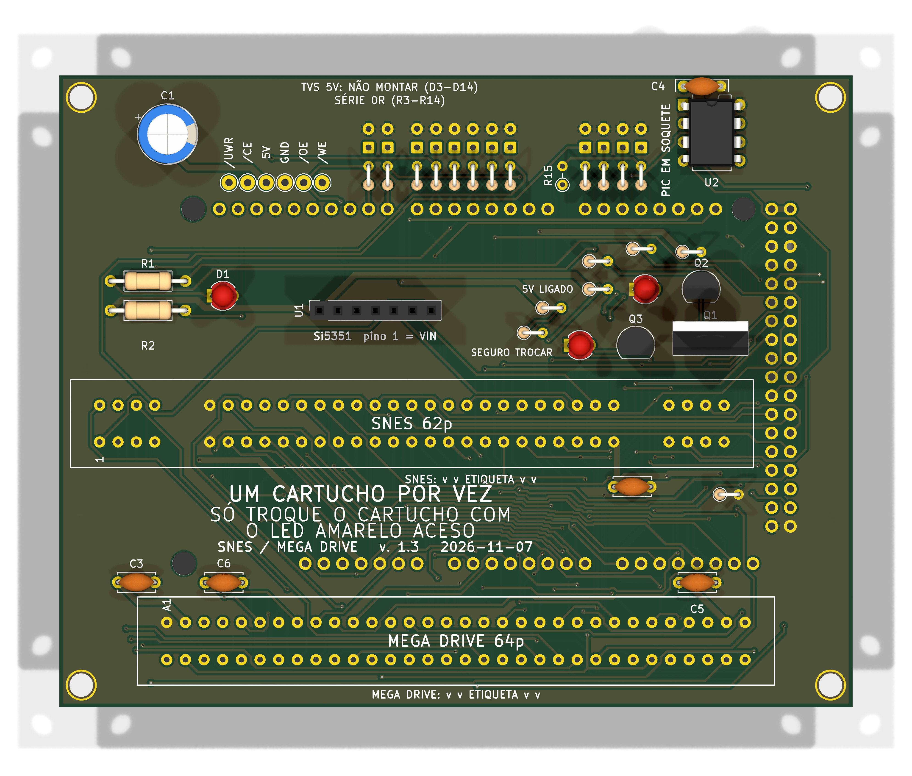
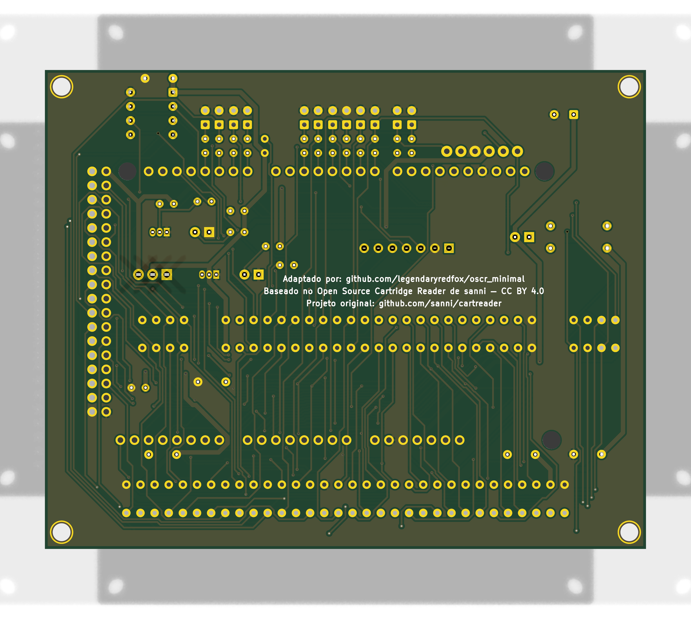

# 16_bits v1.3





Versão **v1.3** da placa [`16_bits`](../README.md): shield 100% THT para Arduino Mega 2560 R3, só USB. Esta é a versão mais nova.

| | |
|---|---|
| Slots | SNES (62p) e Mega Drive (64p), 5 V |
| Circuitos | Si5351 em header fêmea e PIC12F629 (CIC do SNES) em soquete. Sem botão de reset em nenhuma versão (D128). |
| Tamanho | 108,1 × 86,1 mm |
| Desligar o 5V por software | **sim** |
| Projeto KiCad | [`hardware/`](.) (`dumper.kicad_pro`, `.kicad_sch`, `.kicad_pcb`) |
| Fábrica (JLCPCB) | `../fab/gerbers/`, `../fab/dumper-v1.3-jlcpcb.zip` |
| Renders | `../renders/16_bits-v1.3-cima.png`, `../renders/16_bits-v1.3-baixo.png` |
| Estado | Nada montado nem testado com cartucho; revisar o layout no KiCad antes de encomendar |

## Troca de cartucho

**Com desligamento por software** (bloco de troca de cartucho, D126): o comando `POWER` liga e desliga o 5V dos slots, o rail é descarregado e o LED amarelo "SEGURO TROCAR" acende quando dá para tirar o cartucho. Circuito, peças e testes: [`docs/referencia/bloco-troca.md`](../../../docs/referencia/bloco-troca.md).

## Particularidades desta versão

A v1.2 mais os 12 TVS 5 V (D3 a D14, DNP) e o bloco de troca de cartucho (Q1 a Q3, R16 a R22, LEDs D15 e D16, comando no D19, sensor no D53). Roteada de novo pelo Freerouting: **revisar no KiCad antes de encomendar**.

## O que muda em relação à v1.2

| Peça | Referências | Antes | Agora |
|---|---|---|---|
| TVS ou zener 5V (DNP) | D3,D4,D5,D6,D7,D8,D9,D10,D11,D12,D13,D14 | 0 | 12 |
| LED verde 3mm | D15 | 0 | 1 |
| LED amarelo 3mm | D16 | 0 | 1 |
| IRF9540N | Q1 | 0 | 1 |
| 2N7000 | Q2,Q3 | 0 | 2 |
| 100k | R16,R20 | 0 | 2 |
| 100R | R17 | 0 | 1 |
| 1k | R18,R21,R22 | 0 | 3 |
| 330R | R19 | 0 | 1 |

## Lista de peças

| Referências | Valor | Footprint | Qtd |
|---|---|---|---|
| A1 | Mega2560_R3_Shield | `dumper:Mega2560_R3_Shield` | 1 |
| C1 | 470u/16V | `Capacitor_THT:CP_Radial_D8.0mm_P3.50mm` | 1 |
| C2,C3,C4,C5,C6 | 100n | `Capacitor_THT:C_Disc_D5.0mm_W2.5mm_P5.00mm` | 5 |
| D1 | LED 3mm | `LED_THT:LED_D3.0mm` | 1 |
| D3,D4,D5,D6,D7,D8,D9,D10,D11,D12,D13,D14 | TVS ou zener 5V (DNP) | `Diode_THT:D_DO-35_SOD27_P2.54mm_Vertical_CathodeUp` | 12 |
| D15 | LED verde 3mm | `LED_THT:LED_D3.0mm` | 1 |
| D16 | LED amarelo 3mm | `LED_THT:LED_D3.0mm` | 1 |
| FLG1,FLG2 | PWR_FLAG | `` | 2 |
| MD1 | MD_Slot | `dumper:MD_Slot` | 1 |
| Q1 | IRF9540N | `Package_TO_SOT_THT:TO-220-3_Vertical` | 1 |
| Q2,Q3 | 2N7000 | `Package_TO_SOT_THT:TO-92_Inline` | 2 |
| R1 | 220R | `Resistor_THT:R_Axial_DIN0207_L6.3mm_D2.5mm_P10.16mm_Horizontal` | 1 |
| R2 | 1k | `Resistor_THT:R_Axial_DIN0207_L6.3mm_D2.5mm_P10.16mm_Horizontal` | 1 |
| R3,R4,R5,R6,R7,R8,R9,R10,R11,R12,R13,R14 | 0R | `Resistor_THT:R_Axial_DIN0204_L3.6mm_D1.6mm_P2.54mm_Vertical` | 12 |
| R15 | 10k (DNP) | `Resistor_THT:R_Axial_DIN0204_L3.6mm_D1.6mm_P2.54mm_Vertical` | 1 |
| R16,R20 | 100k | `Resistor_THT:R_Axial_DIN0204_L3.6mm_D1.6mm_P2.54mm_Vertical` | 2 |
| R17 | 100R | `Resistor_THT:R_Axial_DIN0204_L3.6mm_D1.6mm_P2.54mm_Vertical` | 1 |
| R18,R21,R22 | 1k | `Resistor_THT:R_Axial_DIN0204_L3.6mm_D1.6mm_P2.54mm_Vertical` | 3 |
| R19 | 330R | `Resistor_THT:R_Axial_DIN0204_L3.6mm_D1.6mm_P2.54mm_Vertical` | 1 |
| SNES1 | SNES_Slot | `dumper:SNES_Slot` | 1 |
| U1 | Si5351_Module | `Connector_PinSocket_2.54mm:PinSocket_1x07_P2.54mm_Vertical` | 1 |
| U2 | PIC12F629 (em soquete; snescic-lock-resync) | `Package_DIP:DIP-8_W7.62mm` | 1 |

Gerada do esquemático desta versão (`kicad-cli sch export bom`). Peças marcadas DNP ou opcionais: `docs/componentes-opcionais.md` da placa.

## Verificação e fábrica (da raiz do repositório)

```
python3 tools/check_netlist.py --board 16_bits
kicad-cli sch erc boards/16_bits/hardware/dumper.kicad_sch
kicad-cli pcb drc boards/16_bits/hardware/dumper.kicad_pcb
tools/export_fab.sh 16_bits v1.3
tools/render_board.sh 16_bits v1.0 v1.2 v1.3
```

Mais: [README da placa](../README.md), [`docs/`](../docs/). Comparação entre as versões: [`docs/versoes.md`](../docs/versoes.md).
