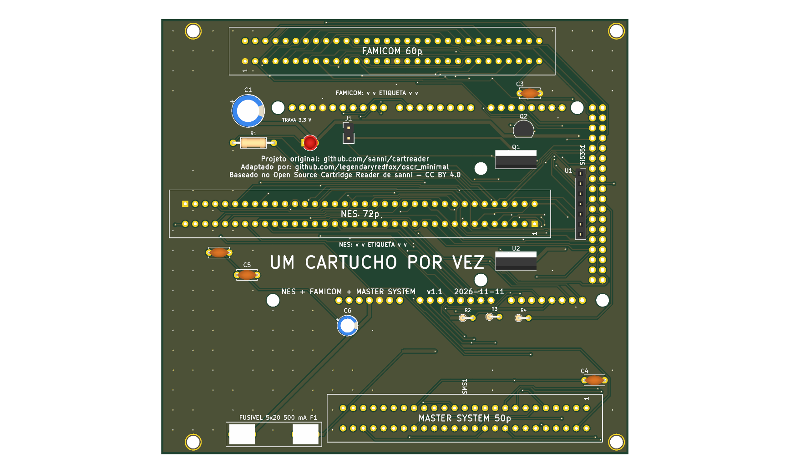

# 8_bits — NES, Famicom e Master System



**README por versão** (renders de cima e de baixo, peças, diferenças): [v1.0](hardware-v1.0/README.md), [v1.1](hardware-v1.1/README.md).

Versão mínima de três slots em shield para Arduino Mega 2560 R3, 100% THT, só USB: **NES** (72p, 2,5 mm), **Famicom** (60p, 2,54 mm) e **Master System / Mark III** (50p, 2,54 mm). Os três slots ficam **em paralelo** nos mesmos pinos do Mega (como no `six_slot_adapter` do OSCR): **um cartucho por vez, em um slot só**. Pinagem idêntica ao OSCR HW5 (`docs/pinmap.md`: NES e Famicom da `famicom_nes`, Master System da `megadrive_sms`).

**Si5351, sem PIC:** o NES usa o `CLK0` do Si5351 no pino 37; Famicom e Master System não usam clock (o pino 47 do SMS fica sem ligação, D136). Sem PIC (CIC do SNES), sem R2 e sem regulador de 3,3 V fixo.

## Versões (regra do usuário, 2026-11-11)

- **v1.0: a mínima que funciona, com fusível.** 5V direto nos slots, atrás do F1 (suporte de fusível 5×20 mm de 500 mA, D144). 117,1 × 97,1 mm.
- **v1.1: proteção mais robusta.** A v1.0 mais o seletor de tensão 3,3 V/5 V nos três slots (LDO LD1117V33, Q1 de bypass, Q2 de comando pelo D18; D138, D147) e o J1 "TRAVA 3,3 V". 117,1 × 109,1 mm. Firmware: ambiente `SerialASCII_Volt`.

O 5V dos slots **não é cortado por software** em nenhuma versão (D139): para trocar o cartucho, desligue o USB.

**Estado:** ERC 0 violações; DRC sem ligações abertas nem erros (só avisos de biblioteca); netlist confere com `docs/pinmap.md` nas duas versões (`tools/check_netlist.py --board 8_bits`). Roteadas pelo Freerouting e costuradas com vias de GND: **revisar o layout no KiCad antes de encomendar**. Nada encomendado, montado nem testado.

## Como foi feita (D153)

Criada da `famicom_nes` (v1.0 para a v1.0, v1.1 para a v1.1) com o slot SMS acrescentado, a mesma receita da `megadrive_sms` (D136). Scripts em `tools/boards/8_bits/` (da raiz do repositório):

1. `add_sms_sch.py` acrescenta SMS1 e o capacitor do slot ao esquemático, tira as marcas de não conexão dos 11 pinos do Mega que só o SMS usa (D6, D8, D9, D17, D30 a D34, D36, D37) e põe os rótulos. Variáveis `SMS_VCC` (`+5V_CART` na v1.0, `VCC_CART` na v1.1), `SMS_CAP` e `SMS_CAP_SRC`.
2. `place_sms.py` (python com `pcbnew`) tira trilhas e zonas, acrescenta SMS1 e o capacitor, liga os pads do Mega às nets novas; na v1.0 estende a placa para baixo (127 para 135 mm).
3. `renum.py` (v1.1) e `renum_pwr.py` deixam as referências em sequência: C4 (SMS), C5 e C6 (LDO), R2 a R4, Q1 e Q2, e os `#PWR` (D109, D150).
4. `reroute.sh` (`VER=v1.0|v1.1`): Freerouting, zonas de GND, costura e preenchimento; depois `tools/troca/pads_solidos.py` onde o DRC acusa `starved_thermal`.

```
python3 tools/check_netlist.py --board 8_bits                                              # v1.1
python3 tools/check_netlist.py --board 8_bits boards/8_bits/hardware-v1.0/dumper.kicad_sch  # v1.0
kicad-cli sch erc boards/8_bits/hardware-v1.1/dumper.kicad_sch
kicad-cli pcb drc boards/8_bits/hardware-v1.1/dumper.kicad_pcb
tools/export_fab.sh 8_bits v1.1
```

## Pendências

1. **Direção da etiqueta do cartucho SMS** no silk (não confirmada; NES e Famicom estão).
2. Medidas dos três slots comprados e do módulo Si5351; folga entre o SMS e os furos de canto de baixo (v1.0: 0,3 mm de folga de caixa).
3. **Firmware:** o núcleo `SMS.cpp` está ligado no fork (D137) mas nunca rodou em hardware; o slot SMS desta placa é o `--mapper 0`.
4. Revisar o layout no KiCad (autoroteador).
5. Sem furos de fixação no Mega (só os 4 de canto): a força de inserir o cartucho passa pelos pinos dos headers.

**Peças opcionais:** [`docs/componentes-opcionais.md`](docs/componentes-opcionais.md). BOM: [`docs/bom.md`](docs/bom.md). Montagem: [`docs/montagem.md`](docs/montagem.md).

Atribuição: baseado no Open Source Cartridge Reader de sanni (CC BY 4.0).
