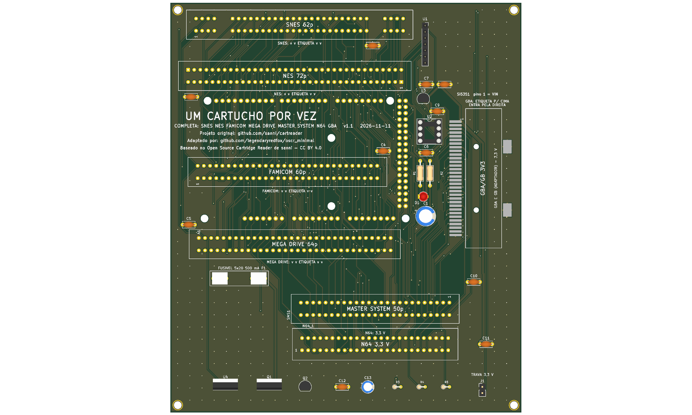

# completa — SNES, NES, Famicom, Mega Drive, Master System, N64 e GBA



**README por versão** (renders de cima e de baixo, peças, diferenças): [v1.0](hardware-v1.0/README.md), [v1.1](hardware-v1.1/README.md).

Shield 100% THT (só o slot GBA é SMD) para Arduino Mega 2560 R3, só USB, com os **seis slots do `six_slot_adapter` do OSCR** (**SNES** 62p a 2,5 mm, **NES** 72p a 2,5 mm, **Famicom** 60p a 2,54 mm, **Mega Drive** 64p a 2,54 mm, **Master System / Mark III** 50p a 2,54 mm e **N64** 50p a 2,5 mm, 3,3 V) mais o **GBA** da placa principal HW5 (32 pads SMD, 1,5 mm, 3,3 V; GB e GBC por adaptador). Os sete ficam **em paralelo** nos mesmos pinos do Mega: **um cartucho por vez, em um slot só**. Pinagem idêntica ao OSCR HW5 (`docs/pinmap.md`: SNES, NES, Famicom, Mega Drive e GBA da `16_and_8_bits`; Master System da `megadrive_sms`; N64 da `n64`).

Com **Si5351** e **PIC12F629 (CIC) em soquete** (SA-1 do SNES) e o regulador de 3,3 V (U3) dos slots **GBA e N64** (um cartucho por vez). Pino 47 (Clock) do SMS sem ligação (D136). O `EEPROM_CLK` do N64 (pino 19) vai ao `CLK1` do Si5351; o `EEPROM_DATA` (pino 21) é o D7, com o pull-up R2 **para 5 V** (ver pendências).

## Versões (regra do usuário, 2026-11-11)

- **v1.0: a mínima que funciona, com fusível.** É a `16_and_8_bits` v1.0 (que já leva o F1, D144) mais o slot SMS (C10) e o slot N64 (C11). 144,1 × 152,1 mm.
- **v1.1: proteção mais robusta.** A v1.0 mais o seletor de tensão 3,3 V/5 V nos slots **NES, Famicom, Mega Drive e SMS** (LDO LD1117V33 U4, Q1 de bypass, Q2 de comando pelo D18, R3 a R5, C12, C13; D138, D147) e o J1 "TRAVA 3,3 V". **O SNES fica sempre em 5 V** (o SA-1 não funciona a 3,3 V, como na `16_bits` v1.3), assim como o PIC e o Si5351; **GBA e N64 não mudam** (3,3 V do U3). 144,1 × 168,1 mm. Firmware: ambiente `SerialASCII_Volt`.

O 5V dos slots **não é cortado por software** em nenhuma versão (D139): para trocar o cartucho, desligue o USB.

**Estado:** ERC sem violações; DRC e netlist (`tools/check_netlist.py --board completa`) nas duas versões, ver `docs/decisoes.md` D156. Gerbers, zips e BOM em `fab/` (ver `fab/PEDIDO.md`). Roteada pelo Freerouting: **revisar o layout no KiCad antes de encomendar**. Nada encomendado, montado nem testado.

## Como foi feita (D156)

Scripts em `tools/boards/completa/` (da raiz):

0. `add_n64_sch.py` acrescenta N64_1 e C11 (rótulos a partir da tabela N64 de `boards/n64/docs/pinmap.md`, VCC em `+3V3`); roda depois do SMS e, na v1.1, do seletor.
1. `tools/boards/8_bits/add_sms_sch.py` (com `SMS_X=762 SMS_CAP=C10 SMS_CAP_SRC=C6`, e `SMS_VCC=VCC_CART` na v1.1) acrescenta SMS1 e C10 ao esquemático da `16_and_8_bits` v1.0; todos os pinos do Mega usados pelo SMS já tinham rótulo (os outros slots os usam).
2. `place_sms.py` (python com `pcbnew`): tira trilhas e zonas, estende a placa para baixo (138 para 172 mm; 188 mm na v1.1), põe SMS1 e C10; `place_n64.py` põe N64_1 e C11 abaixo do SMS.
3. v1.1: `add_seletor_sch.py` transplanta o seletor do esquemático da `8_bits` v1.1 e passa os slots NES, Famicom, Mega Drive e SMS (e C3, C4, C5, C10) para `VCC_CART`; `place_seletor.py` põe as peças numa fileira abaixo do SMS e acerta as nets do PCB.
4. `reroute.sh` (`VER=v1.0|v1.1`): Freerouting, zonas, costura de GND; depois `tools/troca/pads_solidos.py` e `tools/boards/megadrive/frag_vias.py` onde o DRC acusa.

```
python3 tools/check_netlist.py --board completa                                              # v1.1
python3 tools/check_netlist.py --board completa boards/completa/hardware-v1.0/dumper.kicad_sch  # v1.0
kicad-cli sch erc boards/completa/hardware-v1.1/dumper.kicad_sch
kicad-cli pcb drc boards/completa/hardware-v1.1/dumper.kicad_pcb
tools/export_fab.sh completa v1.1
```

## Pendências

1. **Direção da etiqueta do cartucho SMS** no silk (não confirmada).
2. Medidas dos seis slots e do módulo Si5351; altura dos espaçadores (o USB-C e o jack do Mega passam por baixo).
3. Sem furos de fixação no Mega: a força de inserir o cartucho passa pelos pinos dos headers.
4. **Firmware:** o núcleo `SMS.cpp` nunca rodou em hardware (slot SMS = `--mapper 0`) e **o N64 está desligado no fork** (`n64 = false` no `user.ini`; sem protocolo, host nem GUI): a placa tem o slot, o software ainda não lê N64.
5. **N64 e D7:** o R2 puxa o D7 a 5 V (SNES `/IRQ`), e o N64 quer o pull-up da EEPROM em 3,3 V. No OSCR o pull-up acompanha o VCC; aqui fica em 5 V. O Mega já dirige o D7 a 5 V em 3,3 V (D140), então não é um risco novo, mas é uma tensão a mais no pino da EEPROM: se só o N64 for usado, o R2 pode ser retirado. **Corrente do U3 (250 mA) com o N64 não conferida.**
6. Revisar o layout no KiCad (autoroteador). Placa grande: confira as trilhas de +5V/VCC_CART e o 3,3 V do GBA.

**Peças opcionais:** [`docs/componentes-opcionais.md`](docs/componentes-opcionais.md). BOM: [`docs/bom.md`](docs/bom.md). Montagem: [`docs/montagem.md`](docs/montagem.md).

Atribuição: baseado no Open Source Cartridge Reader de sanni (CC BY 4.0).
