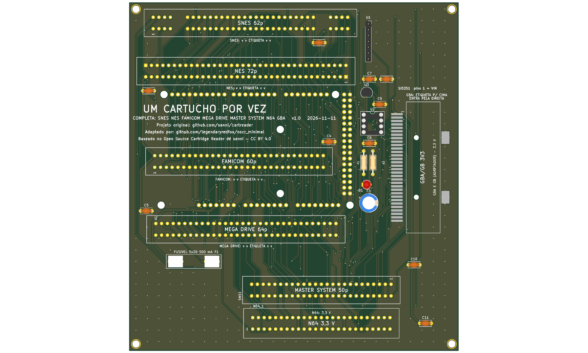
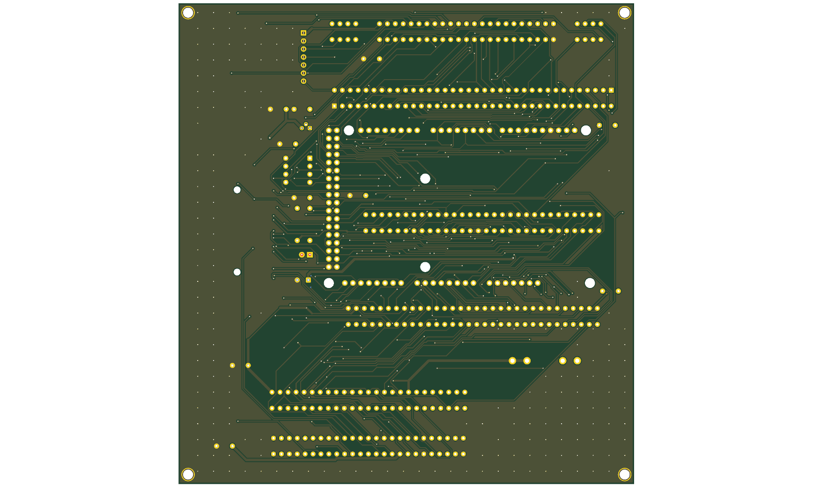

# completa v1.0





Versão **v1.0** da placa [`completa`](../README.md): shield 100% THT para Arduino Mega 2560 R3, só USB. Versão anterior, mantida ao lado da mais nova.

| | |
|---|---|
| Slots | SNES (62p), NES (72p), Famicom (60p), Mega Drive (64p) e Master System (50p), 5 V ou 3,3 V (seletor na v1.1; o SNES fica sempre em 5 V), mais N64 (50p) e GBA (32p, SMD, 1,5 mm) a 3,3 V (regulador U3); **um cartucho por vez, em um slot só** |
| Circuitos | Si5351 em header fêmea e PIC12F629 (CIC do SNES) em soquete. Pino 47 (Clock) do slot SMS sem ligação. |
| Tamanho | 144,1 × 152,1 mm |
| Projeto KiCad | [`hardware-v1.0/`](.) (`dumper.kicad_pro`, `.kicad_sch`, `.kicad_pcb`) |
| Fábrica (JLCPCB) | `../fab/gerbers-v1.0/`, `../fab/dumper-v1.0-jlcpcb.zip` |
| Renders | `render-cima.png`, `render-baixo.png` |
| Estado | Nada montado nem testado com cartucho; revisar o layout no KiCad antes de encomendar |

## Troca de cartucho

O 5V dos slots vai direto do Mega e **não é cortado por software** (o desligamento por software foi retirado, D139). Para trocar o cartucho, **desligue a placa tirando o cabo USB** do Mega; nunca com a USB ligada.

## Proteção de corrente e tensão (D138)

**F1: fusível de vidro 5×20 mm de 500 mA (ação rápida) em suporte de clipes, opcional.** O suporte é de furo passante (Littelfuse série 100 ou equivalente) e o fusível queimado se troca **sem solda**; fica em série com o 5 V que a placa recebe do Mega Um curto no cartucho queima o fusível e protege a placa, o Mega e a porta USB. A queda é de 0,1 a 0,2 V a 200 mA (o SA-1 do SNES continua abaixo de ~5,2 V). **Sem o fusível no suporte a placa fica sem 5 V** (um fio no lugar dele também serve). Ele limita corrente e não protege contra tensão errada.

## Particularidades desta versão

A `16_and_8_bits` v1.0 (já com o F1) mais os slots SMS (C10) e N64 (C11). Mínima que funciona, com fusível. Roteada pelo Freerouting: **revisar o layout no KiCad**.

## Lista de peças

| Referências | Valor | Footprint | Qtd |
|---|---|---|---|
| A1 | Mega2560_R3_Shield | `dumper:Mega2560_R3_Shield` | 1 |
| C1 | 470u/16V | `Capacitor_THT:CP_Radial_D8.0mm_P3.50mm` | 1 |
| C2,C3,C4,C5,C6,C9,C10,C11 | 100n | `Capacitor_THT:C_Disc_D5.0mm_W2.5mm_P5.00mm` | 8 |
| C7,C8 | 1u | `Capacitor_THT:C_Disc_D5.0mm_W2.5mm_P5.00mm` | 2 |
| D1 | LED 3mm | `LED_THT:LED_D3.0mm` | 1 |
| F1 | Fusivel 5x20 500mA | `Fuse:Fuseholder_Littelfuse_100_series_5x20mm` | 1 |
| FC1 | FC_Slot | `dumper:FC_Slot` | 1 |
| FLG1,FLG2 | PWR_FLAG | `` | 2 |
| GBA1 | GBA_Slot | `dumper:GBA_Slot` | 1 |
| MD1 | MD_Slot | `dumper:MD_Slot` | 1 |
| N64_1 | N64_Slot | `dumper:N64_Slot` | 1 |
| NES1 | NES_Slot | `dumper:NES_Slot` | 1 |
| R1 | 220R | `Resistor_THT:R_Axial_DIN0207_L6.3mm_D2.5mm_P10.16mm_Horizontal` | 1 |
| R2 | 1k | `Resistor_THT:R_Axial_DIN0207_L6.3mm_D2.5mm_P10.16mm_Horizontal` | 1 |
| SMS1 | SMS_Slot | `dumper:SMS_Slot` | 1 |
| SNES1 | SNES_Slot | `dumper:SNES_Slot` | 1 |
| U1 | Si5351_Module | `Connector_PinSocket_2.54mm:PinSocket_1x07_P2.54mm_Vertical` | 1 |
| U2 | PIC12F629 (snescic-lock-resync) | `Package_DIP:DIP-8_W7.62mm_Socket` | 1 |
| U3 | MCP1700-3302E/TO (3,3 V) | `Package_TO_SOT_THT:TO-92` | 1 |

Gerada do esquemático desta versão (`kicad-cli sch export bom`). Peças marcadas DNP ou opcionais: `docs/componentes-opcionais.md` da placa.

## Verificação e fábrica (da raiz do repositório)

```
python3 tools/check_netlist.py --board completa boards/completa/hardware-v1.0/dumper.kicad_sch
kicad-cli sch erc boards/completa/hardware-v1.0/dumper.kicad_sch
kicad-cli pcb drc boards/completa/hardware-v1.0/dumper.kicad_pcb
tools/export_fab.sh completa v1.0
tools/render_board.sh completa v1.0 v1.1
```

Mais: [README da placa](../README.md), [`docs/`](../docs/).
