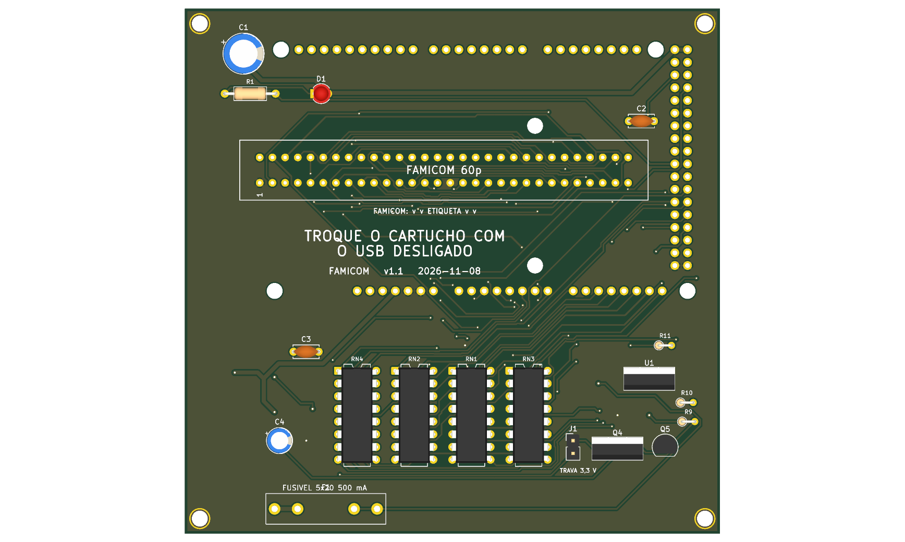

# famicom — só Famicom



**README por versão** (renders de cima e de baixo, peças, diferenças): [v1.0](hardware-v1.0/README.md), [v1.1](hardware-v1.1/README.md).

Versão mínima de uma função: um slot **Famicom** (60p, 2,54 mm) em shield para Arduino Mega 2560 R3, 100% THT, só USB, **5 V** fixo. Um cartucho por vez. Pinagem idêntica ao OSCR HW5 (`docs/pinmap.md`, recorte da `16_and_8_bits`).

**Sem Si5351 e sem PIC:** o slot Famicom não tem pino de clock nem CIC do SNES; o `pinmap.md` não liga nenhum deles ao slot. A placa é a mais simples de todas: slot, LED, C1 e um capacitor.

**Estado:** v1.1, 107,1 × 65,1 mm. ERC 0 violações; DRC sem erros nem ligações abertas (só 4 avisos de biblioteca e os de paridade das outras placas); netlist confere com `docs/pinmap.md`; gerbers em `fab/`. Roteada pelo Freerouting (MCP) com GND roteado junto e costurado com vias; alimentação (`+5V`) com 0,8 mm desde o roteamento (padrão de net class `/+5V` já corrigido, D96). **Revisar o layout no KiCad antes de encomendar.** Nada encomendado nem montado. Montagem: `docs/montagem.md`.

**NES:** cartucho de 72 pinos não entra aqui; use `boards/nes/`.

## Diferenças em relação à `16_and_8_bits`

| Item | 16_and_8_bits | famicom |
|---|---|---|
| Slots | SNES, NES, Famicom, Mega Drive, GBA | só Famicom |
| Mantido | LED (D1, R1), C1, C4 (VCC do slot; agora C2, D109) | idem |
| Removido | SNES1, NES1, MD1, GBA1, Si5351 (U1), PIC (U2), R2, regulador U3 e C7, C8, C9, C2, C3, C5, C6, furos M2 | |
| Placa | 144 × 108 mm | 107,1 × 65,1 mm |

O slot fica entre as fileiras de pinos do Mega, no mesmo lugar que o Mega Drive na `megadrive/`. Os 6 furos não metalizados do Mega e os 4 de canto foram mantidos.

Ficam sem ligação no Mega: tudo que só os outros sistemas usam (`D2..D9`, `D14..D17`, `D20`, `D21`, `D29..D34`, `D36`, `D37`, `D40`, `D41`) e os de sempre (`D0`, `D1`, `D10..D13`, `D18`, `D19`, `D39`, `D50..D53`).

## Como foi feita

Mesma receita da `nes/` (`boards/nes/README.md`), com `tools/boards/famicom/place.py`: `strip_sch.py` (SNES1, NES1, MD1, GBA1, U1, U2, R2, U3, C2, C3, C5 a C9), `place.py`, `tools/boards/nes/sync_unconnected.py`, `autoroute` do KiCad MCP com o GND como trilha, depois `add_zones.py`, `stitch.py`, `tools/historico/revisao/widen_power.py` (sem efeito aqui: o 5V já saiu com 0,8 mm) e `fill_zones.py`.

```
python3 tools/check_netlist.py --board famicom
kicad-cli sch erc boards/famicom/hardware-v1.1/dumper.kicad_sch
kicad-cli pcb drc boards/famicom/hardware-v1.1/dumper.kicad_pcb
tools/export_fab.sh famicom v1.0
```

**Peças opcionais:** o que se perde ao retirar cada componente, e que jogos são afetados, está em [`docs/componentes-opcionais.md`](docs/componentes-opcionais.md).

## Versões

| Versão | O que tem | Projeto KiCad | Fábrica | Renders (cima e baixo) |
|---|---|---|---|---|
| v1.0 | F1 (suporte de fusível); 5V direto nos slots | `hardware-v1.0/` | `fab/gerbers-v1.0/`, `fab/dumper-v1.0-jlcpcb.zip`, `fab/bom-v1.0.csv` | `hardware-v1.0/render-cima.png`, `hardware-v1.0/render-baixo.png` |
| v1.1 | v1.0 mais o seletor de tensão 3,3 V/5 V, J1 e os resistores de 470 Ω em série (D138) | `hardware-v1.1/` | `fab/gerbers-v1.1/`, `fab/dumper-v1.1-jlcpcb.zip`, `fab/bom-v1.1.csv` | `hardware-v1.1/render-cima.png`, `hardware-v1.1/render-baixo.png` (`render.png` = v1.1, de cima) |

O 5V dos slots **não é cortado por software** em nenhuma versão (o bloco de troca de cartucho, D126 a D128, foi retirado em D139): para trocar o cartucho, desligue o USB. Verificação: `python3 tools/check_netlist.py --board famicom` (v1.1) e `python3 tools/check_netlist.py --board famicom boards/famicom/hardware-v1.0/dumper.kicad_sch` (v1.0).
