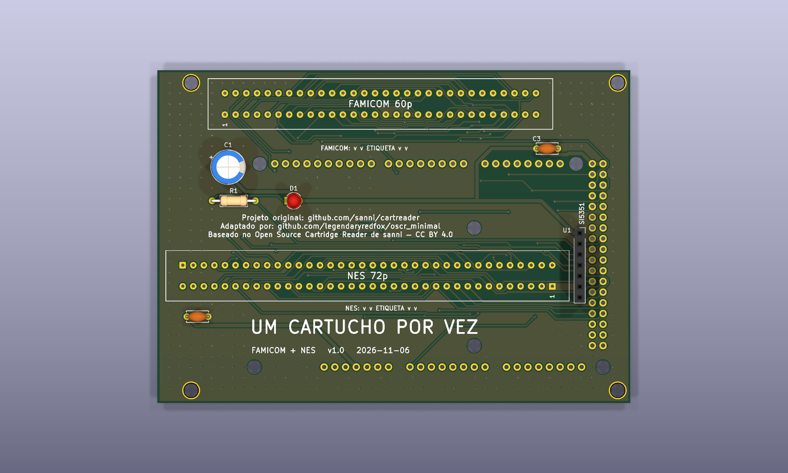

# famicom_nes — Famicom e NES



Versão mínima de duas funções: um slot **Famicom** (60p, 2,54 mm) e um slot **NES** (72p, 2,5 mm) em shield para Arduino Mega 2560 R3, 100% THT, só USB, **5 V** fixo. Os dois slots ficam **em paralelo** nos mesmos pinos do Mega (como no `six_slot_adapter` do OSCR): **um cartucho por vez, em um slot só**. Pinagem idêntica ao OSCR HW5 (`docs/pinmap.md`, recorte da `16_and_8_bits`).

**Si5351, sem PIC:** o NES usa o `CLK0` do Si5351 no pino 37; o Famicom não tem pino de clock. Sem PIC (CIC do SNES), sem R2 e sem regulador de 3,3 V.

**Estado:** v1.0, 112,1 × 79,1 mm. ERC 0 violações; DRC sem erros nem ligações abertas (só 4 avisos de biblioteca e os de paridade das outras placas); netlist confere com `docs/pinmap.md`; gerbers em `fab/`. Roteada pelo Freerouting (MCP) com GND roteado junto e costurado com vias; alimentação (`+5V`) com 0,8 mm. **Revisar o layout no KiCad antes de encomendar.** Nada encomendado nem montado. Montagem: `docs/montagem.md`.

## Diferenças em relação à `16_and_8_bits`

| Item | 16_and_8_bits | famicom_nes |
|---|---|---|
| Slots | SNES, NES, Famicom, Mega Drive, GBA | NES e Famicom |
| Mantido | Si5351 (U1), LED (D1, R1), C1, C3 (VCC do NES), C4 (VCC do Famicom) (agora C2 e C3, D109) | idem |
| Removido | SNES1, MD1, GBA1, PIC (U2), R2, regulador U3 e C7, C8, C9, C2, C5, C6, furos M2 | |
| Placa | 144 × 108 mm | 112,1 × 79,1 mm |

**Layout:** o NES fica entre as fileiras de pinos do Mega, deslocado 12 mm para a esquerda do centro; o Famicom fica acima do cabeçalho do Mega (a placa cresce para cima); o soquete do Si5351 fica na vertical, ao lado do header duplo do Mega, com o módulo em pé. Os 6 furos não metalizados do Mega e os 4 de canto foram mantidos.

**Rótulo:** nos dois slots o rótulo do cartucho fica para baixo (lado do USB). Conferido com a [página Cartridge connector da NESdev](https://www.nesdev.org/wiki/Cartridge_connector): os pinos 1–36 do NES e 1–30 do Famicom estão no lado do rótulo, e nos dois footprints essa é a fileira de baixo. A orientação do corpo do slot continua a confirmar com a peça (D27).

## Como foi feita

`tools/famicom_nes/place.py` sobre a cópia da `16_and_8_bits`, depois `tools/nes/sync_unconnected.py`, `autoroute` do KiCad MCP com o GND como trilha, `add_zones.py`, `stitch.py`, `widen_power.py` e `fill_zones.py` (receita da `nes/` e da D96).

```
python3 tools/check_netlist.py --board famicom_nes
kicad-cli sch erc boards/famicom_nes/hardware/dumper.kicad_sch
kicad-cli pcb drc boards/famicom_nes/hardware/dumper.kicad_pcb
tools/export_fab.sh famicom_nes v1.0
```

**Peças opcionais:** o que se perde ao retirar cada componente, e que jogos são afetados, está em [`docs/componentes-opcionais.md`](docs/componentes-opcionais.md).
