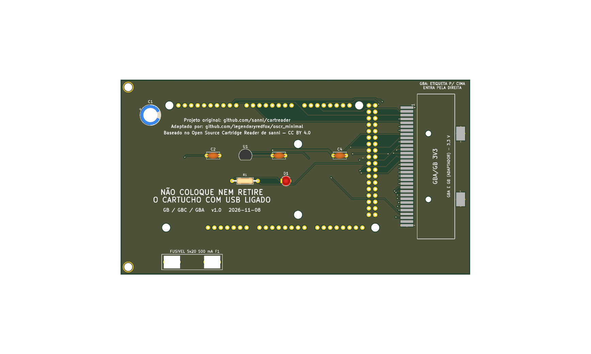

# gb_gba — GBA; GB e GBC por adaptador



**README por versão** (renders de cima e de baixo, peças, diferenças): [v1.0](hardware-v1.0/README.md), [v1.1](hardware/README.md).

Versão mínima de uma função: um slot **GBA** (32 pads SMD, 1,5 mm, **3,3 V**) em shield para Arduino Mega 2560 R3, só USB. GB e GBC entram **só pelo slot GBA, com adaptador** (D56). Um cartucho por vez. Pinagem idêntica ao OSCR HW5 (`docs/pinmap.md`, recorte da `16_and_8_bits`). Sem SD, sem LCD, sem Si5351 e sem PIC.

**Estado:** v1.1, 138,1 × 67,1 mm. ERC com 1 aviso de biblioteca (U1, antes U3; o mesmo da `16_and_8_bits`); DRC sem erros nem ligações abertas (só avisos de biblioteca e paridade); netlist confere com `docs/pinmap.md`; gerbers em `fab/`. Roteada pelo Freerouting (MCP) com o GND junto; o `/D9` o autoroteador não achou caminho em nenhuma tentativa e foi roteado pelo A* de `tools/historico/pcb_v12` (`tools/boards/gb_gba/route_net.py`). **Revisar o layout no KiCad antes de encomendar.** Nada encomendado nem montado. Montagem: `docs/montagem.md`. Trilhas de alimentação (`+5V`, `+3V3`) alargadas até onde cabe, 0,8 mm na maior parte (`tools/historico/revisao/widen_power.py`, D96).

## Diferenças em relação à `16_and_8_bits`

| Item | 16_and_8_bits | gb_gba |
|---|---|---|
| Slots | SNES, NES, Famicom, Mega Drive, GBA | só GBA |
| Regulador 3,3 V (U3, C7, C8, C9; na gb_gba: U1, C2, C3, C4, D109) | sim | sim |
| Si5351, PIC, R2, C2 a C6 | sim | não |
| Placa | 144 × 108 mm | 138,1 × 67,1 mm |
| Furos | 4 M3 de canto, 6 do Mega, 2 M2 do Si5351 | 4 M3 junto ao Mega (nenhum do lado do slot GBA); sem os 6 do Mega |

O slot GBA ficou **na mesma orientação** (boca para a direita, etiqueta para cima), mas encostado no Mega, com as peças soltas dentro da área do Mega. O pino 31 (AUD_IRQ) continua sem ligação (D22).

## Como foi feita

Mesma receita da `megadrive/` e da `snes/` (`boards/megadrive/README.md`, D92 e D93), com `tools/boards/gb_gba/place.py`. `fix_nets.py` leva **um pad por chamada** (num laço de shell).

```
python3 tools/check_netlist.py --board gb_gba
kicad-cli sch erc boards/gb_gba/hardware/dumper.kicad_sch
kicad-cli pcb drc boards/gb_gba/hardware/dumper.kicad_pcb
tools/export_fab.sh gb_gba v1.0
```

**Peças opcionais:** o que se perde ao retirar cada componente, e que jogos são afetados, está em [`docs/componentes-opcionais.md`](docs/componentes-opcionais.md).

## Bloco de troca de cartucho (v1.1, D126)

Circuito e motivo: `docs/referencia/bloco-troca.md` (na raiz do repositório). Peças novas desta placa:

| Ref. | Valor | Função |
|---|---|---|
| Q1 | IRF9540N (P-MOSFET, TO-220) | chave de alta do 5V dos slots (`+5V_CART`); comando no D19 (nível baixo liga) |
| R2 | 100 kΩ | gate do Q1 ao 5V (desligado com o Mega em reset) |
| R3 | 100 Ω | D19 ao gate do Q1 |
| R4, D2 | 1 kΩ, LED verde 3 mm | `+5V_CART` presente |
| Q2, R5 e R6 | 2N7000 (TO-92), 330 Ω (o R6 descarrega o 3,3 V) | descarga do rail quando o Q1 abre |
| Q3, R7, R8, R9, D3 | 2N7000, 100 kΩ, 1 kΩ, 1 kΩ, LED amarelo 3 mm | sensor do rail: D3 aceso = seguro trocar; R9 leva o nó ao D53 |

Os pinos de 5V dos slots e dos circuitos que a placa tiver (Si5351, PIC, pull-up, entrada do regulador de 3,3 V) e os capacitores deles ficam em `+5V_CART`. O Q1 (TO-220) fica em pé na placa, sem dissipador (a corrente do cartucho é baixa).

## Versões: com e sem o desligamento por software (D128)

O desligamento do 5V dos slots por software (bloco de troca de cartucho, D126) é uma versão **separada**; a placa existe também sem ele.

| Versão | Bloco de troca (Q1, Q2, Q3, LEDs, D19 e D53) | Projeto KiCad | Fábrica | Renders (cima e baixo) |
|---|---|---|---|---|
| v1.0 | **não** (5V direto nos slots) | `hardware-v1.0/` | `fab/gerbers-v1.0/`, `fab/dumper-v1.0-jlcpcb.zip`, `fab/bom-v1.0.csv` | `renders/gb_gba-v1.0-cima.png`, `renders/gb_gba-v1.0-baixo.png` |
| v1.1 | sim | `hardware/` | `fab/gerbers/`, `fab/dumper-v1.1-jlcpcb.zip`, `fab/bom.csv` | `renders/gb_gba-v1.1-cima.png`, `renders/gb_gba-v1.1-baixo.png` (`render.png` = v1.1, de cima) |

A v1.0 é o projeto de antes do D126, restaurado do histórico do git; os gerbers dela foram regerados da pasta `hardware-v1.0/`. Verificação: `python3 tools/check_netlist.py --board gb_gba --sem-troca boards/gb_gba/hardware-v1.0/dumper.kicad_sch` (v1.0) e `python3 tools/check_netlist.py --board gb_gba` (v1.1). Para refazer os gerbers da v1.0: `HWDIR=hardware-v1.0 GDIR=gerbers-v1.0 tools/export_fab.sh gb_gba v1.0`. Nenhuma das duas foi encomendada, montada nem testada com cartucho.

