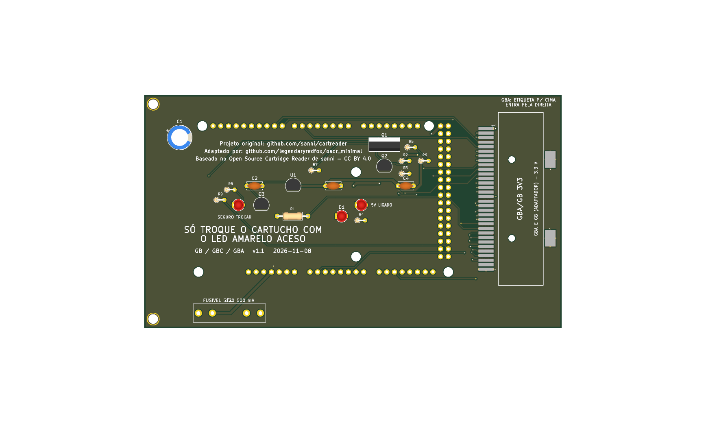
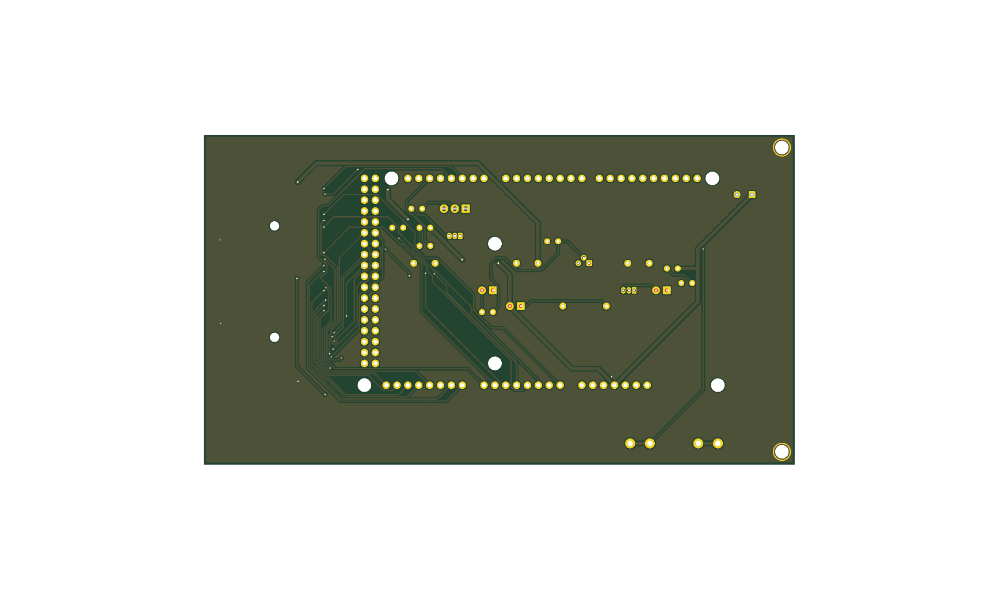

# gb_gba v1.1





Versão **v1.1** da placa [`gb_gba`](../README.md): shield 100% THT para Arduino Mega 2560 R3, só USB. Esta é a versão mais nova.

| | |
|---|---|
| Slots | GBA (32 pads SMD, 1,5 mm), 3,3 V; GB e GBC só com adaptador |
| Circuitos | Sem Si5351 e sem PIC. |
| Tamanho | 138,1 × 77,1 mm |
| Desligar o 5V por software | **sim** |
| Projeto KiCad | [`hardware-v1.1/`](.) (`dumper.kicad_pro`, `.kicad_sch`, `.kicad_pcb`) |
| Fábrica (JLCPCB) | `../fab/gerbers-v1.1/`, `../fab/dumper-v1.1-jlcpcb.zip` |
| Renders | `render-cima.png`, `render-baixo.png` |
| Estado | Nada montado nem testado com cartucho; revisar o layout no KiCad antes de encomendar |

## Troca de cartucho

**Com desligamento por software** (bloco de troca de cartucho, D126): o comando `POWER` liga e desliga o 5V dos slots, o rail é descarregado e o LED amarelo "SEGURO TROCAR" acende quando dá para tirar o cartucho. Circuito, peças e testes: [`docs/referencia/bloco-troca.md`](../../../docs/referencia/bloco-troca.md).

## Proteção de corrente e tensão (D138)

**F1: fusível de vidro 5×20 mm de 500 mA (ação rápida) em suporte de clipes, opcional.** O suporte é de furo passante (Littelfuse série 100 ou equivalente) e o fusível queimado se troca **sem solda**; fica em série com o 5 V que a placa recebe do Mega (nas versões com bloco de troca, antes do Q1). Um curto no cartucho queima o fusível e protege a placa, o Mega e a porta USB. A queda é de 0,1 a 0,2 V a 200 mA (o SA-1 do SNES continua abaixo de ~5,2 V). **Sem o fusível no suporte a placa fica sem 5 V** (um fio no lugar dele também serve). Ele limita corrente e não protege contra tensão errada.

## O que muda em relação à v1.0

| Peça | Referências | Antes | Agora |
|---|---|---|---|
| LED verde 3mm | D2 | 0 | 1 |
| LED amarelo 3mm | D3 | 0 | 1 |
| IRF9540N | Q1 | 0 | 1 |
| 2N7000 | Q2,Q3 | 0 | 2 |
| 100k | R2,R7 | 0 | 2 |
| 100R | R3 | 0 | 1 |
| 1k | R4,R8,R9 | 0 | 3 |
| 330R | R5,R6 | 0 | 2 |

## Lista de peças

| Referências | Valor | Footprint | Qtd |
|---|---|---|---|
| A1 | Mega2560_R3_Shield | `dumper:Mega2560_R3_Shield` | 1 |
| C1 | 470u/16V | `Capacitor_THT:CP_Radial_D8.0mm_P3.50mm` | 1 |
| C2,C3 | 1u | `Capacitor_THT:C_Disc_D5.0mm_W2.5mm_P5.00mm` | 2 |
| C4 | 100n | `Capacitor_THT:C_Disc_D5.0mm_W2.5mm_P5.00mm` | 1 |
| D1 | LED 3mm | `LED_THT:LED_D3.0mm` | 1 |
| D2 | LED verde 3mm | `LED_THT:LED_D3.0mm` | 1 |
| D3 | LED amarelo 3mm | `LED_THT:LED_D3.0mm` | 1 |
| F1 | Fusivel 5x20 500mA | `Fuse:Fuseholder_Littelfuse_100_series_5x20mm` | 1 |
| FLG1,FLG2 | PWR_FLAG | `` | 2 |
| GBA1 | GBA_Slot | `dumper:GBA_Slot` | 1 |
| Q1 | IRF9540N | `Package_TO_SOT_THT:TO-220-3_Vertical` | 1 |
| Q2,Q3 | 2N7000 | `Package_TO_SOT_THT:TO-92_Inline` | 2 |
| R1 | 220R | `Resistor_THT:R_Axial_DIN0207_L6.3mm_D2.5mm_P10.16mm_Horizontal` | 1 |
| R2,R7 | 100k | `Resistor_THT:R_Axial_DIN0204_L3.6mm_D1.6mm_P2.54mm_Vertical` | 2 |
| R3 | 100R | `Resistor_THT:R_Axial_DIN0204_L3.6mm_D1.6mm_P2.54mm_Vertical` | 1 |
| R4,R8,R9 | 1k | `Resistor_THT:R_Axial_DIN0204_L3.6mm_D1.6mm_P2.54mm_Vertical` | 3 |
| R5,R6 | 330R | `Resistor_THT:R_Axial_DIN0204_L3.6mm_D1.6mm_P2.54mm_Vertical` | 2 |
| U1 | MCP1700-3302E/TO (3,3 V) | `Package_TO_SOT_THT:TO-92` | 1 |

Gerada do esquemático desta versão (`kicad-cli sch export bom`). Peças marcadas DNP ou opcionais: `docs/componentes-opcionais.md` da placa.

## Verificação e fábrica (da raiz do repositório)

```
python3 tools/check_netlist.py --board gb_gba
kicad-cli sch erc boards/gb_gba/hardware-v1.1/dumper.kicad_sch
kicad-cli pcb drc boards/gb_gba/hardware-v1.1/dumper.kicad_pcb
tools/export_fab.sh gb_gba v1.1
tools/render_board.sh gb_gba v1.0 v1.1
```

Mais: [README da placa](../README.md), [`docs/`](../docs/).
