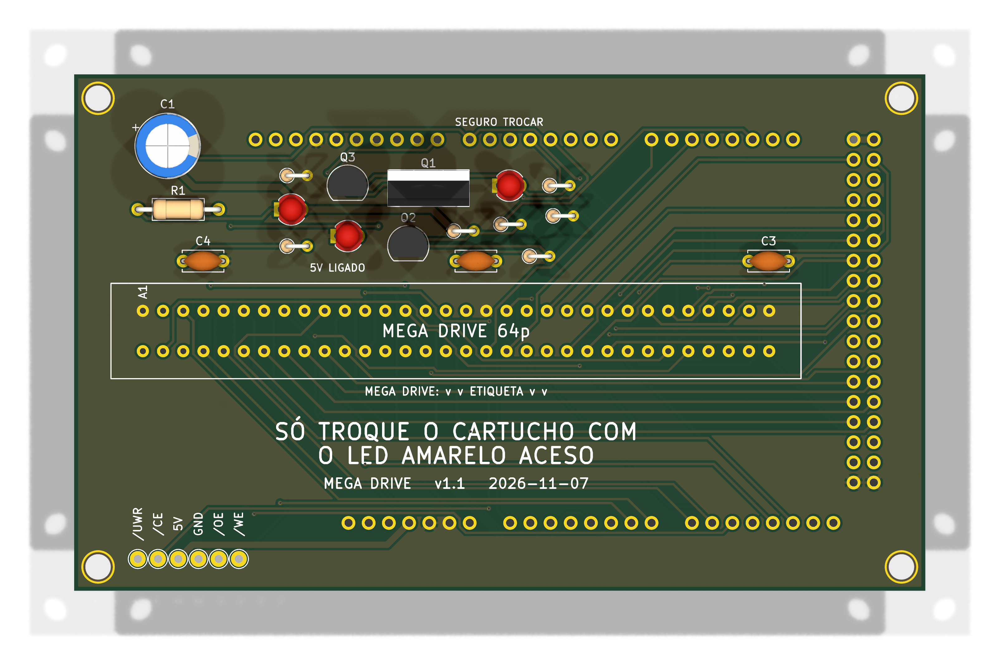

# megadrive — só Mega Drive / Genesis



Versão mínima de uma função: um slot **Mega Drive** (64p, 2,54 mm) em shield para Arduino Mega 2560 R3, 100% THT, só USB, **5 V** fixo. Um cartucho por vez. Pinagem idêntica ao OSCR HW5 (`docs/pinmap.md`, recorte da `16_bits`).

**Estado:** v1.1, 107,1 × 65,1 mm. ERC 0 violações; DRC sem erros nem ligações abertas (os 2 `starved_thermal` da B.Cu, nos pads GND3 do Mega e A18 do slot, foram resolvidos ligando esses pads sem alívio térmico, D96); netlist confere com `docs/pinmap.md`; gerbers em `fab/`. Roteada pelo Freerouting (MCP) e costurada com vias de GND: **revisar o layout no KiCad antes de encomendar** (trilhas não foram conferidas à mão). Nada encomendado nem montado. Montagem: `docs/montagem.md`. Trilhas de alimentação (`+5V`) alargadas até onde cabe, 0,8 mm na maior parte (`tools/revisao/widen_power.py`, D96).

## Diferenças em relação à `16_bits`

| Item | 16_bits | megadrive |
|---|---|---|
| Slots | SNES, Mega Drive | só Mega Drive |
| Si5351, PIC12F629 (CIC), R2 (pull-up do IRQ do SNES) | sim | **não** (o `MegaDrive.cpp` do OSCR não usa clock nem CIC) |
| Capacitores de 100 nF | C2 a C6 | C2, C3, C4 (slot Mega Drive; renumerados em D109, eram C3, C5, C6 na `16_bits`) |
| Slot dentro da área do Mega | não (SNES ocupava) | **sim**: o slot MD fica entre as fileiras de pinos do Mega |
| Placa | 108,1 × 86,1 mm | 107,1 × 65,1 mm |
| Mantido | `/CART` em D50, pontos de teste (`/UWR`, `/CE`, `5V`, `GND`, `/OE`, `/WE`), LED de status em D38, C1 470 µF | idem |

Ficam sem ligação no Mega: `D20`, `D21`, `D40`, `D41` (I²C do Si5351 e reset do PIC).

## Como foi feita

Scripts em `tools/megadrive/` (da raiz do repositório):

1. `strip_sch.py` tira do esquemático da `16_bits` SNES1, U1, U2, R2, C2, C4 e os rótulos dos pinos deles.
2. `place.py` (Python do venv do KiCad MCP) limpa as trilhas, remove as peças, move o slot, refaz contorno e zonas.
3. Roteamento: `autoroute` (Freerouting) do KiCad MCP (3 tentativas, 215 s).
4. `fix_nets.py` (pinos sem uso do Mega), `fill_zones.py`, `stitch.py` e `frag_vias.py` (vias de GND que ligam fragmentos do preenchimento), depois DRC e `check_netlist.py`.

Verificação:

```
python3 tools/check_netlist.py --board megadrive
kicad-cli sch erc boards/megadrive/hardware/dumper.kicad_sch
kicad-cli pcb drc boards/megadrive/hardware/dumper.kicad_pcb
tools/export_fab.sh megadrive v1.0
```

**Peças opcionais:** o que se perde ao retirar cada componente, e que jogos são afetados, está em [`docs/componentes-opcionais.md`](docs/componentes-opcionais.md).

## Bloco de troca de cartucho (v1.1, D126)

Circuito e motivo: `docs/bloco-troca.md` (na raiz do repositório). Peças novas desta placa:

| Ref. | Valor | Função |
|---|---|---|
| Q1 | IRF9540N (P-MOSFET, TO-220) | chave de alta do 5V dos slots (`+5V_CART`); comando no D19 (nível baixo liga) |
| R2 | 100 kΩ | gate do Q1 ao 5V (desligado com o Mega em reset) |
| R3 | 100 Ω | D19 ao gate do Q1 |
| R4, D2 | 1 kΩ, LED verde 3 mm | `+5V_CART` presente |
| Q2, R5 | 2N7000 (TO-92), 330 Ω | descarga do rail quando o Q1 abre |
| Q3, R6, R7, R8, D3 | 2N7000, 100 kΩ, 1 kΩ, 1 kΩ, LED amarelo 3 mm | sensor do rail: D3 aceso = seguro trocar; R8 leva o nó ao D53 |

Os pinos de 5V dos slots e dos circuitos que a placa tiver (Si5351, PIC, pull-up, entrada do regulador de 3,3 V) e os capacitores deles ficam em `+5V_CART`. O Q1 (TO-220) fica em pé na placa, sem dissipador (a corrente do cartucho é baixa).

## Versões: com e sem o desligamento por software (D128)

O desligamento do 5V dos slots por software (bloco de troca de cartucho, D126) é uma versão **separada**; a placa existe também sem ele.

| Versão | Bloco de troca (Q1, Q2, Q3, LEDs, D19 e D53) | Projeto KiCad | Fábrica | Renders (cima e baixo) |
|---|---|---|---|---|
| v1.0 | **não** (5V direto nos slots) | `hardware-v1.0/` | `fab/gerbers-v1.0/`, `fab/dumper-v1.0-jlcpcb.zip`, `fab/bom-v1.0.csv` | `renders/megadrive-v1.0-cima.png`, `renders/megadrive-v1.0-baixo.png` |
| v1.1 | sim | `hardware/` | `fab/gerbers/`, `fab/dumper-v1.1-jlcpcb.zip`, `fab/bom.csv` | `renders/megadrive-v1.1-cima.png`, `renders/megadrive-v1.1-baixo.png` (`render.png` = v1.1, de cima) |

A v1.0 é o projeto de antes do D126, restaurado do histórico do git; os gerbers dela foram regerados da pasta `hardware-v1.0/`. Verificação: `python3 tools/check_netlist.py --board megadrive --sem-troca boards/megadrive/hardware-v1.0/dumper.kicad_sch` (v1.0) e `python3 tools/check_netlist.py --board megadrive` (v1.1). Para refazer os gerbers da v1.0: `HWDIR=hardware-v1.0 GDIR=gerbers-v1.0 tools/export_fab.sh megadrive v1.0`. Nenhuma das duas foi encomendada, montada nem testada com cartucho.

