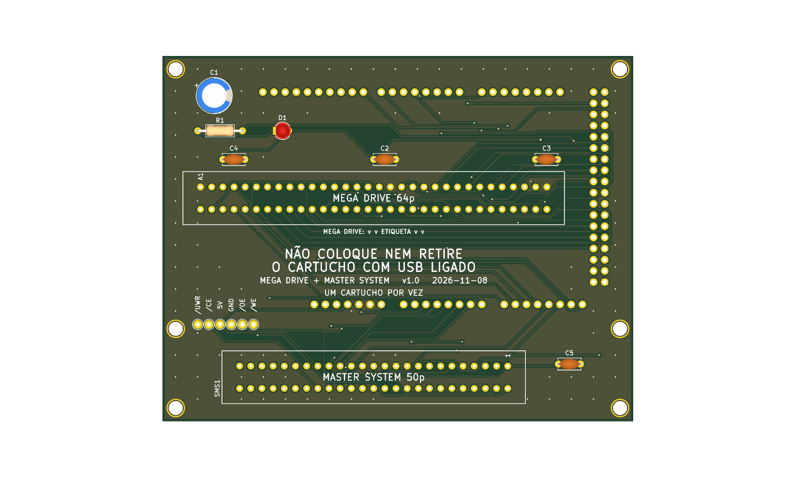

# megadrive_sms — Mega Drive e Master System



**README por versão** (renders de cima e de baixo, peças, diferenças): [v1.0](hardware-v1.0/README.md).

Versão mínima de dois slots em shield para Arduino Mega 2560 R3, 100% THT, só USB, **5 V** fixo: **Mega Drive** (64p, 2,54 mm) e **Master System / Mark III** (50p, 2,54 mm). Um cartucho por vez. Pinagem idêntica ao OSCR HW5 (`docs/pinmap.md`; o SMS vem do `mastersystem_adapter` do OSCR).

**Estado:** v1.0, 107,1 × 83,1 mm, **sem o bloco de troca de cartucho** (regra do usuário: a v1.0 é a mais barata que funciona; desligue o USB para trocar). ERC 0 violações; DRC sem erros nem ligações abertas; netlist confere com `docs/pinmap.md` (`tools/check_netlist.py --board megadrive_sms --sem-troca`); gerbers em `fab/`. Roteada pelo Freerouting e costurada com vias de GND: **revisar o layout no KiCad antes de encomendar**. Nada encomendado, montado nem testado.

## Decisões (2026-11-08, D136)

- Pino 47 (Clock) do SMS sem ligação; sem Si5351.
- Slot SMS de 50p a 2,54 mm (2 × 25), o mesmo tipo de item de AliExpress do slot Mega Drive (wiki de peças do OSCR). Footprint `SMS_Slot` em `boards/_lib/` (e no repositório `romulofer/kicad_libraries_romulo`). Medir o slot recebido.
- Game Gear e SG-1000 por adaptador de terceiros (Retrode, Retron, Raphnet), fora da placa.
- v1.0 sem o bloco de troca; versão com bloco só depois, como v1.1.

## Diferenças em relação à `megadrive` v1.0

| Item | megadrive | megadrive_sms |
|---|---|---|
| Slots | Mega Drive | Mega Drive e Master System (50p) |
| Capacitores de 100 nF | C2, C3, C4 | C2, C3, C4 e C5 (junto ao 5V do slot SMS) |
| Placa | 107,1 × 65,1 mm | 107,1 × 83,1 mm (slot SMS abaixo da fileira de baixo do Mega) |
| Furos M3 | 4 | 6 |

## Pendências

1. **Direção da etiqueta do cartucho SMS** no silk (não confirmada; o do Mega Drive está).
2. Medidas dos dois slots comprados e folga entre eles (cerca de 40 mm entre os centros).
3. **Firmware:** o núcleo `SMS.cpp` do OSCR está desligado no `user.ini` e não há comando no protocolo; a placa só lê Master System depois que esse núcleo entrar no fork (meta D77, `docs/referencia/funcoes-oscr.md`).
4. Revisar o layout no KiCad (roteamento por autoroteador).

## Como foi feita

Scripts em `tools/boards/megadrive_sms/` (da raiz do repositório):

1. `gen_pinmap_sms.py` gera a seção Master System do `docs/pinmap.md` (netlist do `mastersystem_adapter` do OSCR, `pinout.ods`, `SMS.cpp`).
2. `add_sms_sch.py` copia o esquemático da `megadrive` v1.0 e acrescenta SMS1 (rótulos de net, `+5V`, GND, não conexões) e C5.
3. `place_sms.py` (python do sistema, com `pcbnew`) copia o PCB da `megadrive` v1.0, tira trilhas e zonas, estende a placa, põe SMS1, C5 e os furos novos.
4. Roteamento: DSN por `pcbnew`, Freerouting (`java -jar ~/.kicad-mcp/freerouting.jar -de ... -mp 30`, 0 não roteados), SES importado; depois `tools/boards/megadrive/` `tp_header.py`, `add_zones.py`, `stitch.py` e `frag_vias.py`.

Verificação:

```
python3 tools/check_netlist.py --board megadrive_sms --sem-troca
kicad-cli sch erc boards/megadrive_sms/hardware-v1.0/dumper.kicad_sch
kicad-cli pcb drc boards/megadrive_sms/hardware-v1.0/dumper.kicad_pcb
tools/export_fab.sh megadrive_sms v1.0
```

Peças opcionais: [`docs/componentes-opcionais.md`](docs/componentes-opcionais.md). BOM: [`docs/bom.md`](docs/bom.md). Montagem: [`docs/montagem.md`](docs/montagem.md).

Atribuição: baseado no Open Source Cartridge Reader de sanni (CC BY 4.0).
