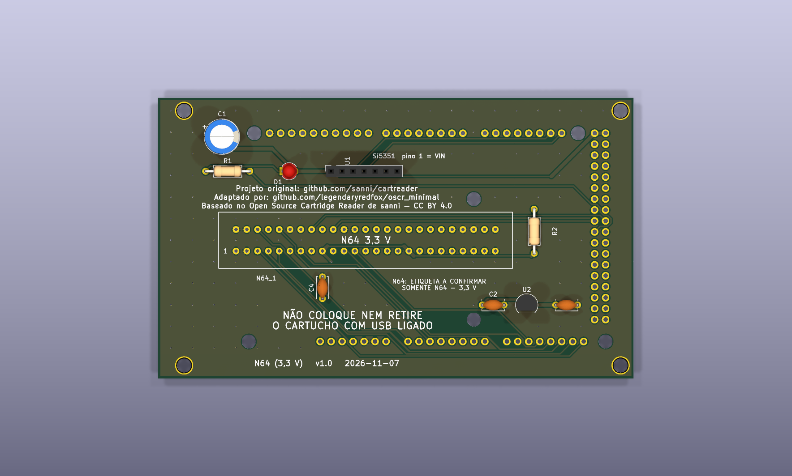

# n64 — Nintendo 64

**Slots:** N64 (50 pinos, cartucho de 3,3 V; footprint `N64_Slot` do OSCR, a trazer para `_lib/`)

**Estado:** v1.0, 110,1 × 65,1 mm. ERC com 1 aviso de biblioteca (U2, o mesmo das outras placas); DRC sem erros nem ligações abertas (só 4 avisos de biblioteca dos furos); netlist confere com `docs/pinmap.md` (30 nets, 96 ligações); gerbers em `fab/`. Roteada pelo Freerouting, **não revisada à mão no KiCad**; nada encomendado nem montado. Reproduzir: `tools/n64/build_pcb.sh` (PCB) e `tools/n64/make_sch.py` (esquemático). Aprovado pelo usuário em 2026-11-07 ("confere tudo e pode fazer no kicad"). **Fase 1 do `CLAUDE.md`:** `docs/pinmap.md` gerado por `tools/n64/gen_pinmap.py` cruzando `pinout.ods`, `n64_adapter` + `six_slot_adapter` e `N64.ino`: 50 pinos, 0 divergências entre as fontes. 

## O que o pinmap mostra

- Sinais: `AD0` a `AD15` em A0 a A15 (portas F e K), `/READ` em D9, `/WRITE` em D8, `ALE_L` em D37, `ALE_H` em D36, `RESET` em D17, `EEPROM_DATA` em D7 (com pull-up de 1 kΩ para o 3,3 V no adaptador do OSCR). `EEPROM_CLK` (pino 19) vem do `CLK1` do Si5351 (2 MHz).
- Tensão: `VCC` (pinos 9, 17, 34, 42) em **3,3 V**. Mesmo regulador do GBA (MCP1700, `gb_gba/`) e sinais do Mega em 5 V, como o OSCR HW5 e a família já fazem no slot GBA.
- Sem ligação (como no OSCR): `12V` (13, 38), `NC` (14, 39), `CIC_to_PIF` (18), `L_AUDIO` (24), `PIF_to_CIC` (43), `R4300_CLK` (44), `NMI` (45), `Video_CLK` (46), `R_AUDIO` (49). O CIC do N64 **não** é lido por esta placa.

## O que a placa leva e o que cada peça faz

Detalhe em `docs/componentes-opcionais.md`. Resumo:

| Peça | Sem ela |
|---|---|
| Regulador 3,3 V + 2 capacitores | Slot sem energia: nada lê |
| Si5351 (só `CLK1`) | Não lê as **EEPROMs** de save (4K e 16K); ROM e SRAM/Flash seguem |
| Pull-up de 1 kΩ no D7 | EEPROM não lê com confiança |

## Pendências

1. Medidas reais do slot N64 comprado (CLAUDE.md, seção 5), contorno do footprint (estimativa) e direção da etiqueta (D27; o silk diz "a confirmar").
2. Firmware: religar o núcleo em `firmware/oscr/user.ini` (`n64 = true`), id no protocolo, host e GUI.
3. Revisar o layout no KiCad antes de encomendar.

Montagem: `docs/montagem.md`; compra: `docs/bom.md`.

O `CLAUDE.md` (seção 4) deixava o N64 fora das placas anteriores; esta placa nasce a pedido do usuário (2026-11-07).

Regras gerais: `CLAUDE.md`. Layout da pasta: `boards/README.md`.

**Peças opcionais:** [`docs/componentes-opcionais.md`](docs/componentes-opcionais.md).
