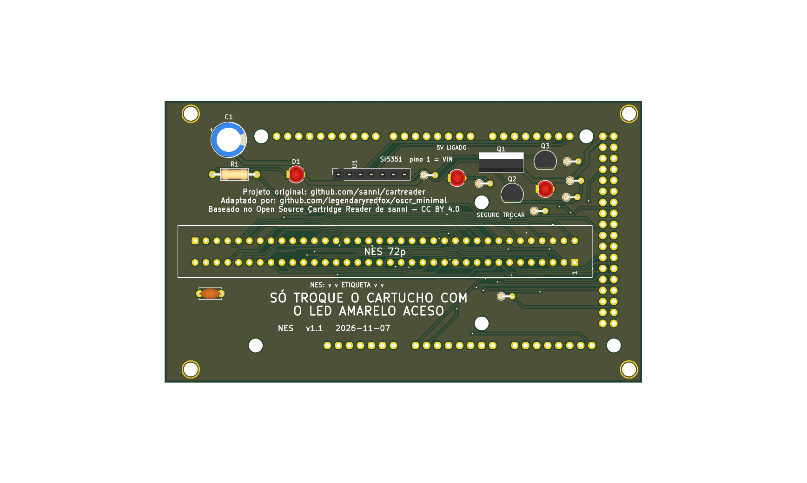

# nes — só NES



**README por versão** (renders de cima e de baixo, peças, diferenças): [v1.0](hardware-v1.0/README.md), [v1.1](hardware/README.md).

Versão mínima de uma função: um slot **NES** (72p, 2,5 mm) em shield para Arduino Mega 2560 R3, 100% THT, só USB, **5 V** fixo. Um cartucho por vez. Pinagem idêntica ao OSCR HW5 (`docs/pinmap.md`, recorte da `16_and_8_bits`).

**Famicom:** não está nesta placa. O Famicom tem slot próprio de 60 pinos: use `boards/famicom/` (D98). Cartucho Famicom aqui só com adaptador 60→72 pinos, e isso **não foi validado** (D95).

**Estado:** v1.1, 110,1 × 65,1 mm. ERC 0 violações; DRC sem erros nem ligações abertas (só avisos de biblioteca e paridade, os mesmos das outras placas); netlist confere com `docs/pinmap.md`; gerbers em `fab/`. Roteada pelo Freerouting (MCP), com GND roteado junto e costurado com vias: **revisar o layout no KiCad antes de encomendar**. Nada encomendado nem montado. Montagem: `docs/montagem.md`. Trilhas de alimentação (`+5V`) alargadas até onde cabe, 0,8 mm na maior parte (`tools/revisao/widen_power.py`, D96).

## Diferenças em relação à `16_and_8_bits`

| Item | 16_and_8_bits | nes |
|---|---|---|
| Slots | SNES, NES, Famicom, Mega Drive, GBA | só NES |
| Mantido | Si5351 (U1, o CLK0 vai ao pino 37 do slot), LED (D1, R1), C1, C3 (VCC do slot; agora C2, D109) | idem |
| Removido | SNES1, FC1, MD1, GBA1, PIC (U2), R2, regulador U3 e C7, C8, C9, C2, C4, C5, C6, furos M2 | |
| Placa | 144 × 108 mm | 110,1 × 65,1 mm |

O slot NES fica entre as fileiras de pinos do Mega, deslocado 9 mm para a esquerda do centro para não encostar no header 2x18 (os pads dele chegam a 116,5 mm). Os 6 furos não metalizados do Mega e os 4 furos de canto foram mantidos.

Ficam sem ligação no Mega: `D2..D9`, `D14..D17`, `D29..D34`, `D36`, `D37`, `D40`, `D41` (outros sistemas) e os de sempre (`D0`, `D1`, `D10..D13`, `D18`, `D19`, `D39`, `D50..D53`).

## Como foi feita

Mesma receita da `snes/` (`boards/snes/README.md`), com `tools/nes/place.py` no lugar do `place.py` dela:

1. `tools/megadrive/strip_sch.py ... SNES1,FC1,MD1,GBA1,U2,R2,U3,C2,C4,C5,C6,C7,C8,C9` tira do esquemático da `16_and_8_bits` o que o NES não usa.
2. `tools/nes/place.py` (Python do venv do KiCad MCP) limpa trilhas e zonas, remove as peças, move o slot, refaz o contorno.
3. `tools/nes/sync_unconnected.py placa.kicad_pcb netlist.net` passa as nets `unconnected-(...)` do esquemático para o PCB (todos os pinos de uma vez; a netlist vem de `kicad-cli sch export netlist --format kicadsexpr`).
4. `autoroute` do KiCad MCP (3 tentativas) **com o GND como trilha** (sem zonas), depois `tools/megadrive/add_zones.py`, `stitch.py` (que agora evita legendas do silkscreen) e `tools/fill_zones.py`.
5. `tools/nes/retext.py` reaplica só as posições dos textos sobre a placa roteada, sem refazer o roteamento.

```
python3 tools/check_netlist.py --board nes
kicad-cli sch erc boards/nes/hardware/dumper.kicad_sch
kicad-cli pcb drc boards/nes/hardware/dumper.kicad_pcb
tools/export_fab.sh nes v1.0
```

**Peças opcionais:** o que se perde ao retirar cada componente, e que jogos são afetados, está em [`docs/componentes-opcionais.md`](docs/componentes-opcionais.md).

## Bloco de troca de cartucho (v1.1, D126)

Circuito e motivo: `docs/bloco-troca.md` (na raiz do repositório). Peças novas desta placa:

| Ref. | Valor | Função |
|---|---|---|
| Q1 | IRF9540N (P-MOSFET, TO-220) | chave de alta do 5V dos slots (`+5V_CART`); comando no D19 (nível baixo liga) |
| R2 | 100 kΩ | gate do Q1 ao 5V (desligado com o Mega em reset) |
| R3 | 100 Ω | D19 ao gate do Q1 |
| R4, D2 | 1 kΩ, LED verde 3 mm | `+5V_CART` presente |
| Q2, R5 | 2N7000 (TO-92), 330 Ω | descarga do rail quando o Q1 abre |
| Q3, R6, R7, R8, D3 | 2N7000, 100 kΩ, 1 kΩ, 1 kΩ, LED amarelo 3 mm | sensor do rail: D3 aceso = seguro trocar; R8 leva o nó ao D53 |

Os pinos de 5V dos slots e dos circuitos que a placa tiver (Si5351, PIC, pull-up, entrada do regulador de 3,3 V) e os capacitores deles ficam em `+5V_CART`. O Q1 (TO-220) fica em pé na placa, sem dissipador (a corrente do cartucho é baixa).

## Versões: com e sem o desligamento por software (D128)

O desligamento do 5V dos slots por software (bloco de troca de cartucho, D126) é uma versão **separada**; a placa existe também sem ele.

| Versão | Bloco de troca (Q1, Q2, Q3, LEDs, D19 e D53) | Projeto KiCad | Fábrica | Renders (cima e baixo) |
|---|---|---|---|---|
| v1.0 | **não** (5V direto nos slots) | `hardware-v1.0/` | `fab/gerbers-v1.0/`, `fab/dumper-v1.0-jlcpcb.zip`, `fab/bom-v1.0.csv` | `renders/nes-v1.0-cima.png`, `renders/nes-v1.0-baixo.png` |
| v1.1 | sim | `hardware/` | `fab/gerbers/`, `fab/dumper-v1.1-jlcpcb.zip`, `fab/bom.csv` | `renders/nes-v1.1-cima.png`, `renders/nes-v1.1-baixo.png` (`render.png` = v1.1, de cima) |

A v1.0 é o projeto de antes do D126, restaurado do histórico do git; os gerbers dela foram regerados da pasta `hardware-v1.0/`. Verificação: `python3 tools/check_netlist.py --board nes --sem-troca boards/nes/hardware-v1.0/dumper.kicad_sch` (v1.0) e `python3 tools/check_netlist.py --board nes` (v1.1). Para refazer os gerbers da v1.0: `HWDIR=hardware-v1.0 GDIR=gerbers-v1.0 tools/export_fab.sh nes v1.0`. Nenhuma das duas foi encomendada, montada nem testada com cartucho.

