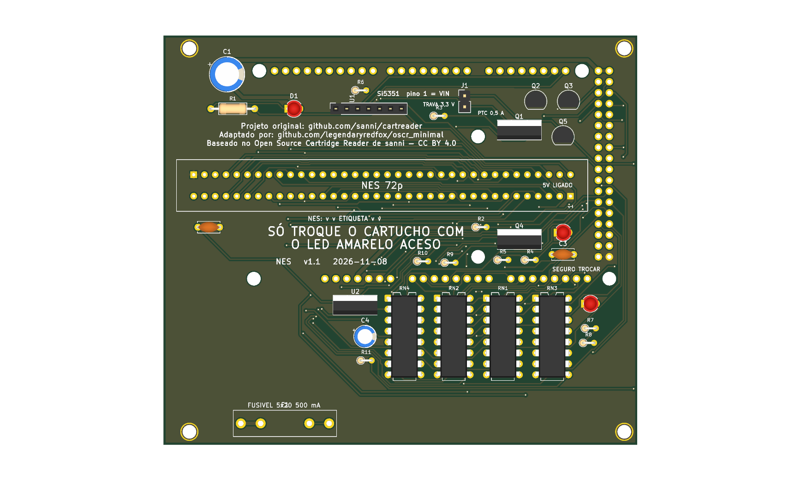
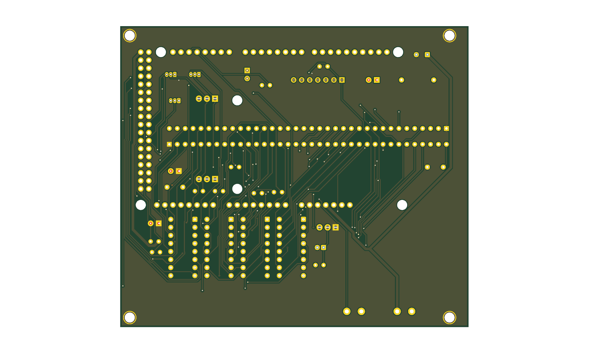

# nes v1.1





Versão **v1.1** da placa [`nes`](../README.md): shield 100% THT para Arduino Mega 2560 R3, só USB. Esta é a versão mais nova.

| | |
|---|---|
| Slots | NES (72p, 2,5 mm), 5 V |
| Circuitos | Si5351 (clock do slot), sem PIC. |
| Tamanho | 110,1 × 95,1 mm |
| Desligar o 5V por software | **sim** |
| Projeto KiCad | [`hardware-v1.1/`](.) (`dumper.kicad_pro`, `.kicad_sch`, `.kicad_pcb`) |
| Fábrica (JLCPCB) | `../fab/gerbers-v1.1/`, `../fab/dumper-v1.1-jlcpcb.zip` |
| Renders | `render-cima.png`, `render-baixo.png` |
| Estado | Nada montado nem testado com cartucho; revisar o layout no KiCad antes de encomendar |

## Troca de cartucho

**Com desligamento por software** (bloco de troca de cartucho, D126): o comando `POWER` liga e desliga o 5V dos slots, o rail é descarregado e o LED amarelo "SEGURO TROCAR" acende quando dá para tirar o cartucho. Circuito, peças e testes: [`docs/referencia/bloco-troca.md`](../../../docs/referencia/bloco-troca.md).

## Proteção de corrente e tensão (D138)

**F1: fusível de vidro 5×20 mm de 500 mA (ação rápida) em suporte de clipes, opcional.** O suporte é de furo passante (Littelfuse série 100 ou equivalente) e o fusível queimado se troca **sem solda**; fica em série com o 5 V que a placa recebe do Mega (nas versões com bloco de troca, antes do Q1). Um curto no cartucho queima o fusível e protege a placa, o Mega e a porta USB. A queda é de 0,1 a 0,2 V a 200 mA (o SA-1 do SNES continua abaixo de ~5,2 V). **Sem o fusível no suporte a placa fica sem 5 V** (um fio no lugar dele também serve). Ele limita corrente e não protege contra tensão errada.

**Seletor de tensão 3,3 V/5 V dos slots NES** (LDO LD1117V33 em TO-220, Q4 de bypass, Q5 de carga, redes de resistores de 470 Ω em série com as linhas entre o Mega e esses slots, comando no D18). **Padrão: 5 V**; 3,3 V só quando o usuário pede (`--voltage 3v3`, ou o botão da GUI). Passar de 3,3 V para 5 V mostra um alerta e pede confirmação. Os outros slots e o Si5351/PIC ficam direto no 5 V. Cartuchos de 3,3 V ligados em 5 V podem queimar.

**J1: jumper "TRAVA 3,3 V", opcional.** Fechado, prende o gate do Q4 no 5 V e o slot nunca passa de 3,3 V, mesmo com erro de software ou de GUI: é a única defesa independente do firmware. Aberto, o seletor funciona normalmente.

## O que muda em relação à v1.0

| Peça | Referências | Antes | Agora |
|---|---|---|---|
| 10u/16V | C4 | 0 | 1 |
| LED verde 3mm | D2 | 0 | 1 |
| LED amarelo 3mm | D3 | 0 | 1 |
| TRAVA 3,3 V | J1 | 0 | 1 |
| IRF9540N | Q1,Q4 | 0 | 2 |
| 2N7000 | Q2,Q3,Q5 | 0 | 3 |
| 100k | R2,R6,R9 | 0 | 3 |
| 100R | R3 | 0 | 1 |
| 1k | R4,R7,R8,R10 | 0 | 4 |
| 330R | R5 | 0 | 1 |
| 220R | R11 | 0 | 1 |
| 470R | RN1,RN2,RN3,RN4 | 0 | 4 |
| LD1117V33 | U2 | 0 | 1 |
| 100n | C2,C3 | 1 | 2 |

## Lista de peças

| Referências | Valor | Footprint | Qtd |
|---|---|---|---|
| A1 | Mega2560_R3_Shield | `dumper:Mega2560_R3_Shield` | 1 |
| C1 | 470u/16V | `Capacitor_THT:CP_Radial_D8.0mm_P3.50mm` | 1 |
| C2,C3 | 100n | `Capacitor_THT:C_Disc_D5.0mm_W2.5mm_P5.00mm` | 2 |
| C4 | 10u/16V | `Capacitor_THT:CP_Radial_D5.0mm_P2.00mm` | 1 |
| D1 | LED 3mm | `LED_THT:LED_D3.0mm` | 1 |
| D2 | LED verde 3mm | `LED_THT:LED_D3.0mm` | 1 |
| D3 | LED amarelo 3mm | `LED_THT:LED_D3.0mm` | 1 |
| F1 | Fusivel 5x20 500mA | `Fuse:Fuseholder_Littelfuse_100_series_5x20mm` | 1 |
| FLG1,FLG2 | PWR_FLAG | `` | 2 |
| J1 | TRAVA 3,3 V | `Connector_PinHeader_2.54mm:PinHeader_1x02_P2.54mm_Vertical` | 1 |
| NES1 | NES_Slot | `dumper:NES_Slot` | 1 |
| Q1,Q4 | IRF9540N | `Package_TO_SOT_THT:TO-220-3_Vertical` | 2 |
| Q2,Q3,Q5 | 2N7000 | `Package_TO_SOT_THT:TO-92_Inline` | 3 |
| R1 | 220R | `Resistor_THT:R_Axial_DIN0207_L6.3mm_D2.5mm_P10.16mm_Horizontal` | 1 |
| R2,R6,R9 | 100k | `Resistor_THT:R_Axial_DIN0204_L3.6mm_D1.6mm_P2.54mm_Vertical` | 3 |
| R3 | 100R | `Resistor_THT:R_Axial_DIN0204_L3.6mm_D1.6mm_P2.54mm_Vertical` | 1 |
| R4,R7,R8,R10 | 1k | `Resistor_THT:R_Axial_DIN0204_L3.6mm_D1.6mm_P2.54mm_Vertical` | 4 |
| R5 | 330R | `Resistor_THT:R_Axial_DIN0204_L3.6mm_D1.6mm_P2.54mm_Vertical` | 1 |
| R11 | 220R | `Resistor_THT:R_Axial_DIN0204_L3.6mm_D1.6mm_P2.54mm_Vertical` | 1 |
| RN1,RN2,RN3,RN4 | 470R | `Package_DIP:DIP-16_W7.62mm` | 4 |
| U1 | Si5351_Module | `Connector_PinSocket_2.54mm:PinSocket_1x07_P2.54mm_Vertical` | 1 |
| U2 | LD1117V33 | `Package_TO_SOT_THT:TO-220-3_Vertical` | 1 |

Gerada do esquemático desta versão (`kicad-cli sch export bom`). Peças marcadas DNP ou opcionais: `docs/componentes-opcionais.md` da placa.

## Verificação e fábrica (da raiz do repositório)

```
python3 tools/check_netlist.py --board nes
kicad-cli sch erc boards/nes/hardware-v1.1/dumper.kicad_sch
kicad-cli pcb drc boards/nes/hardware-v1.1/dumper.kicad_pcb
tools/export_fab.sh nes v1.1
tools/render_board.sh nes v1.0 v1.1
```

Mais: [README da placa](../README.md), [`docs/`](../docs/).
