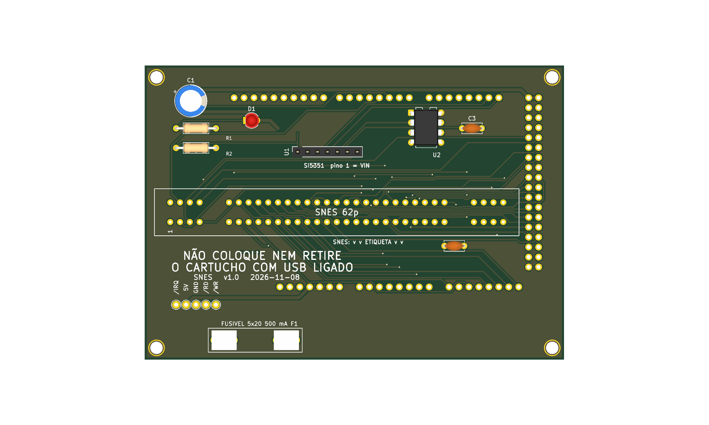

# snes — só SNES / Super Famicom



**README por versão** (renders de cima e de baixo, peças, diferenças): [v1.0](hardware-v1.0/README.md), [v1.1](hardware-v1.1/README.md).

Versão mínima de uma função: um slot **SNES/SFC** (62p, 2,5 mm) em shield para Arduino Mega 2560 R3, 100% THT, só USB, **5 V** fixo. Um cartucho por vez. Pinagem idêntica ao OSCR HW5 (`docs/pinmap.md`, recorte da `16_bits`).

**CIC:** PIC12F629 em soquete (D89/D91). O RP2040-Zero (`docs/planos/placa-v1.3-rp2040.md`) só entra depois de validado.

**Estado:** v1.1, 107,1 × 65,1 mm. ERC 0 violações; DRC sem erros nem ligações abertas (só avisos de biblioteca e paridade, os mesmos da `16_bits`); netlist confere com `docs/pinmap.md`; gerbers em `fab/`. Roteada pelo Freerouting (MCP), com GND roteado junto e costurado com vias: **revisar o layout no KiCad antes de encomendar**. Nada encomendado nem montado. Montagem: `docs/montagem.md`. Trilhas de alimentação (`+5V`) alargadas até onde cabe, 0,8 mm na maior parte (`tools/historico/revisao/widen_power.py`, D96).

## Diferenças em relação à `16_bits`

| Item | 16_bits | snes |
|---|---|---|
| Slots | SNES, Mega Drive | só SNES |
| Mantido | Si5351 (U1), PIC (U2), R2 (pull-up do IRQ), C2, C4 (agora C3, D109), C1, LED | idem |
| Removido | | MD1, C3, C5, C6, TP3 (`/CE` do Mega Drive), `/CART` (D50 sem ligação). Referências renumeradas em D109 (C4 virou C3; TP4 a TP6 viraram TP3 a TP5) |
| Pontos de teste | `/UWR`, `/CE`, `5V`, `GND`, `/OE`, `/WE` | `/IRQ` (D7), `5V`, `GND`, `/RD` (D9), `/WR` (D8) |
| Placa | 108,1 × 86,1 mm | 107,1 × 65,1 mm |

O slot SNES fica no mesmo lugar (dentro da área do Mega); a placa encolheu porque o slot Mega Drive saiu.

## Como foi feita

Mesma receita da `megadrive/` (`boards/megadrive/README.md`), com `tools/boards/snes/place.py` no lugar de `tools/boards/megadrive/place.py`. Roteamento: `autoroute` do KiCad MCP **com o GND como trilha** (sem zonas), depois `add_zones.py`, `fix_nets.py` (D5, D16, D50), `stitch.py`. Roteando o GND como plano, dois pinos GND do Mega ficaram num grupo de cobre sem saída; roteando o GND junto, o Freerouting resolveu.

```
python3 tools/check_netlist.py --board snes
kicad-cli sch erc boards/snes/hardware-v1.1/dumper.kicad_sch
kicad-cli pcb drc boards/snes/hardware-v1.1/dumper.kicad_pcb
tools/export_fab.sh snes v1.0
```

**Peças opcionais:** o que se perde ao retirar cada componente, e que jogos são afetados, está em [`docs/componentes-opcionais.md`](docs/componentes-opcionais.md).

## Bloco de troca de cartucho (v1.1, D126)

Circuito e motivo: `docs/referencia/bloco-troca.md` (na raiz do repositório). Peças novas desta placa:

| Ref. | Valor | Função |
|---|---|---|
| Q1 | IRF9540N (P-MOSFET, TO-220) | chave de alta do 5V dos slots (`+5V_CART`); comando no D19 (nível baixo liga) |
| R3 | 100 kΩ | gate do Q1 ao 5V (desligado com o Mega em reset) |
| R4 | 100 Ω | D19 ao gate do Q1 |
| R5, D2 | 1 kΩ, LED verde 3 mm | `+5V_CART` presente |
| Q2, R6 | 2N7000 (TO-92), 330 Ω | descarga do rail quando o Q1 abre |
| Q3, R7, R8, R9, D3 | 2N7000, 100 kΩ, 1 kΩ, 1 kΩ, LED amarelo 3 mm | sensor do rail: D3 aceso = seguro trocar; R9 leva o nó ao D53 |

Os pinos de 5V dos slots, do Si5351 e do PIC e os capacitores deles ficam em `+5V_CART`. O Q1 (TO-220) fica em pé na placa, sem dissipador (a corrente do cartucho é baixa).

## Versões: com e sem o desligamento por software (D128)

O desligamento do 5V dos slots por software (bloco de troca de cartucho, D126) é uma versão **separada**; a placa existe também sem ele.

| Versão | Bloco de troca (Q1, Q2, Q3, LEDs, D19 e D53) | Projeto KiCad | Fábrica | Renders (cima e baixo) |
|---|---|---|---|---|
| v1.0 | **não** (5V direto nos slots) | `hardware-v1.0/` | `fab/gerbers-v1.0/`, `fab/dumper-v1.0-jlcpcb.zip`, `fab/bom-v1.0.csv` | `hardware-v1.0/render-cima.png`, `hardware-v1.0/render-baixo.png` |
| v1.1 | sim | `hardware-v1.1/` | `fab/gerbers-v1.1/`, `fab/dumper-v1.1-jlcpcb.zip`, `fab/bom-v1.1.csv` | `hardware-v1.1/render-cima.png`, `hardware-v1.1/render-baixo.png` (`render.png` = v1.1, de cima) |

A v1.0 é o projeto de antes do D126, restaurado do histórico do git; os gerbers dela foram regerados da pasta `hardware-v1.0/`. Verificação: `python3 tools/check_netlist.py --board snes --sem-troca boards/snes/hardware-v1.0/dumper.kicad_sch` (v1.0) e `python3 tools/check_netlist.py --board snes` (v1.1). Para refazer os gerbers da v1.0: `HWDIR=hardware-v1.0 GDIR=gerbers-v1.0 tools/export_fab.sh snes v1.0`. Nenhuma das duas foi encomendada, montada nem testada com cartucho.

