# Bancada do RP2040: montar o teste na protoboard

Este guia é para quem **nunca montou um circuito**. Siga na ordem, um passo de cada vez, e marque ☐ quando terminar cada item.

## Para que serve

A placa `16_bits` usa um chip pequeno, o **PIC12F629**, para "destravar" os cartuchos de SNES com chip SA-1 (Super Mario RPG, Kirby Super Star...). Queremos trocar o PIC por um **módulo RP2040-Zero**, que se grava pelo USB. Mas **ainda não sabemos se ele funciona**. Esta bancada serve para descobrir, **antes** de mandar fazer a placa nova (v1.3).

Você monta um **adaptador na protoboard**. Ele se liga com fios no soquete **U2** da placa v1.0 (o soquete onde mora o PIC, que você vai tirar). Se o cartucho SA-1 for lido com o CRC32 certo, o RP2040 funciona.

> **Estado (2026-11-10):** nada foi montado nem testado. Conferido só no PC: o programa `scripts/bancada.py` confere que cada fio e cada peça ligam exatamente o que o plano pede (`../README.md`, seção "Bancada na placa v1.0"; `../../../docs/planos/placa-v1.3-rp2040.md`). Os desenhos saem desse mesmo programa. O módulo e o 74HCT125 nunca rodaram neste circuito.

## O que você precisa

<!-- material -->
| Qtd | Peça | Ref. | Como reconhecer |
|---|---|---|---|
| 1 | Placa 16_bits v1.0 (ou v1.2) pronta, com o Mega, o módulo Si5351 e **sem o PIC** no soquete U2 | | |
| 1 | Módulo **Waveshare RP2040-Zero** | M1 | placa pequena, 18 × 23,5 mm, USB-C numa ponta |
| 2 | Barras de pinos macho 1×9, passo 2,54 mm | | soldadas no módulo (ver "Antes de começar") |
| 1 | Chip **SN74HCT125N** (DIP-14) | U1 | 14 pernas. Tem que ter o **T** no nome: o 74HC125 **não serve** |
| 1 | Diodo **1N5819** | D1 | preto, com uma faixa prateada de um lado |
| 1 | Capacitor 100 nF | C1 | disquinho laranja marcado **104** |
| 1 | Resistor 1 kΩ | R1 | faixas: marrom, preto, vermelho, dourado |
| 3 | Resistor 2,0 kΩ | R2, R4, R6 | faixas: vermelho, preto, vermelho, dourado |
| 3 | Resistor 3,3 kΩ | R3, R5, R7 | faixas: laranja, laranja, vermelho, dourado |
| 4 | Resistor 10 kΩ | R8 a R11 | faixas: marrom, preto, laranja, dourado |
| 1 | Protoboard de 830 pontos | | com 4 trilhos: 2 em cima e 2 embaixo (o desenho usa as colunas 1 a 52) |
| 27 | Fios macho-macho (jumpers) | | 8 deles vão ao soquete U2 (a ponta macho entra no furo do soquete; se ficar frouxa, prenda com um pouco de fita). Misture comprimentos de 10 cm e 20 cm; os fios do módulo ao chip 74HCT125 precisam de 20 cm |
| 1 | Cabo USB-C | | para gravar e ver os números do módulo |
| 1 | Multímetro | | |
| 1 | Cartucho de SNES com SA-1 (Super Mario RPG, Kirby Super Star...) | | para o teste de verdade |
<!-- /material -->

**Cuidado com os 5 V.** O módulo RP2040 só aguenta 3,3 V nos pinos. Por isso o circuito tem os resistores em pares (divisores) e o chip 74HCT125. **Nunca ligue um fio de 5 V direto num pino GP do módulo.**

## Antes de começar

1. **Solde os pinos no módulo.** O módulo vem só com furos. Solde as **duas barras de 9 pinos macho** nas duas bordas compridas (a que tem 5V, GND, 3V3... e a que tem GP0, GP1...). Os pinos saem para o lado de **baixo** do módulo (o lado do chip e do conector USB-C fica para cima). Dica: enfie as barras na protoboard, ponha o módulo por cima e solde assim, que tudo fica alinhado.
2. **Não solde** os 5 furos da borda curta de baixo (GP13 a GP9). Não usamos.
3. Ache o pino **5V** do módulo. Na borda comprida que tem 5V, GND e 3V3, o **5V é o pino mais perto da USB-C**. (O desenho de pinos da Waveshare para o RP2040-Zero mostra isso.) Se ficar em dúvida, o teste de 3,3 V mais adiante mostra se o módulo está do lado certo.
4. **Tire o PIC** do soquete U2 da placa v1.0, com a placa **desligada** (sem USB).
5. Deixe tudo desligado enquanto monta: **sem USB no módulo, sem USB no Mega.**

## Como ler os furos

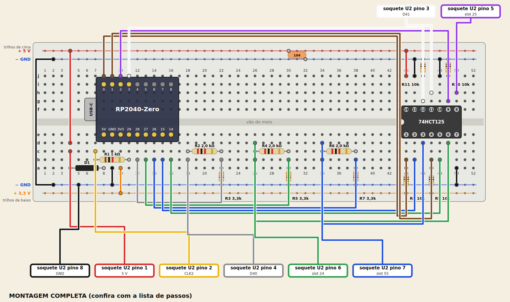

- Cada furo da protoboard tem uma **letra** (a linha: de `a` a `j`) e um **número** (a coluna: de 1 a 52 aqui). **c18** é a linha `c`, coluna `18`.
- As letras `a b c d e` ficam na **metade de baixo**. As letras `f g h i j` ficam na **metade de cima**. No meio há um **vão**.
- **Furos com o mesmo número e na mesma metade estão ligados por dentro.** Por exemplo, a18, b18, c18, d18 e e18 são o mesmo ponto.
- Os **trilhos** são as 4 linhas compridas de furos nas bordas: dois em cima (`+` e `−`) e dois embaixo. Qualquer furo do trilho serve; o desenho mostra um furo perto da coluna certa.
- **Resistor "em pé"**: uma perna no furo e a outra no trilho. Entorte a perna de cima e encaixe.
- O módulo cobre os furos `f`, `g` e `h` das colunas 8 a 16. **Nada vai nesses furos.**

## Cores dos fios

| Cor | Para que serve |
|---|---|
| vermelho | 5 V |
| preto | GND (terra) |
| laranja | 3,3 V do módulo |
| amarelo | clock (CLK2) |
| cinza | D40 |
| verde | dados 1 (slot 24) |
| azul | dados 0 (slot 55) |
| roxo | slot 25 |
| branco | D41 |
| marrom | liga/desliga os buffers do chip (GP0 e GP1) |

As cores ajudam, mas não são obrigatórias. O que importa são os furos.

## Mapa de todos os fios

São **27 fios macho-macho**. Faça um traço em cada fio que montar. Os passos abaixo mostram a ordem e uma figura para cada passo.

<!-- fios -->
| Feito | Cor | De | Para | O que faz |
|:-:|---|---|---|---|
| ☐ | **preto** | **trilho − de cima** | **trilho − de baixo** | liga o trilho − de cima ao de baixo |
| ☐ | **preto** | furo **a9** | **trilho − de baixo** | GND do módulo ao trilho − |
| ☐ | **laranja** | furo **a10** | **trilho + de baixo** | 3V3 do módulo ao trilho + |
| ☐ | **vermelho** | furo **d4** | **trilho + de cima** | 5 V da placa ao trilho + de cima |
| ☐ | **cinza** | furo **b12** | furo **b22** | GP28 ao divisor do D40 |
| ☐ | **verde** | furo **b13** | furo **b30** | GP27 ao divisor do slot 24 |
| ☐ | **azul** | furo **b14** | furo **b38** | GP26 ao divisor do slot 55 |
| ☐ | **vermelho** | furo **j44** | **trilho + de cima** | pino 14 do 74HCT125 aos 5 V |
| ☐ | **preto** | furo **j45** | **trilho − de cima** | pino 13 do 74HCT125 ao GND |
| ☐ | **preto** | furo **j48** | **trilho − de cima** | pino 10 do 74HCT125 ao GND |
| ☐ | **preto** | furo **a50** | **trilho − de baixo** | pino 7 do 74HCT125 ao GND |
| ☐ | **azul** | furo **b15** | furo **b45** | GP15 ao pino 2 do 74HCT125 |
| ☐ | **verde** | furo **b16** | furo **b48** | GP14 ao pino 5 do 74HCT125 |
| ☐ | **marrom** | furo **j8** | furo **b44** | GP0 ao pino 1 do 74HCT125 |
| ☐ | **marrom** | furo **j9** | furo **b47** | GP1 ao pino 4 do 74HCT125 |
| ☐ | **roxo** | furo **j10** | furo **g49** | GP2 ao pino 9 do 74HCT125 |
| ☐ | **branco** | furo **j11** | furo **g46** | GP3 ao pino 12 do 74HCT125 |
| ☐ | **verde** | furo **d26** | furo **d49** | slot 24 ao pino 6 do 74HCT125 |
| ☐ | **azul** | furo **d34** | furo **d46** | slot 55 ao pino 3 do 74HCT125 |
| ☐ | **vermelho** | soquete **U2**, pino **1** | furo **c4** | pino 1 do soquete U2 (5 V) |
| ☐ | **preto** | soquete **U2**, pino **8** | **trilho − de baixo** | pino 8 do soquete U2 (GND) |
| ☐ | **amarelo** | soquete **U2**, pino **2** | furo **c7** | pino 2 do soquete U2 (CLK2) |
| ☐ | **cinza** | soquete **U2**, pino **4** | furo **b18** | pino 4 do soquete U2 (D40) |
| ☐ | **verde** | soquete **U2**, pino **6** | furo **b26** | pino 6 do soquete U2 (slot 24) |
| ☐ | **azul** | soquete **U2**, pino **7** | furo **b34** | pino 7 do soquete U2 (slot 55) |
| ☐ | **branco** | soquete **U2**, pino **3** | furo **h47** | pino 3 do soquete U2 (D41) |
| ☐ | **roxo** | soquete **U2**, pino **5** | furo **h50** | pino 5 do soquete U2 (slot 25) |
<!-- /fios -->

## Passo a passo

**Regra de ouro:** nada ligado no USB nem na tomada enquanto você monta.

<!-- passos -->
#### Passo 1: O módulo RP2040-Zero

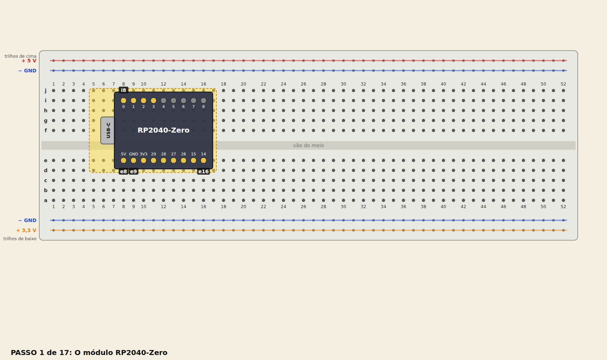

| Feito | O que | Onde |
|:-:|---|---|
| ☐ | **M1**: Módulo RP2040-Zero com os dois pinos macho soldados | pino **5V** em **e8** (USB-C para a esquerda); pinos 5V, GND, 3V3, GP29, GP28, GP27, GP26, GP15, GP14 em e8 a e16; GP0 a GP8 em i8 a i16 |

> USB-C para a ESQUERDA. O módulo cobre as colunas 8 a 16. A fileira de pinos que tem 5V, GND e 3V3 vai na fileira e (embaixo); o 5V é o pino mais perto da USB-C, no furo e8. A outra fileira (GP0 em diante) vai na fileira i.

#### Passo 2: O fio de GND entre os trilhos

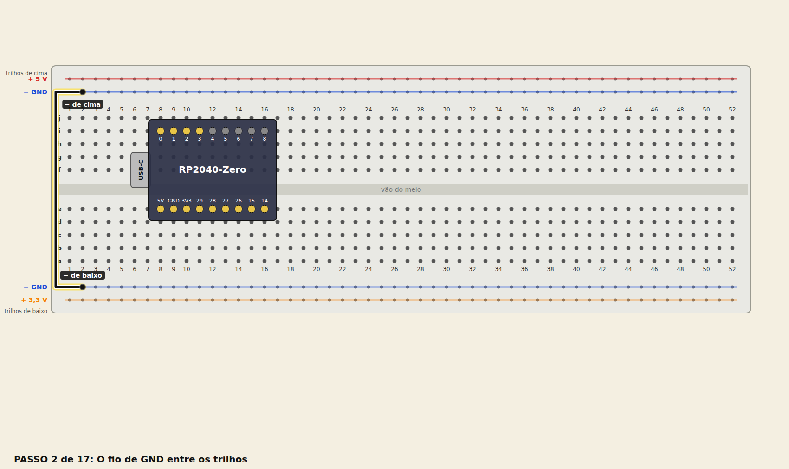

| Feito | O que | Onde |
|:-:|---|---|
| ☐ | fio **preto** (liga o trilho − de cima ao de baixo) | do **trilho − de cima** ao **trilho − de baixo** |

> Os trilhos de cima e de baixo precisam ser o mesmo GND. Se a sua protoboard tem o trilho cortado no meio, o fio vai no mesmo lado dos outros fios.

#### Passo 3: Energia do módulo

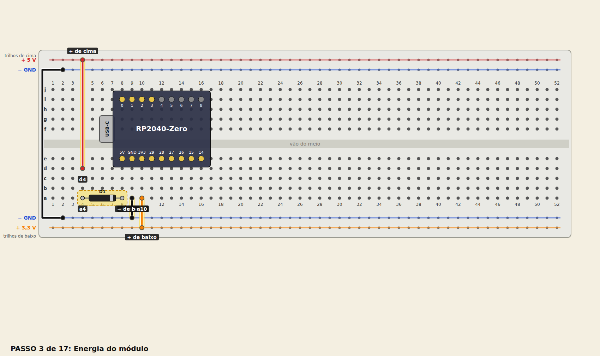

| Feito | O que | Onde |
|:-:|---|---|
| ☐ | **D1**: Diodo 1N5819 (faixa = lado K) | perna A em **a4**, perna K (a da faixa) em **a8** |
| ☐ | fio **preto** (GND do módulo ao trilho −) | do furo **a9** ao **trilho − de baixo** |
| ☐ | fio **laranja** (3V3 do módulo ao trilho +) | do furo **a10** ao **trilho + de baixo** |
| ☐ | fio **vermelho** (5 V da placa ao trilho + de cima) | do furo **d4** ao **trilho + de cima** |

> O diodo tem uma faixa prateada: a faixa fica do lado do módulo (furo a8). O fio vermelho do furo d4 vai no trilho + de cima.

#### Passo 4: Clock (CLK2)

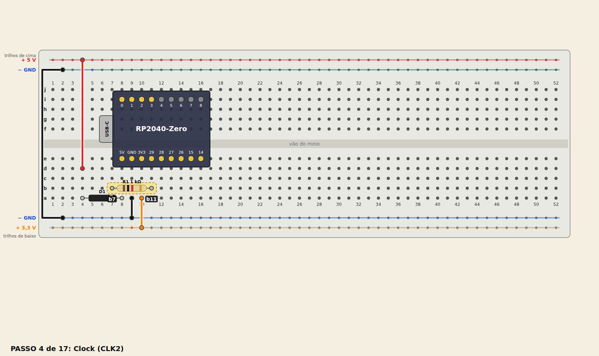

| Feito | O que | Onde |
|:-:|---|---|
| ☐ | **R1**: Resistor 1 kΩ (faixas marrom, preto, vermelho, dourado) | perna 1 em **b7**, perna 2 em **b11** |

> A perna do resistor no furo b7 fica na coluna 7, fora do módulo.

#### Passo 5: Divisor do D40

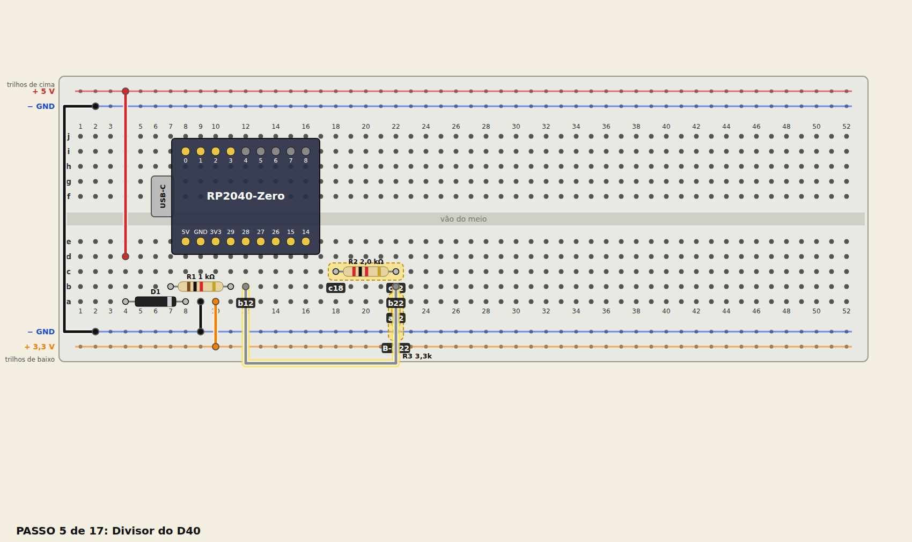

| Feito | O que | Onde |
|:-:|---|---|
| ☐ | **R2**: Resistor 2,0 kΩ (faixas vermelho, preto, vermelho, dourado) | perna 1 em **c18**, perna 2 em **c22** |
| ☐ | **R3**: Resistor 3,3 kΩ (faixas laranja, laranja, vermelho, dourado) | perna 1 em **a22**, perna 2 no **trilho − de baixo** |
| ☐ | fio **cinza** (GP28 ao divisor do D40) | do furo **b12** ao furo **b22** |

> O resistor R3 fica em pé: uma perna no furo a22, a outra no trilho − de baixo.

#### Passo 6: Divisor do slot 24

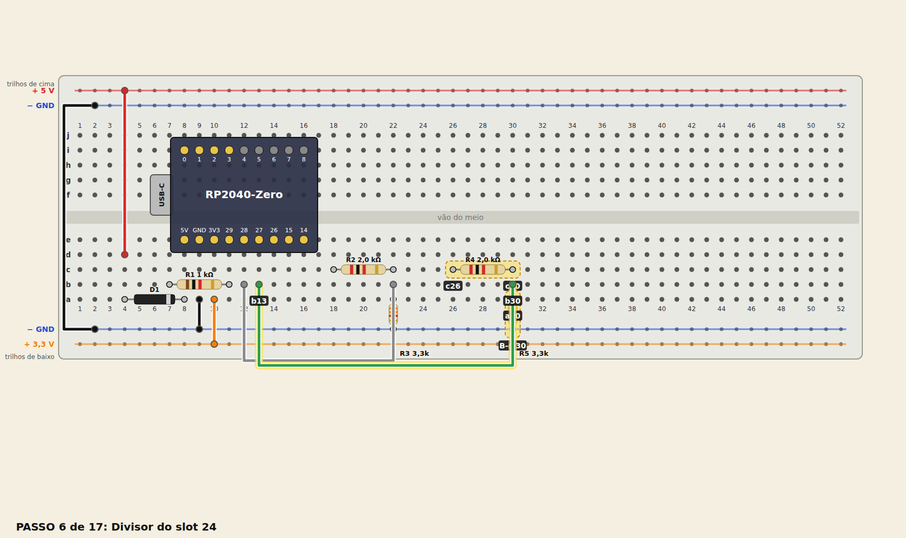

| Feito | O que | Onde |
|:-:|---|---|
| ☐ | **R4**: Resistor 2,0 kΩ (faixas vermelho, preto, vermelho, dourado) | perna 1 em **c26**, perna 2 em **c30** |
| ☐ | **R5**: Resistor 3,3 kΩ (faixas laranja, laranja, vermelho, dourado) | perna 1 em **a30**, perna 2 no **trilho − de baixo** |
| ☐ | fio **verde** (GP27 ao divisor do slot 24) | do furo **b13** ao furo **b30** |

> R5 em pé, como o R3.

#### Passo 7: Divisor do slot 55

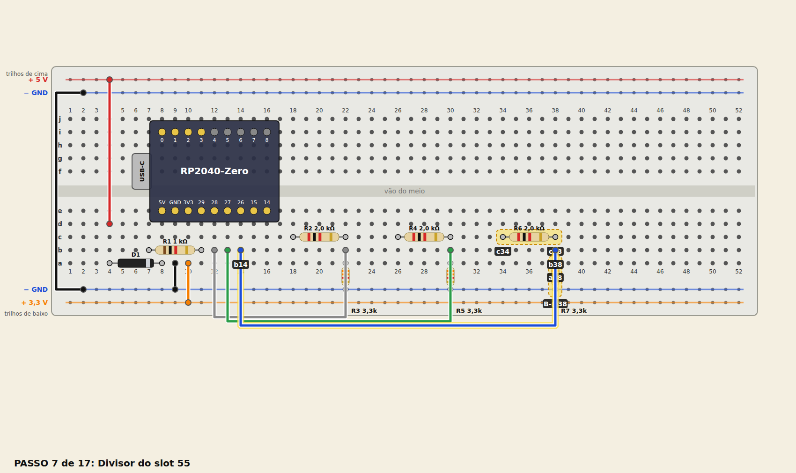

| Feito | O que | Onde |
|:-:|---|---|
| ☐ | **R6**: Resistor 2,0 kΩ (faixas vermelho, preto, vermelho, dourado) | perna 1 em **c34**, perna 2 em **c38** |
| ☐ | **R7**: Resistor 3,3 kΩ (faixas laranja, laranja, vermelho, dourado) | perna 1 em **a38**, perna 2 no **trilho − de baixo** |
| ☐ | fio **azul** (GP26 ao divisor do slot 55) | do furo **b14** ao furo **b38** |

> R7 em pé, como o R3.

#### Passo 8: O chip 74HCT125 e o capacitor

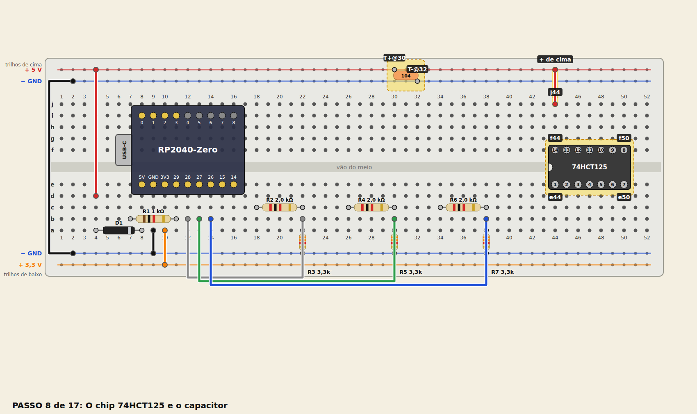

| Feito | O que | Onde |
|:-:|---|---|
| ☐ | **U1**: Chip 74HCT125 (DIP-14) | entalhe para a esquerda; **pino 1 em e44**, pinos 1 a 7 em e44 a e50, pino 14 em f44 e pinos 14 a 8 em f44 a f50 |
| ☐ | **C1**: Capacitor 100 nF (marcado 104) | perna 1 no **trilho + de cima**, perna 2 no **trilho − de cima** |
| ☐ | fio **vermelho** (pino 14 do 74HCT125 aos 5 V) | do furo **j44** ao **trilho + de cima** |

> O chip cavalga o vão do meio, com o entalhe para a ESQUERDA (pino 1 em e44). O capacitor não tem lado; as pernas vão nos dois trilhos de cima.

#### Passo 9: Terra do 74HCT125

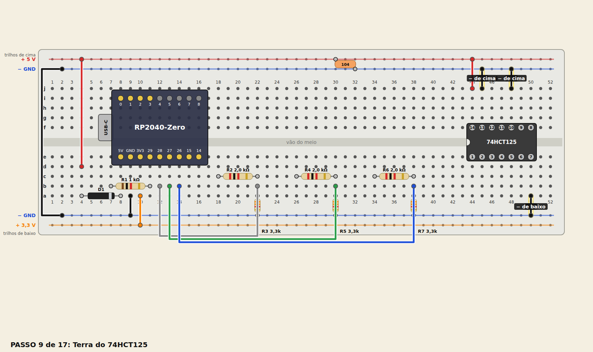

| Feito | O que | Onde |
|:-:|---|---|
| ☐ | fio **preto** (pino 13 do 74HCT125 ao GND) | do furo **j45** ao **trilho − de cima** |
| ☐ | fio **preto** (pino 10 do 74HCT125 ao GND) | do furo **j48** ao **trilho − de cima** |
| ☐ | fio **preto** (pino 7 do 74HCT125 ao GND) | do furo **a50** ao **trilho − de baixo** |

#### Passo 10: Resistores de segurança

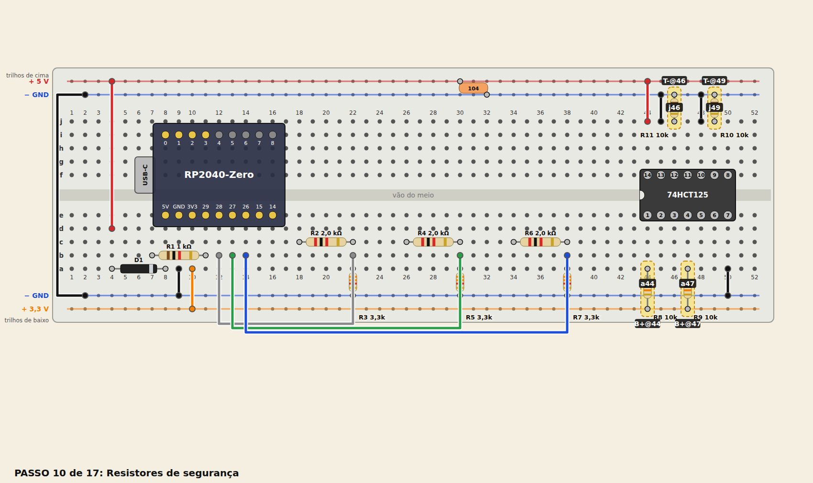

| Feito | O que | Onde |
|:-:|---|---|
| ☐ | **R8**: Resistor 10 kΩ (faixas marrom, preto, laranja, dourado) | perna 1 em **a44**, perna 2 no **trilho + de baixo** |
| ☐ | **R9**: Resistor 10 kΩ (faixas marrom, preto, laranja, dourado) | perna 1 em **a47**, perna 2 no **trilho + de baixo** |
| ☐ | **R10**: Resistor 10 kΩ (faixas marrom, preto, laranja, dourado) | perna 1 em **j49**, perna 2 no **trilho − de cima** |
| ☐ | **R11**: Resistor 10 kΩ (faixas marrom, preto, laranja, dourado) | perna 1 em **j46**, perna 2 no **trilho − de cima** |

> R8 e R9 (puxam para 3,3 V) vão ao trilho + de baixo. R10 e R11 (puxam para GND) vão ao trilho − de cima. Todos em pé.

#### Passo 11: Fios GP15 e GP14

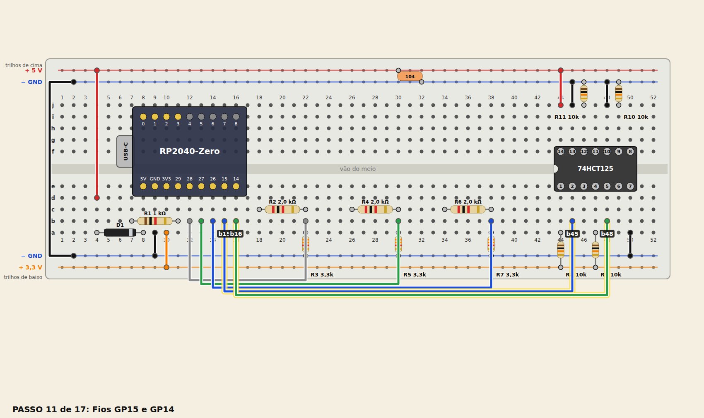

| Feito | O que | Onde |
|:-:|---|---|
| ☐ | fio **azul** (GP15 ao pino 2 do 74HCT125) | do furo **b15** ao furo **b45** |
| ☐ | fio **verde** (GP14 ao pino 5 do 74HCT125) | do furo **b16** ao furo **b48** |

> Estes dois mandam os dados do módulo para o chip.

#### Passo 12: Fios GP0 e GP1 (ligam e desligam o chip)

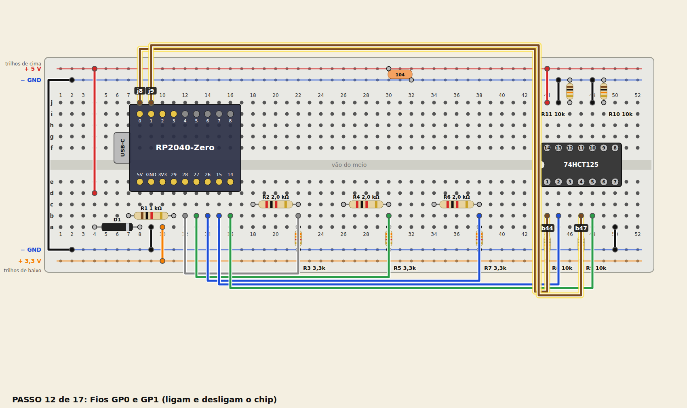

| Feito | O que | Onde |
|:-:|---|---|
| ☐ | fio **marrom** (GP0 ao pino 1 do 74HCT125) | do furo **j8** ao furo **b44** |
| ☐ | fio **marrom** (GP1 ao pino 4 do 74HCT125) | do furo **j9** ao furo **b47** |

> Estes fios saem da fileira de cima do módulo (furos j8 e j9), dão a volta pela direita do módulo e entram no chip por baixo.

#### Passo 13: Fios GP2 e GP3

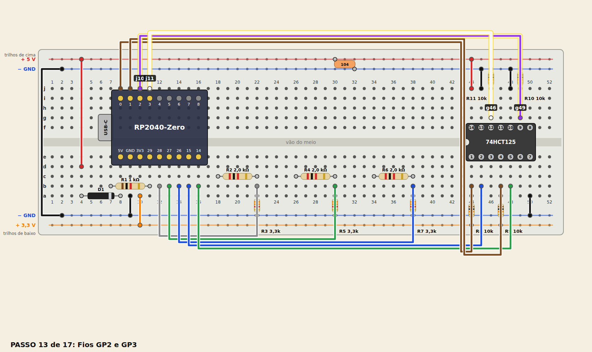

| Feito | O que | Onde |
|:-:|---|---|
| ☐ | fio **roxo** (GP2 ao pino 9 do 74HCT125) | do furo **j10** ao furo **g49** |
| ☐ | fio **branco** (GP3 ao pino 12 do 74HCT125) | do furo **j11** ao furo **g46** |

#### Passo 14: Fios dos divisores ao chip

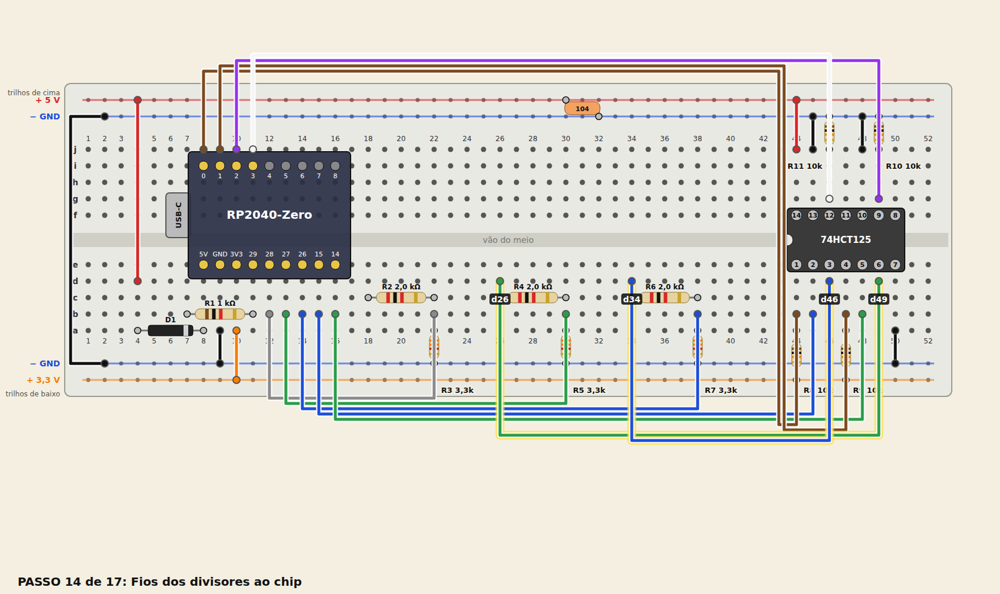

| Feito | O que | Onde |
|:-:|---|---|
| ☐ | fio **verde** (slot 24 ao pino 6 do 74HCT125) | do furo **d26** ao furo **d49** |
| ☐ | fio **azul** (slot 55 ao pino 3 do 74HCT125) | do furo **d34** ao furo **d46** |

#### Passo 15: Fios do soquete U2: energia e clock

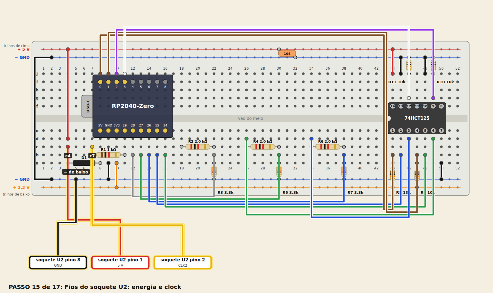

| Feito | O que | Onde |
|:-:|---|---|
| ☐ | fio **vermelho** (pino 1 do soquete U2 (5 V)) | do soquete **U2**, pino **1** ao furo **c4** |
| ☐ | fio **preto** (pino 8 do soquete U2 (GND)) | do soquete **U2**, pino **8** ao **trilho − de baixo** |
| ☐ | fio **amarelo** (pino 2 do soquete U2 (CLK2)) | do soquete **U2**, pino **2** ao furo **c7** |

> Estes fios têm uma ponta na protoboard e outra que vai no soquete U2 da placa. Por enquanto deixe a ponta do soquete solta.

#### Passo 16: Fios do soquete U2: D40, slot 24 e slot 55

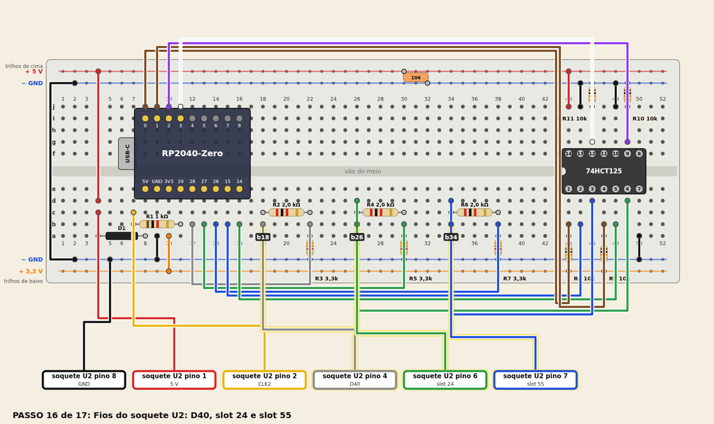

| Feito | O que | Onde |
|:-:|---|---|
| ☐ | fio **cinza** (pino 4 do soquete U2 (D40)) | do soquete **U2**, pino **4** ao furo **b18** |
| ☐ | fio **verde** (pino 6 do soquete U2 (slot 24)) | do soquete **U2**, pino **6** ao furo **b26** |
| ☐ | fio **azul** (pino 7 do soquete U2 (slot 55)) | do soquete **U2**, pino **7** ao furo **b34** |

#### Passo 17: Fios do soquete U2: D41 e slot 25

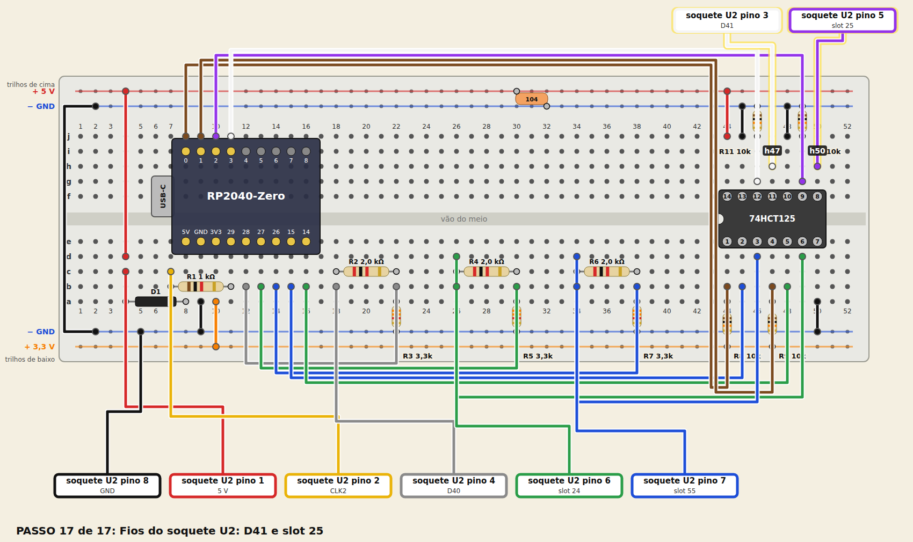

| Feito | O que | Onde |
|:-:|---|---|
| ☐ | fio **branco** (pino 3 do soquete U2 (D41)) | do soquete **U2**, pino **3** ao furo **h47** |
| ☐ | fio **roxo** (pino 5 do soquete U2 (slot 25)) | do soquete **U2**, pino **5** ao furo **h50** |

> Estes dois entram na metade de CIMA da protoboard (furos h47 e h50).

<!-- /passos -->

## Pronto: confira


Com o multímetro em **continuidade (bip)** e **tudo desligado**:

| Meça entre | Deve dar |
|---|---|
| trilho + de cima e trilho − de cima | **sem** bip (senão há um curto) |
| trilho + de baixo e trilho − de baixo | **sem** bip |
| trilho − de cima e trilho − de baixo | bip |
| furo e9 (GND do módulo) e trilho − de baixo | bip |
| furo e8 (5V do módulo) e trilho + de cima, no **modo diodo** do multímetro (ponta vermelha no trilho +, preta no e8) | marca **0,2 a 0,4 V**. Com as pontas invertidas, não marca nada (`OL`) |
| furo c4 (fio do pino 1 do U2) e trilho + de cima | bip |
| furo e10 (3V3 do módulo) e trilho + de baixo | bip |
| furo f44 (pino 14 do 74HCT125) e trilho + de cima | bip |
| furo e50 (pino 7 do 74HCT125) e trilho − de baixo | bip |

Se algum resultado for diferente, volte ao passo da peça ou do fio e confira os furos.

## Testar (sem a placa v1.0)

Ainda **sem** ligar nada na placa v1.0. As pontas dos fios do soquete U2 ficam soltas, longe de tudo.

1. Ligue o **cabo USB-C só no módulo**. Uma luz acende no módulo.
2. Multímetro em volts: entre **e10** (3V3) e **e9** (GND) deve dar **cerca de 3,3 V**. Se der, o módulo está do lado certo. Se não der nada, o módulo pode estar virado: desligue e confira o passo 1.
3. Grave o programa do CIC no módulo. Na raiz do repositório:
   ```
   arduino-cli compile -b rp2040:rp2040:waveshare_rp2040_zero firmware/cic_rp2040/cic_rp2040
   ```
   Depois segure o botão **BOOT** do módulo, ligue o USB, solte o botão e copie o arquivo `.uf2` gerado para a unidade que aparece (ou use `arduino-cli upload`). Detalhes em [`../README.md`](../README.md), seção "Compilar e gravar".
4. Abra a serial (115200). Sai uma linha por segundo:
   ```
   ciclos=<n> atrasos=<n> pc=0x<hex> latch=0x<hex>
   ```
   Sem clock vindo da placa, os `ciclos` não devem andar. Isso é esperado (é o que o código faz; não foi visto no hardware).
5. Desligue o USB.

## Ligar na placa v1.0

1. Placa v1.0 **desligada** (sem USB no Mega), sem PIC no soquete U2.
2. Encaixe a **ponta solta** de cada fio no furo do soquete U2 que tem o mesmo número. O **pino 1 é o do entalhe** do soquete; conte em U (para baixo do lado esquerdo e para cima do direito):

| Fio | Cor | Pino do soquete U2 | Sinal |
|---|---|---|---|
| F1 | vermelho | 1 | 5 V da placa |
| F2 | amarelo | 2 | CLK2 |
| F3 | branco | 3 | D41 |
| F4 | cinza | 4 | D40 |
| F5 | roxo | 5 | slot 25 |
| F6 | verde | 6 | slot 24 |
| F7 | azul | 7 | slot 55 |
| F8 | preto | 8 | GND |

3. Confira duas vezes: **vermelho no 1, preto no 8**. Fio trocado aqui pode queimar peça.
4. **Sem cartucho.** Ligue o USB do Mega (a placa liga). Meça:
   - entre o trilho + de cima e o trilho − de cima: **cerca de 5 V**;
   - entre **e8** (5V do módulo) e o trilho − de baixo: **entre 4,3 e 4,8 V** (os 5 V menos a queda do diodo, 0,2 a 0,4 V). Se estiver bem diferente, desligue e confira;
   - entre o trilho + de baixo e o trilho − de baixo: **cerca de 3,3 V**.
5. Ligue também o USB do módulo no PC (pode ficar ligado junto; o diodo evita briga entre as duas fontes) e deixe a serial aberta.

## O teste de verdade (cartucho SA-1)

1. Desligue tudo e ponha o **cartucho SA-1** no slot de SNES. Só **um** cartucho na placa.
2. Ligue o USB do Mega e do módulo. Deixe a serial do módulo à vista.
3. Rode no PC (outro terminal): `python3 host/dumper.py detect -s snes`. O firmware liga o Si5351 e fica falando com o "PIC", que agora é o módulo.
4. **Olhe a serial do módulo.** O número `atrasos` tem que ficar em **0**.
5. Se o `detect` achou o cartucho, rode `python3 host/dumper.py dump -s snes -o jogo.sfc` e compare o **CRC32** com o do No-Intro.

| O que aconteceu | O que significa |
|---|---|
| `atrasos` em 0 **e** o cartucho SA-1 foi lido com o CRC certo | **Funcionou.** O RP2040 pode entrar na v1.3. |
| `atrasos` acima de 0 | O módulo não está pegando o tempo. O programa precisa ser mais rápido. Mande a linha da serial. |
| `atrasos` em 0, mas "sem cartucho" | Pode ser nível de sinal, fio trocado ou o SA-1 não autenticou. Veja "Problemas". |
| `ciclos` parado com a placa ligada | O clock (CLK2) não chega ao módulo. Confira R1 e o fio amarelo. |

**Mande para mim** as linhas da serial (`ciclos=... atrasos=...`) e a saída do `detect`. O teste com hardware é seu; eu analiso os logs.

## Problemas

- **Nada acende no módulo:** cabo sem dados, ou módulo mal encaixado. Confira o USB.
- **Sem 3,3 V entre e10 e e9:** módulo virado (o 5V tem que estar no canto da USB-C, no furo e8) ou pinos mal soldados.
- **Cheiro de queimado ou chip esquentando:** desligue já. Quase sempre é fio vermelho/preto trocado no soquete U2, ou fio de 5 V encostando num pino GP.
- **A serial do módulo não aparece (Linux):** seu usuário precisa estar no grupo `dialout`.
- **O `detect` não acha o cartucho:** o firmware do Mega pode não estar gravado ou o Si5351 não está encaixado. Teste antes com o PIC no lugar, para saber se o resto da placa está bem.
- **Quer ver a explicação do circuito:** [`../README.md`](../README.md) (programa) e [`../../../docs/planos/placa-v1.3-rp2040.md`](../../../docs/planos/placa-v1.3-rp2040.md) (por que cada peça).

## Arquivos

| Caminho | O que é |
|---|---|
| `scripts/bancada.py` | dados da montagem, verificador (só no PC), desenhos e tabelas deste guia |
| `docs/passo-N.png/.svg` | uma figura por passo |
| `docs/montagem-completa.png/.svg` | a montagem inteira |

Para refazer os desenhos e as tabelas: `python3 -I firmware/cic_rp2040/bancada/scripts/bancada.py` (precisa do `google-chrome` ou `chromium` para os PNG). Só verificar: `... bancada.py --so-verificar`.

## Licença

O firmware do CIC está em `../` (GPL v2, do sd2snes). Este guia e o adaptador seguem o mesmo projeto.
