# Programador de PIC12F629 em shield para Arduino Uno

Grava o **PIC12F629** (o CIC "lock" do SNES SA-1, `snescic-lock-resync.hex`) com um Arduino Uno e o
[ardpicprog](https://rweather.github.io/ardpicprog/). Resolve o problema de quem não tem PICkit: o 12F629 só grava
com Vpp de uns 12 a 13 V no MCLR, e o CH341A não gera isso.

Este shield é o circuito do ardpicprog para o PIC12F629 em DIP-8 direto (a ligação já descrita em
[`../uno/README.md`](../uno/README.md), D91), desenhado em KiCad. Há três jeitos de montar o mesmo circuito, na ordem
de comodidade: **A.** PCB do shield (este projeto KiCad), **B.** protoboard, **C.** placa perfurada.

> **Estado (2026-11-06):** nada foi encomendado, montado nem gravado em PIC. Conferido só no PC: ERC do esquemático
> sem avisos, DRC da PCB sem violações e sem pontos soltos, netlist da PCB contra a tabela de ligações do ardpicprog
> (`scripts/check_netlist.py`), e os desenhos da protoboard e da placa perfurada (`scripts/protoboard.py`,
> `scripts/perfboard.py`). A pinagem do Uno é a do footprint do Mega no projeto, cotas oficiais do Arduino; não foi
> medida num Uno real. O limite máximo de Vpp do 12F629 (DS41191) **não foi conferido**: meça o MCLR antes de pôr o chip.

## Sem diodo por padrão (D1 é DNP)

**O padrão é montar SEM o diodo D1.** O circuito original do ardpicprog não tem diodo, e assim não se perdem 0,2 a
0,3 V de Vpp. Em cada montagem:

| Montagem | Padrão (sem D1) | Se quiser o diodo |
|---|---|---|
| **A. PCB** | D1 **não montado** (DNP) e **JP1 fechado**: jumper (shunt), fio ou gota de solda entre os dois pinos de JP1 | montar D1 (faixa = K para o lado do circuito) e **abrir** JP1 |
| **B. Protoboard** | o positivo da fonte vai direto ao trilho "+" | ver "Com o diodo" na seção B |
| **C. Placa perfurada** | fio de ponte de E2 a I2, no lugar do diodo | tirar a ponte e soldar o diodo em E2 (anodo) e I2 (catodo) |

**Risco de ficar sem ele:** não há proteção contra a fonte ligada ao contrário (plugue com polaridade trocada,
adaptador de centro negativo). Os caminhos passam por R1 (10 kΩ), R2 (4,7 kΩ) e R4 (1 kΩ), então as correntes ficam
em miliampères e nada deve pegar fogo, mas pode queimar o LED vermelho (tensão reversa de ~5 V), o transistor ou o
PIC (o MCLR conduz ~1 mA pelo diodo interno do pino; não conferi o limite no datasheet). **Antes de ligar, confira a
polaridade da fonte com o multímetro.** O bloqueio de D1 é a única proteção que a placa tem para isso; se a polaridade
do seu plugue é conhecida e marcada, dispensá-lo é razoável. Se o Vpp medido no MCLR ficar **perto do limite baixo**
(não conferi o DS41191), o certo é ficar sem o diodo.

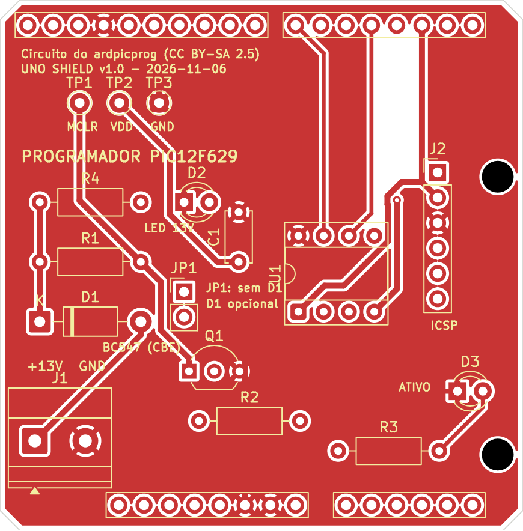

Esquemático (para quem sabe ler): [`docs/esquematico.pdf`](docs/esquematico.pdf). Para todo mundo, o **mapa das ligações** logo abaixo.

## Mapa das ligações (para qualquer pessoa seguir)

<!-- mapa -->
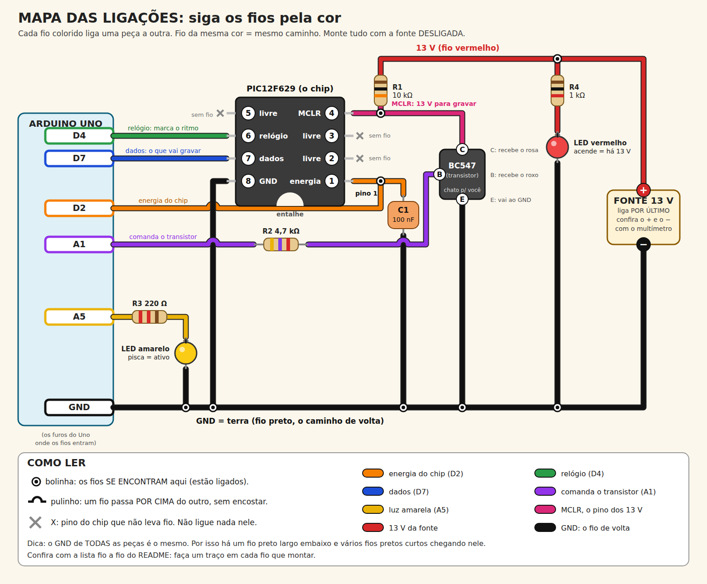

Lista **fio a fio** (faça um traço em cada fio que montar). Os fios pretos vão todos ao **GND**; o resto liga duas peças:

| Feito | Cor do fio | De | Para |
|:-:|---|---|---|
| ☐ | **preto** | GND do Uno | trilho preto de GND |
| ☐ | **preto** | pino 8 do chip | trilho preto de GND |
| ☐ | **preto** | capacitor C1 (perna de baixo) | trilho preto de GND |
| ☐ | **preto** | emissor (E) do transistor | trilho preto de GND |
| ☐ | **preto** | LED vermelho (perna curta) | trilho preto de GND |
| ☐ | **preto** | LED amarelo (perna curta) | trilho preto de GND |
| ☐ | **preto** | negativo (−) da fonte | trilho preto de GND |
| ☐ | **laranja** | D2 do Uno | pino 1 do chip e perna de cima do capacitor C1 |
| ☐ | **verde** | D4 do Uno | pino 6 do chip |
| ☐ | **azul** | D7 do Uno | pino 7 do chip |
| ☐ | **rosa** | pino 4 do chip (MCLR) | resistor R1 (10 kΩ) e coletor (C) do transistor |
| ☐ | **roxo** | A1 do Uno | resistor R2 (4,7 kΩ), e dele à base (B) do transistor |
| ☐ | **amarelo** | A5 do Uno | resistor R3 (220 Ω), e dele à perna longa (+) do LED amarelo |
| ☐ | **vermelho** | positivo (+) da fonte | resistor R1 (o outro lado dele) e resistor R4 (1 kΩ), e dele à perna longa (+) do LED vermelho |

Os pinos 2, 3 e 5 do chip **não levam fio**. O desenho (`docs/esquema-simples.svg` e `.png`) sai de `scripts/esquema_simples.py`, que confere cada fio contra a tabela de ligações do verificador (`protoboard.py`) e para com erro se algum fio ligar o que não deve.
<!-- /mapa -->

## Como funciona

```
13 V (+) ──► [D1 1N5819: DNP, ponte] ─┬── R1 10 kΩ ──┬── PIC pino 4 (MCLR)
                                        │              └── coletor do Q1 (BC547)
                                        └── R4 1 kΩ ── LED vermelho ── GND  (acende = há 13 V)
Uno A1 ── R2 4,7 kΩ ── base do Q1        emissor do Q1 ── GND
Uno D2 ── PIC pino 1 (Vdd)               100 nF entre o pino 1 e o GND, junto ao chip
Uno D4 ── PIC pino 6 (clock)
Uno D7 ── PIC pino 7 (dados)
Uno A5 ── R3 220 Ω ── LED amarelo ── GND (atividade)
Uno GND ── PIC pino 8 ── GND da fonte de 13 V   (GND comum!)
PIC pinos 2, 3 e 5: sem ligação
```

- A1 em nível **baixo** corta o transistor e deixa o MCLR em ~13 V (gravação); em nível alto o transistor puxa o
  MCLR a GND (reset). O sketch aplica os 13 V **antes** de ligar o Vdd. Os pinos conferem com o `ProgramPIC.pde`
  do ardpicprog (`PIN_MCLR A1`, `PIN_VDD 2`, `PIN_CLOCK 4`, `PIN_DATA 7`, `PIN_ACTIVITY A5`), então o sketch roda sem
  alteração.
- Os 13 V nunca vão a um pino do Uno. O PIC é alimentado pelo pino D2 do Uno (consumo de poucos mA).
- **D1 (1N5819) é opcional e vem desmontado (DNP)**; veja "Sem diodo por padrão" acima. Ele é um acréscimo deste
  projeto, o circuito original não tem. Na PCB, JP1 fica em paralelo com ele: fechado = sem diodo.
- A placa também tem um cabeçalho ICSP (J2, ordem do PICkit: 1 MCLR, 2 Vdd, 3 GND, 4 dados, 5 clock) e três pontos de
  teste (MCLR, VDD, GND) para o multímetro.

## Material

| Qtd | Peça | Ref. na PCB | Observação |
|---|---|---|---|
| 1 | Arduino Uno R3 + cabo USB | | clone com CH340 serve (aparece como `/dev/ttyUSB0`) |
| 1 | Fonte de 13 V, ≥ 100 mA, **regulada** | | meça em vazio antes (veja "Antes de ligar") |
| 1 | PIC12F629-I/P (DIP-8) virgem ou a regravar | U1 | em soquete DIP-8 |
| 1 | Soquete DIP-8 | U1 | de contato torneado, para trocar de chip muitas vezes |
| 1 | Transistor NPN pequeno: BC547 ou BC548 (ou 2N3904, 2N2222) | Q1 | pinagem abaixo |
| 0 (1 se quiser) | Diodo 1N5819 | D1 | **opcional, DNP**: só se for usar a proteção contra fonte invertida |
| 1 | Barra de 2 pinos 2,54 mm + jumper (shunt) | JP1 | só na PCB; fechado = sem D1. Pode ser um fio ou solda |
| 1 | Resistor 10 kΩ | R1 | 1/4 W |
| 1 | Resistor 4,7 kΩ | R2 | |
| 1 | Resistor 220 Ω | R3 | |
| 1 | Resistor 1 kΩ | R4 | |
| 1 | Capacitor cerâmico 100 nF | C1 | |
| 1 | LED vermelho 3 mm | D2 | indica os 13 V |
| 1 | LED amarelo 3 mm | D3 | atividade |
| 1 | Borne de parafuso 5,08 mm, 2 vias | J1 | entrada da fonte; para um plugue P4 use um adaptador "jack fêmea com borne" |
| 1 | Barra de 6 pinos 2,54 mm | J2 | ICSP, opcional |
| 3 | Ponto de teste (pino ou argola) | TP1 a TP3 | opcional |
| 4 | Barras fêmea empilháveis do Uno (6, 8, 8 e 10 pinos) | A1 | só na PCB do shield |

**Pinagem do transistor.** BC547 e BC548 (TO-92, lado chato para você, pernas para baixo): C, B, E da esquerda para a
direita. 2N3904 e 2N2222: E, B, C. Na PCB o footprint é C, B, E; um 2N3904 entra **virado 180°** (lado chato para o
lado oposto ao do desenho) e assim as pernas caem certas. Na dúvida, modo diodo do multímetro: a base mede cerca de
0,6 V para as outras duas pernas com o "+" na base (NPN).

## Antes de ligar (vale para as três montagens)

1. **Meça a fonte de 13 V com o multímetro, sem carga.** Adaptadores "13 V" sem regulagem passam de 15 V em vazio.
   Alvo: cerca de 13 V no MCLR com o chip fora. Confira o Vpp máximo do 12F629 no DS41191 antes de pôr o chip.
2. **Confirme a polaridade da fonte com o multímetro** (+ no centro ou na lateral). Sem o diodo D1 (o padrão) nada
   protege contra polaridade invertida.
3. Sem o PIC no soquete, ligue só a fonte: o LED vermelho acende. Meça o **MCLR** (TP1 na PCB; pino 4 do soquete):
   com o Uno em reset (A1 alto) fica perto de 0 V; com A1 solto, ~13 V.
4. Só então ponha o PIC (entalhe/pino 1 conforme o desenho) com tudo **desligado**; ligue a fonte por último e
   desligue-a primeiro.
5. Feche o monitor serial da IDE antes de usar o `ardpicprog` (ele roubaria a porta).

## A. PCB do shield (`hardware/`)

Placa de 2 camadas, 52,6 × 53,3 mm, 100% THT, que encaixa nos headers do Uno. O lado esquerdo (conector USB-B e jack
do Uno) fica livre de propósito.

- Projeto: `hardware/shield_uno.kicad_pro` (KiCad 9 ou 10). Fabricação: `fab/shield_uno-v1.0-jlcpcb.zip` (gerbers e
  furos, 2 camadas, 1,6 mm, HASL) e `fab/bom.csv`. **Nada foi encomendado.**
- Montagem, do mais baixo ao mais alto:
  1. resistores (R1 a R4) e capacitor C1; **D1 não se monta** (DNP). Feche o **JP1** com um jumper, fio ou solda
     (se quiser o diodo: monte D1, com a faixa para o lado do K, e deixe o JP1 aberto);
  2. soquete DIP-8 (entalhe para o lado do pino 1, desenhado na serigrafia);
  3. LEDs (perna curta = K, lado do quadrado) e transistor;
  4. cabeçalho ICSP, pontos de teste e borne;
  5. por último as barras empilháveis, **com o shield encaixado no Uno** para alinhar.
- **Corte as pernas rente** na face de baixo: o Uno tem o ATmega328P e outras peças ali embaixo. Se sobrar perna,
  cubra com fita isolante.
- O borne J1 fica no canto de baixo à esquerda: `+` do lado da borda esquerda, `GND` ao lado.
- Para refazer os arquivos a partir dos scripts: veja "Arquivos".

## B. Protoboard (830 pontos)

Montagem **passo a passo, com um desenho para cada passo**, feita para quem nunca montou um circuito: em cada figura o que
**acabou de entrar** aparece com um brilho amarelo e etiquetas com o nome do furo. Os fios saem do Uno por seis pinos; as
cores dos fios ajudam a não errar.

Os desenhos e as tabelas desta seção são gerados por `scripts/protoboard_desenho.py` a partir de `scripts/protoboard.py`, que
**confere** que cada fio e cada peça ligam exatamente os pontos certos (sem curtos). Para refazê-los: `python3 scripts/protoboard_desenho.py` (precisa do `google-chrome` ou `chromium` para os PNG).

<!-- protoboard -->
### O que você precisa (confira antes de começar)

| Peça | Quantas | Como reconhecer |
|---|---|---|
| Protoboard de 830 pontos (a de 400 também serve) | 1 | com 2 trilhos no alto: um `+` (vermelho) e um `−` (azul) |
| PIC12F629 em soquete DIP-8 | 1 | chip preto de 8 pernas, com uma marca (ponto ou entalhe) no pino 1 |
| Transistor BC547 | 1 | 3 pernas; tem um lado chato |
| Resistor 10 k | 1 | faixas: **marrom, preto, laranja**, dourado |
| Resistor 4,7 k | 1 | faixas: **amarelo, violeta, vermelho**, dourado |
| Resistor 1 k | 1 | faixas: **marrom, preto, vermelho**, dourado |
| Resistor 220 Ω | 1 | faixas: **vermelho, vermelho, marrom**, dourado |
| Capacitor 100 nF | 1 | disquinho pequeno marcado **104** |
| LED vermelho e LED amarelo | 1 de cada | a perna **longa** é o `+` |
| Fios (jumpers) macho-macho | 11 | cores: preto 6, vermelho 2, laranja, azul, verde, roxo, amarelo (1 de cada; as cores ajudam, não são obrigatórias) |
| Fios macho-fêmea para o Uno | 6 | um para cada pino do Uno: GND, D2, D4, D7, A1, A5 |
| Fonte de 13 V e multímetro | 1 | para a medição antes de ligar |

### Os 6 pinos do Uno

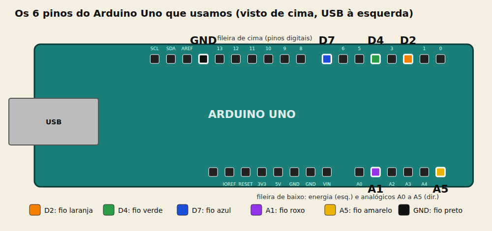

| Pino do Uno | Cor do fio | Vai para | Para que serve |
|---|---|---|---|
| **D2** | laranja | furo c10 (pino 1 do PIC) | dá energia ao PIC (5 V) |
| **D4** | verde | furo j12 (pino 6 do PIC) | clock da gravação |
| **D7** | azul | furo j11 (pino 7 do PIC) | dados da gravação |
| **A1** | roxo | furo d18 (resistor de 4,7 k) | liga e desliga os 13 V no MCLR |
| **A5** | amarelo | furo j24 (resistor de 220) | acende o LED amarelo enquanto grava |
| **GND** | preto | trilho − | terra comum |

**Como ler os furos:** cada furo tem uma **letra** (linha, a a j) e um **número** (coluna 7 a 30). Exemplo: **c10** é a linha `c` na coluna `10`. As letras `a b c d e` ficam na metade de baixo e `f g h i j` na de cima; furos com o mesmo número **e na mesma metade** estão ligados entre si por dentro da protoboard.

**Regra de ouro:** nada ligado na tomada nem no USB enquanto você monta. A fonte só vai no passo 9.

#### Passo 1: Fio de GND do Uno

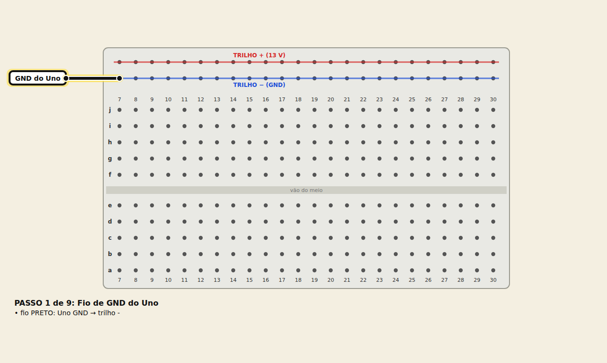

| O que | Onde |
|---|---|
| fio **preto** (GND do Uno) | do **Uno GND** ao trilho - |

> Todo o circuito precisa do mesmo GND do Uno.

#### Passo 2: O chip PIC12F629

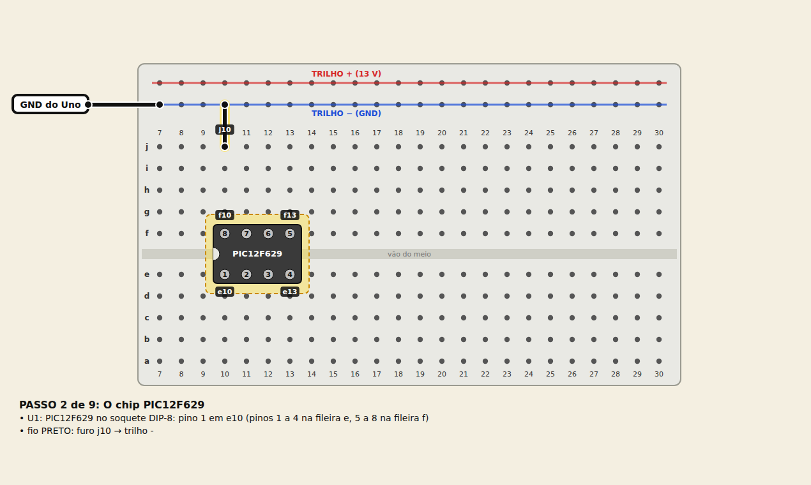

| O que | Onde |
|---|---|
| **PIC12F629 no soquete DIP-8** | pino 1 em **e10**; pinos 1 a 4 em e10 a e13, pinos 8 a 5 em f10 a f13 |
| fio **preto** (pino 8 do PIC ao GND) | do furo **j10** ao trilho **-** |

> O PIC fica a cavaleiro do vao do meio, com o pino 1 em e10 (o entalhe do chip aponta para a esquerda).

#### Passo 3: Energia do chip

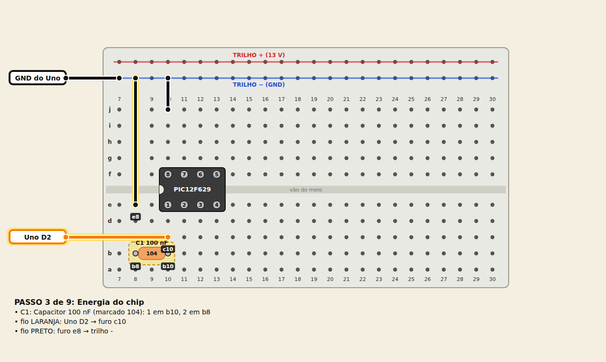

| O que | Onde |
|---|---|
| **Capacitor 100 nF (marcado 104)** | 1 em **b10**, 2 em **b8** |
| fio **laranja** (D2 do Uno: alimenta o PIC) | do **Uno D2** ao furo **c10** |
| fio **preto** (capacitor ao GND) | do furo **e8** ao trilho **-** |

> O capacitor fica junto do pino 1, perto do chip.

#### Passo 4: Dados e clock

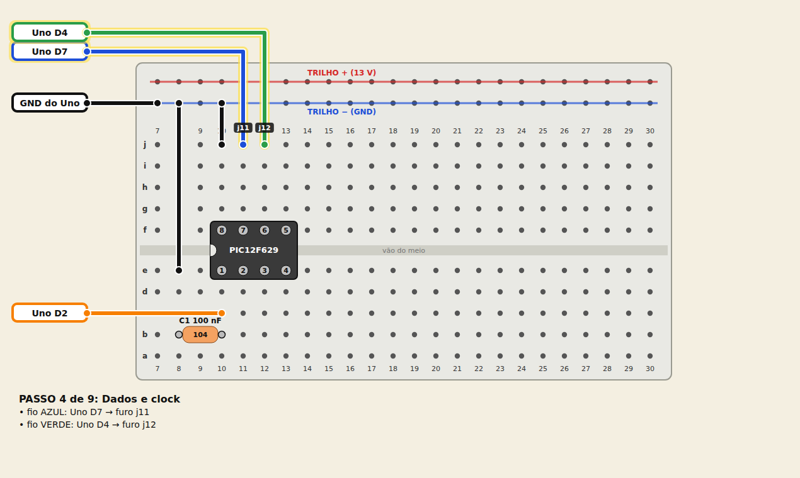

| O que | Onde |
|---|---|
| fio **azul** (D7 do Uno: dados) | do **Uno D7** ao furo **j11** |
| fio **verde** (D4 do Uno: clock) | do **Uno D4** ao furo **j12** |

#### Passo 5: Transistor e resistor de 10 k

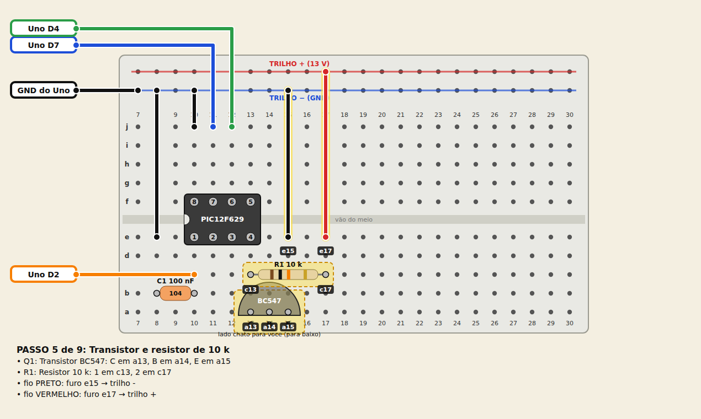

| O que | Onde |
|---|---|
| **Transistor BC547** | C em **a13**, B em **a14**, E em **a15** |
| **Resistor 10 k** (faixas marrom, preto, laranja, dourado) | 1 em **c13**, 2 em **c17** |
| fio **preto** (emissor do transistor ao GND) | do furo **e15** ao trilho **-** |
| fio **vermelho** (13 V para o resistor de 10 k e para o LED) | do furo **e17** ao trilho **+** |

> O transistor BC547 entra com o lado CHATO virado para voce (para a borda de baixo da figura): C, B, E da esquerda para a direita.

#### Passo 6: Comando do transistor

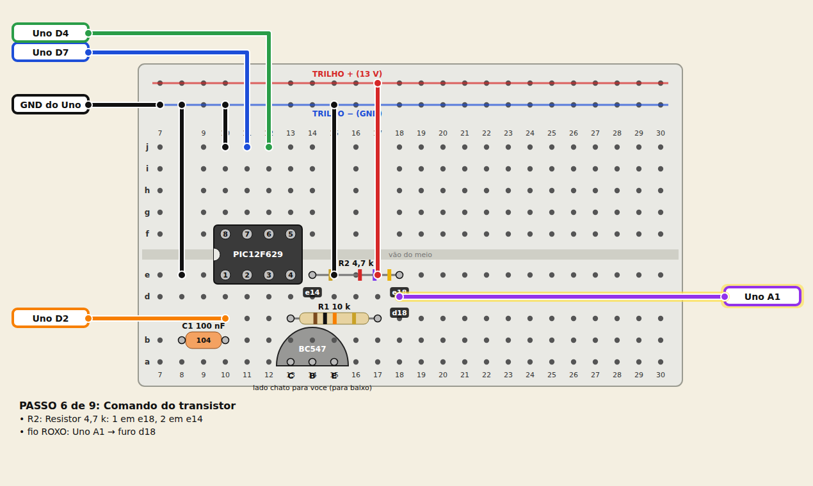

| O que | Onde |
|---|---|
| **Resistor 4,7 k** (faixas amarelo, violeta, vermelho, dourado) | 1 em **e18**, 2 em **e14** |
| fio **roxo** (A1 do Uno: comanda o transistor) | do **Uno A1** ao furo **d18** |

#### Passo 7: LED vermelho (tem 13 V)

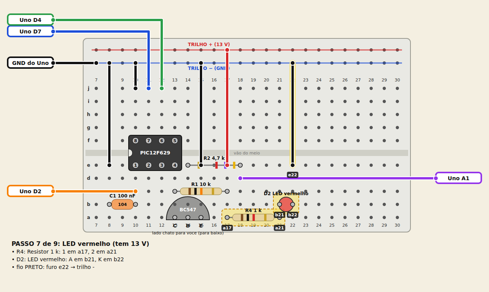

| O que | Onde |
|---|---|
| **Resistor 1 k** (faixas marrom, preto, vermelho, dourado) | 1 em **a17**, 2 em **a21** |
| **LED vermelho** | A em **b21**, K em **b22** |
| fio **preto** (LED vermelho ao GND) | do furo **e22** ao trilho **-** |

> A perna LONGA do LED e o +; ela vai no furo de numero menor.

#### Passo 8: LED amarelo (atividade)

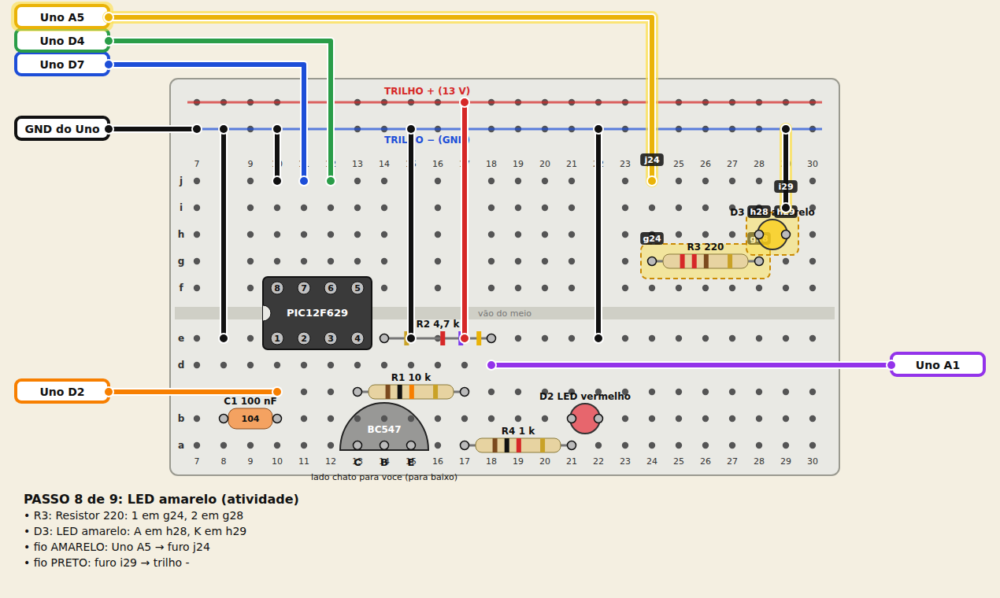

| O que | Onde |
|---|---|
| **Resistor 220** (faixas vermelho, vermelho, marrom, dourado) | 1 em **g24**, 2 em **g28** |
| **LED amarelo** | A em **h28**, K em **h29** |
| fio **amarelo** (A5 do Uno: luz de atividade) | do **Uno A5** ao furo **j24** |
| fio **preto** (LED amarelo ao GND) | do furo **i29** ao trilho **-** |

> A perna LONGA do LED e o +; ela vai no furo de numero menor.

#### Passo 9: Fonte de 13 V (por ultimo!)

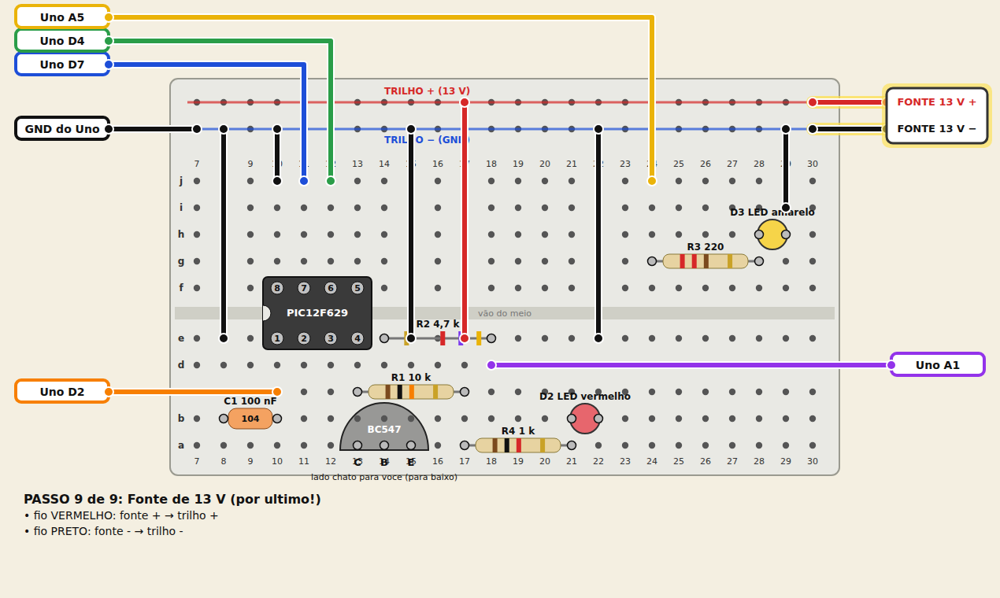

| O que | Onde |
|---|---|
| fio **vermelho** (positivo da fonte de 13 V) | do **fonte +** ao trilho + |
| fio **preto** (negativo da fonte de 13 V) | do **fonte -** ao trilho - |

> Fonte DESLIGADA e polaridade conferida com o multimetro.

#### Pronto: confira

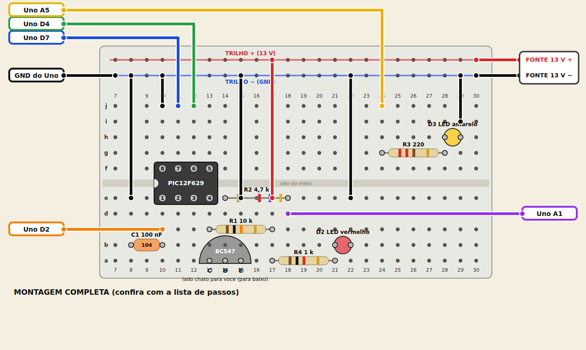

Com o multímetro em **continuidade (bip)** e **tudo desligado**:

| Meça entre | Deve dar |
|---|---|
| trilho `+` e trilho `−` | **sem** bip (senão há um curto) |
| trilho `−` e o pino 8 do PIC (furo f10) | bip |
| furo e13 (pino 4 do PIC) e furo a13 (transistor) | bip |
| furo c10 (D2) e furo e10 (pino 1 do PIC) | bip |

**Depois:** siga "Antes de ligar" (medir o MCLR com o chip fora) e "Gravar".

**Com o diodo (opcional, D1).** Tire o fio vermelho que vai do positivo da fonte ao trilho `+`. Ponha o diodo 1N5819 na fileira `c`: o lado **sem faixa** (anodo) em **c29** e o lado **com faixa** (catodo) em **c25**. Depois: um fio vermelho do **positivo da fonte** ao furo **c29**, e outro fio vermelho do furo **c25** ao trilho `+`. (O desenho acima não mostra isso.)
<!-- /protoboard -->

## C. Placa perfurada

Placa de furos a 2,54 mm de **22 colunas × 14 linhas** (uma de 5 × 7 cm serve), com um **cabo Dupont fêmea-fêmea de 6
vias** do barramento J3 ao Uno. Fios **isolados** (kynar/wire-wrap) no lado da solda; só o trilho de GND (linha N) pode
ser fio nu. Os furos têm nome: letra da linha (A a N) e número da coluna (1 a 22).

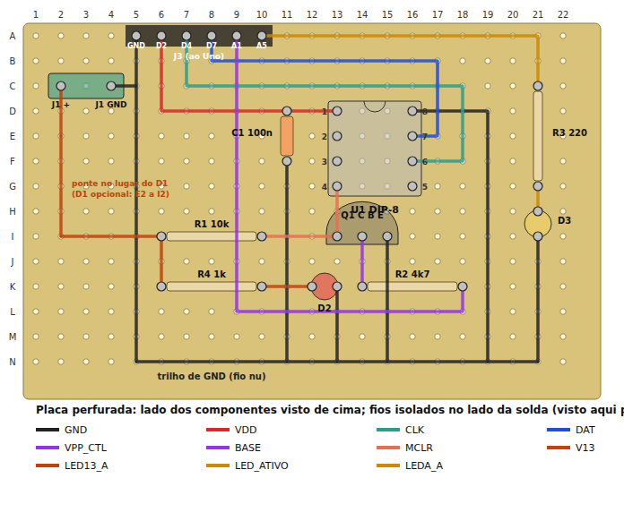

- Desenho gerado por `scripts/perfboard.py`, que **verifica** que cada fio liga exatamente os pontos certos e que não
  há curto. Tabelas completas de furos e fios: [`docs/perfboard.md`](docs/perfboard.md).
- A figura mostra o lado dos componentes visto de cima, com os fios do lado de baixo vistos por transparência.

Ordem de montagem:

1. Soldar o **soquete DIP-8** (colunas 13 e 16, linhas D a G; entalhe para cima = pino 1 em D13), os resistores, o
   capacitor, os LEDs, o transistor, o borne J1 e a barra J3 (A5 a A10, de cima: GND, D2, D4, D7, A1, A5),
   nos furos da tabela [`docs/perfboard.md`](docs/perfboard.md).
2. Passar os fios **na ordem da tabela de fios**, um a um, soldando as pontas e riscando na tabela. Os fios podem
   passar por cima de furos ocupados desde que sejam isolados; o trilho de GND (N5 a N21) é um fio nu soldado nos pontos
   marcados.
3. Conferir com o multímetro, tudo desligado: GND (J3 GND) com o pino 8 do soquete, o emissor do transistor e os dois
   catodos; 13 V **sem** continuidade com o GND.
4. Ligar o cabo Dupont: J3 GND, D2, D4, D7, A1, A5 aos mesmos pinos do Uno (nesta ordem na barra, da esquerda para a
   direita). Siga "Antes de ligar" e "Gravar".

**D1 não é montado (DNP):** no lugar dele há um fio de ponte de **E2 a I2** (coluna 2). Para usar o diodo, tire esse fio
e solde o D1 com o anodo em E2 e o catodo (faixa) em I2; o fio de C2 a E2 continua.

Os pontos de teste e o ICSP ficam de fora nesta versão (o MCLR se mede no pino 4 do soquete).

## Gravar

O Uno precisa do sketch `ProgramPIC` do ardpicprog, e o PC do programa `ardpicprog`. Instalação e comandos estão em
[`../uno/README.md`](../uno/README.md) (compilar com `tools/pic/uno/instalar_ardpicprog.sh`, subir o sketch com
`arduino-cli`). Resumo, com o shield montado e o PIC no soquete:

```
A="tools/pic/bin/ardpicprog -p /dev/ttyUSB0"      # ttyACM0 num Uno original
$A --list-devices                                  # teste da comunicação
$A -o backup-virgem.hex --skip-ones                # lê o chip antes (guarda o OSCCAL)
$A --erase --burn -i firmware/cic_rp2040/third_party/snescic-lock-resync.hex -o lido.hex --skip-ones
python3 -I tools/pic/comparar_hex.py firmware/cic_rp2040/third_party/snescic-lock-resync.hex lido.hex
```

## Problemas

- **LED vermelho apagado:** fonte desligada, ou R4/LED ao contrário. Se a fonte puder estar invertida e não há D1, **desligue já** e meça a polaridade.
- **Não detecta o chip:** confira o pino 1 do PIC, o GND comum entre fonte e Uno e se há ~13 V no pino 4 com A1 solto.
- **13 V não chegam ao MCLR:** transistor com a pinagem errada (veja "Pinagem do transistor") ou R1 solto.
- **Erro de verificação:** grave de novo; se repetir, queda da fonte sob carga ou mau contato (na protoboard).
- **Nada na serial:** feche o monitor serial; confira a porta e o grupo `dialout`.

## Arquivos

| Caminho | O que é |
|---|---|
| `hardware/` | projeto KiCad (`shield_uno.kicad_pro/_sch/_pcb`), símbolo e footprint do Uno (`uno_shield.*`) |
| `fab/` | gerbers, furos, `bom.csv` (sem o D1, que é DNP) e o zip da JLCPCB |
| `docs/` | esquemático em PDF, mapa das ligações, imagem da placa, passos da protoboard, desenho e tabelas da placa perfurada |
| `scripts/gerar_sch.py` | gera o esquemático e o símbolo do Uno |
| `scripts/gerar_pcb.py`, `scripts/rotear.py` | geram a PCB (footprints, nets, contorno) e roteiam com o Freerouting, depois zonas de GND |
| `scripts/check_netlist.py` | confere a PCB contra a tabela do ardpicprog (usa `pcbnew`) |
| `scripts/exportar_fab.sh` | gerbers, furos, BOM e zip |
| `scripts/perfboard.py`, `scripts/protoboard.py`, `scripts/protoboard_desenho.py` | desenho e verificação das montagens B e C (a protoboard sai em passos, com PNG feitos pelo Chrome sem janela) |
| `scripts/esquema_simples.py` | o mapa das ligações (`docs/esquema-simples.svg/.png`) e a lista fio a fio do README; confere cada fio contra `protoboard.ESPERADO` |

Para refazer: `python3 scripts/gerar_sch.py`, depois, com o Python do venv do KiCad MCP (tem `pcbnew`),
`gerar_pcb.py`, `rotear.py` (precisa de `java` e `~/.kicad-mcp/freerouting.jar`) e `check_netlist.py`;
`kicad-cli sch erc` e `kicad-cli pcb drc --schematic-parity` conferem os arquivos.

## Licença e créditos

O circuito é do **ardpicprog**, de Rhys Weatherley (circuitos e documentação **CC BY-SA 2.5**,
https://rweather.github.io/ardpicprog/). Este shield é derivado dele e fica sob **CC BY-SA 2.5**. O firmware do Uno
(`ProgramPIC.pde`) e o programa do PC são GPL v3 e não estão neste repositório (o instalador baixa do upstream).
